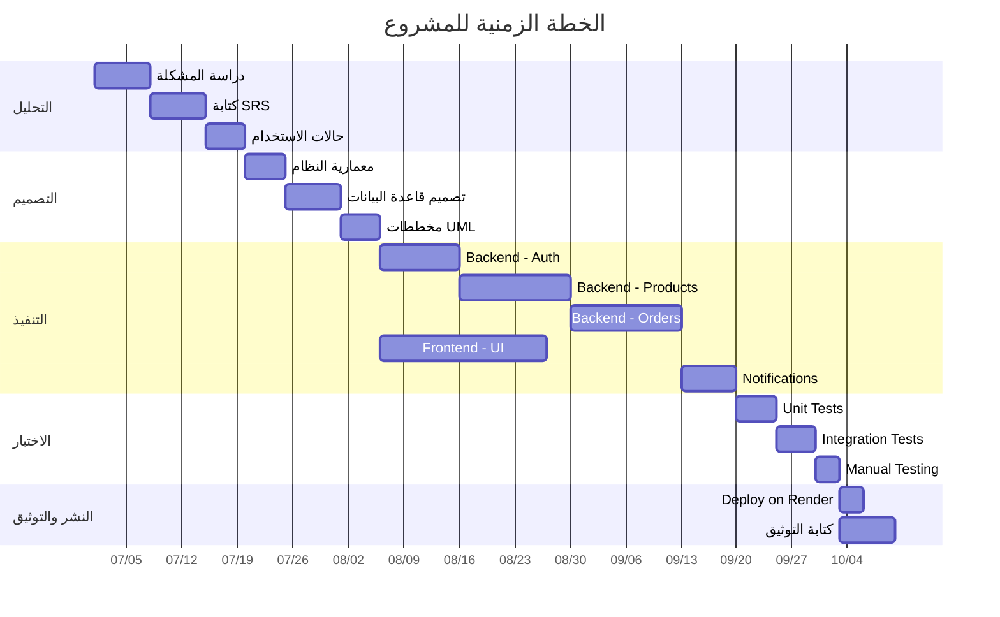

# الفصل الأول: المقدمة

---

## 1.1 خلفية المشروع

شهدت التجارة الإلكترونية في السنوات الأخيرة تحولاً جذرياً على مستوى العالم، وأصبح التسوق عبر الإنترنت جزءاً لا يتجزأ من حياة المستهلكين اليومية. وفقاً لتقارير منظمة التجارة العالمية، تجاوز حجم التجارة الإلكترونية العالمية **5.7 تريليون دولار** في عام 2024، مع نمو سنوي يتجاوز **14%** في الأسواق الناشئة.

في المنطقة العربية، تشهد التجارة الإلكترونية نمواً متسارعاً، حيث تُشير الدراسات إلى أن **60% من المستهلكين العرب** قاموا بعملية شراء واحدة على الأقل عبر الإنترنت خلال العام الماضي، مع تفضيل واضح للفئات التي تشمل الملابس والإلكترونيات والمنتجات المنزلية.

غير أنّ هذا النمو لا يخلو من تحديات كبيرة، خاصةً على صعيد **التجار الصغار ومتوسطي الحجم** الذين يواجهون صعوبات في مواكبة هذا التحول الرقمي، ومن أبرزها:

- **التكلفة المرتفعة** لبناء متجر إلكتروني مستقل، وما يتطلبه ذلك من استضافة ودفع إلكتروني وتطوير مستمر.
- **ضعف الخبرة التقنية** لدى كثير من التجار، مما يجعلهم يعتمدون على وسطاء أو منصات عالمية عالية العمولة.
- **تشتّت الزبائن** بين عشرات المتاجر المستقلة، مما يُضعف تجربة التسوق ويُصعّب المقارنة.
- **غياب المنصات العربية الموحّدة** التي تدعم اللغة العربية بالكامل مع تخطيط صحيح من اليمين إلى اليسار (RTL).
- **صعوبة إدارة المخزون والطلبات** يدوياً، مما يؤدي إلى أخطاء متكررة وفوضى تشغيلية.

من هنا تنبع فكرة هذا المشروع: بناء **منصة تجارة إلكترونية متعددة البائعين** (Multi-Vendor E-Commerce Platform) تجمع عدة تجار ملابس في منصة واحدة، بحيث يستفيد الجميع من بنية تقنية موحّدة، وتجربة تسوق سلسة للزبائن، وتكلفة تشغيل منخفضة نسبياً.

---

## 1.2 تعريف المشكلة

### 1.2.1 المشكلة الرئيسية

**عدم وجود منصة عربية موحّدة** تتيح للتجار الصغار ومتوسطي الحجم في قطاع الملابس عرض منتجاتهم وإدارة متاجرهم بسهولة وبتكلفة منخفضة، مع توفير تجربة تسوق متكاملة للزبائن.

### 1.2.2 المشاكل الفرعية

| # | المشكلة الفرعية | الأثر المترتب |
|---|------------------|----------------|
| 1 | التكلفة العالية لبناء متجر إلكتروني مستقل | يُثبّط دخول التجار الصغار للسوق الرقمي |
| 2 | تشتّت الزبون بين عشرات المتاجر | تجربة تسوق مرهقة وتقليل فرص الشراء |
| 3 | صعوبة إدارة المخزون والطلبات يدوياً | أخطاء تشغيلية وخسائر مالية |
| 4 | غياب نظام تقييمات موثوق | ضعف الثقة بين الزبون والتاجر |
| 5 | ضعف دعم اللغة العربية والتخطيط RTL | تجربة سيئة للمستخدم العربي |
| 6 | انعدام منصة إشراف مركزية | صعوبة ضبط جودة المتاجر والمنتجات |

### 1.2.3 صياغة المشكلة

> **"كيف يمكن بناء منصة إلكترونية متعددة البائعين تُمكّن التجار من إدارة متاجرهم بكفاءة، وتُوفّر للزبائن تجربة تسوق سلسة وآمنة، مع دعم كامل للغة العربية، وتكلفة تشغيل منخفضة، وبنية قابلة للتوسع؟"**

---

## 1.3 أهداف المشروع

### 1.3.1 الأهداف الرئيسية

1. **بناء منصة موحّدة** تجمع عدة تجار ملابس في مكان واحد، بتكلفة منخفضة.
2. **توفير لوحة تحكم كاملة** لكل تاجر لإدارة متجره ومنتجاته ومخزونه وطلباته.
3. **توفير لوحة إدارة مركزية** للمشرف للإشراف على المنصة والموافقة على المتاجر.
4. **تقديم تجربة تسوق متكاملة** للزبائن تشمل السلة والطلبات والكوبونات والتقييمات.
5. **دعم كامل للغة العربية** مع تخطيط RTL احترافي.

### 1.3.2 الأهداف الفرعية

- ✅ توفير **نظام تقييمات موثّق** بشرط الشراء لبناء الثقة.
- ✅ تمكين **تتبع الطلبات** من لحظة الطلب حتى التسليم.
- ✅ دعم **كوبونات الخصم** لتحفيز المبيعات.
- ✅ بناء نظام **إشعارات بريدية** آمن وموثوق.
- ✅ توفير **قائمة مفضلة** للزبائن لتحسين تجربة التسوق.
- ✅ ضمان **أمان كلمات المرور** عبر التشفير باستخدام bcrypt.
- ✅ تطبيق **الحماية من الثغرات** الشائعة (CSRF, XSS, SQL Injection).

### 1.3.3 الأهداف التقنية

| الهدف | المعيار |
|--------|---------|
| اتباع نمط **MVC** | فصل Presentation عن Business Logic |
| استخدام **Services Layer** | فصل منطق الأعمال عن Controllers |
| تطبيق **مبادئ SOLID** | كود قابل للصيانة والتوسع |
| كتابة **اختبارات آلية** | تغطية ≥ 70% |
| اتباع معايير **PSR-12** | توافق مع معايير PHP |
| أداء عالٍ | زمن استجابة < 2 ثانية |

---

## 1.4 نطاق المشروع

### 1.4.1 داخل النطاق (In-Scope)

النظام يشمل الوظائف التالية:

#### 🔐 وحدة المصادقة
- تسجيل حساب جديد (زبون)
- تسجيل الدخول (بريد + كلمة مرور)
- تسجيل الخروج
- تغيير كلمة المرور + إشعار بريدي
- استعادة كلمة المرور
- تأكيد البريد الإلكتروني

#### 👥 إدارة المستخدمين (Admin)
- عرض جميع المستخدمين
- تعديل/حذف مستخدم
- ترقية زبون إلى تاجر

#### 🏪 إدارة المتاجر
- تاجر يُنشئ متجره
- Admin يوافق على متجر جديد
- عرض صفحة المتجر
- إيقاف/حذف متجر

#### 📦 إدارة المنتجات
- إضافة/تعديل/حذف منتج (Merchant)
- تصفح المنتجات (زائر/زبون)
- بحث وفلترة (سعر، تصنيف، تقييم)
- صفحة تفاصيل المنتج

#### 🛒 السلة والطلبات
- إضافة للسلة، تعديل، حذف
- إتمام الطلب (Checkout)
- تتبع حالة الطلب
- Merchant يحدّث حالة الطلب

#### 🎟️ الكوبونات
- Merchant يُنشئ كوبون (نسبة/مبلغ)
- تطبيق كوبون في Checkout
- التحقق من الصلاحية

#### ⭐ التقييمات والمراجعات
- تقييم منتج (1-5 نجوم)
- تحقق من الشراء
- عرض التقييمات

#### ❤️ المفضلة
- إضافة/إزالة منتج
- عرض قائمة المفضلة

#### 🔔 الإشعارات
- إشعار بريدي عند تغيير كلمة المرور
- إشعار بريدي عند تأكيد الطلب
- إشعار داخلي للتاجر

#### 📊 الإحصائيات (Admin)
- عدد المستخدمين
- عدد المتاجر
- إجمالي المبيعات
- عدد الطلبات بحسب الحالة

### 1.4.2 خارج النطاق (Out-of-Scope)

الميزات التالية **لا تشملها النسخة الحالية**، وتُترك للعمل المستقبلي:

- 💳 **الدفع الإلكتروني** (Stripe/PayPal)
- 📱 **تطبيق موبايل** (iOS/Android)
- 💬 **دردشة مباشرة** بين التاجر والزبون
- 🔔 **Push Notifications**
- 🚚 **نظام شحن متكامل** مع شركات
- 📈 **تحليلات متقدمة** (Business Intelligence)
- 🌍 **دعم لغات إضافية** (غير العربية والإنجليزية)
- 📊 **لوحة تحليلات متقدمة** للتاجر

---

## 1.5 أهمية المشروع

### 1.5.1 على المستوى الأكاديمي

- تطبيق عملي لمعايير **هندسة البرمجيات** (SRS, ERD, UML)
- استخدام **تقنيات حديثة** (Laravel 12, Tailwind v4)
- توثيق كامل وفق **IEEE 830 / ISO 29148**
- تجسيد **دورة حياة تطوير البرمجيات** (SDLC) كاملة

### 1.5.2 على المستوى العملي

- حل **حقيقي** لمشكلة السوق العربي
- منصة **قابلة للنشر الفعلي** والتشغيل
- **بنية قابلة للتوسع** لاستيعاب متاجر ومستخدمين أكثر
- **تكلفة تشغيل منخفضة** (متاحة على Render Free Tier)

### 1.5.3 على المستوى الشخصي (فريق العمل)

- إتقان **دورة حياة تطوير البرمجيات** (SDLC)
- بناء **مشروع Portfolio احترافي** لكل عضو
- التعاون الجماعي وإدارة المشاريع
- مواجهة تحديات تقنية حقيقية وحلّها

### 1.5.4 على المستوى المجتمعي

- **تمكين التجار الصغار** من التحول الرقمي
- **توفير فرص عمل** غير مباشرة (توصيل، تغليف)
- **تعزيز التجارة الإلكترونية المحلية**
- **دعم الاقتصاد الرقمي** في فلسطين والعالم العربي

---

## 1.6 منهجية العمل

اتبع المشروع منهجية **دورة حياة تطوير البرمجيات** (Software Development Life Cycle - SDLC) بنموذج **Agile** مُصغّر (Scrum مصغّر)، مع تكرارات أسبوعية ومراجعات دورية.

### 1.6.1 نموذج العمل (SDLC)

### 1.6.2 مراحل العمل

| المرحلة | المدة | المخرجات |
|---------|-------|----------|
| **التحليل** | أسبوعان | SRS + Use Cases |
| **التصميم** | أسبوعان | ERD + Class + Sequence Diagrams |
| **التنفيذ** | 6 أسابيع | كود + اختبارات |
| **الاختبار** | أسبوع | Test Report |
| **التوثيق** | أسبوع | هذا المستند |
| **النشر** | 3 أيام | Deploy على Render |

**المدة الإجمالية:** ~12 أسبوعاً (3 أشهر)

### 1.6.3 توزيع الأدوار

| الطالب | المهام الرئيسية |
|--------|------------------|
| **أحمد ماهر** | Backend (Laravel) + Deployment |
| **محمد رأفت شاهين** | Backend (Auth + Notifications) |
| **مرام أيمن المطري** | Frontend (Blade + Tailwind) |
| **نور مصطفى عناية** | Database Design + Testing |

### 1.6.4 المخطط الزمني (Gantt Chart)

### 1.6.5 أدوات التطوير

| الفئة | الأدوات |
|-------|---------|
| **إدارة الكود** | Git + GitHub |
| **إدارة المهام** | Trello / GitHub Projects |
| **التواصل** | WhatsApp / Discord |
| **التطوير** | VS Code + XAMPP (محلي) |
| **النشر** | Render + Docker |

---

## 1.7 تنظيم الوثيقة

يتكوّن هذا التوثيق من ستة فصول رئيسية:

1. **الفصل الأول — المقدمة:** يعرض خلفية المشروع، المشكلة، الأهداف، النطاق، والمنهجية.
2. **الفصل الثاني — التحليل:** يضم مواصفات المتطلبات (SRS)، حالات الاستخدام، ودراسة الجدوى.
3. **الفصل الثالث — التصميم:** يعرض معمارية النظام، مخطط ERD، مخططات UML، وتصميم الواجهات.
4. **الفصل الرابع — التنفيذ:** يوضح التقنيات، هيكل المشروع، والتنفيذات الرئيسية.
5. **الفصل الخامس — الاختبار:** يقدّم استراتيجية الاختبار، الحالات، والنتائج.
6. **الفصل السادس — الخاتمة:** يلخص الإنجازات، التحديات، والعمل المستقبلي.

---

**نهاية الفصل الأول**