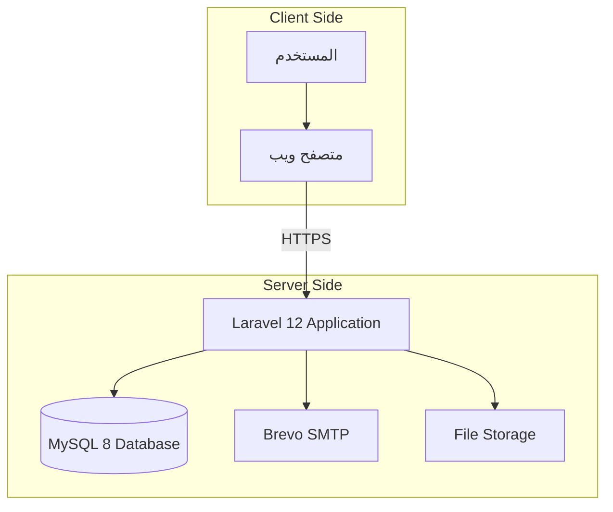

# الفصل الثاني: التحليل
## مواصفات متطلبات النظام (SRS)

**وفقاً للمعيار:** IEEE 830 / ISO/IEC/IEEE 29148
**إصدار الوثيقة:** 1.0
**تاريخ الإصدار:** أكتوبر 2026
**الحالة:** مُعتمَد

---

## 2.1 المقدمة

### 2.1.1 الغرض

هذا المستند يُحدد المتطلبات الكاملة لنظام **متجر الملابس الإلكتروني**، ويُعدّ المرجع الرسمي والاتفاق الملزم بين فريق التطوير وأصحاب المصلحة. يُستخدم المستند كأساس لـ:

- **التصميم المعماري** للنظام
- **تخطيط الاختبارات** ومعايير القبول
- **تقييم الاكتمال** عند التسليم
- **إدارة التغييرات** المستقبلية

### 2.1.2 النطاق

النظام **منصة تجارة إلكترونية متعددة البائعين** (Multi-Vendor E-Commerce Platform) متخصصة في بيع الملابس، تعمل على الويب، وتدعم أربعة أدوار رئيسية. يُشار إلى النظام في هذا المستند بـ **"النظام"** أو **"المنصة"**.

**سياق النظام:**

- المستخدم النهائي: متصفح ويب حديث
- الخادم: Laravel 12 + MySQL 8
- النشر: منصة Render السحابية (Docker)

### 2.1.3 التعريفات والمختصرات

| المصطلح | التعريف |
|---------|---------|
| **Admin** | مشرف المنصة، المسؤول الأعلى |
| **Merchant** | تاجر يمتلك متجراً في المنصة |
| **Customer** | زبون مسجل يشتري |
| **Visitor** | زائر غير مسجل |
| **Multi-Vendor** | منصة تجمع عدة بائعين |
| **COD** | Cash on Delivery (الدفع عند الاستلام) |
| **RTL** | Right-to-Left (التخطيط من اليمين لليسار) |
| **CRUD** | Create, Read, Update, Delete |
| **SRS** | Software Requirements Specification |
| **FR** | Functional Requirement |
| **NFR** | Non-Functional Requirement |
| **UC** | Use Case |

### 2.1.4 المراجع

- IEEE Std 830-1998 — Recommended Practice for SRS
- ISO/IEC/IEEE 29148:2018 — Requirements Engineering
- Laravel 12 Official Documentation
- OWASP Top 10 (2021) — Security Risks
- WCAG 2.1 — Web Accessibility Guidelines

---

## 2.2 الوصف العام

### 2.2.1 منظور المنتج

النظام تطبيق ويب متكامل (Web Application) يعمل بنمط **Client-Server**:

**النظام مستقل تماماً** ولا يعتمد على أنظمة خارجية سوى:

- **Brevo SMTP** لإرسال البريد الإلكتروني
- **Render** للاستضافة

### 2.2.2 وظائف المنتج (Summary)

| المجموعة الوظيفية | الوصف المختصر |
|-------------------|----------------|
| **المصادقة** | تسجيل، دخول، خروج، تغيير كلمة المرور |
| **إدارة المستخدمين** | عرض، تعديل، حذف، ترقية |
| **إدارة المتاجر** | إنشاء، موافقة، إيقاف |
| **إدارة المنتجات** | CRUD + بحث وفلترة |
| **السلة والطلبات** | إضافة، تعديل، Checkout، تتبع |
| **الكوبونات** | إنشاء، تطبيق، تحقق |
| **التقييمات** | كتابة، عرض، تحقق من الشراء |
| **المفضلة** | إضافة، إزالة، عرض |
| **الإشعارات** | بريدية + داخلية |
| **الإحصائيات** | لوحة إدارة مركزية |

### 2.2.3 فئات المستخدمين

#### 🛡️ المشرف (Admin)

| البند | الوصف |
|-------|-------|
| **الوصف** | مدير المنصة، المسؤول الأعلى |
| **الخبرة التقنية** | متوسطة إلى عالية |
| **تكرار الاستخدام** | يومي |
| **المهام** | إدارة المستخدمين، الموافقة على المتاجر، مراقبة الإحصائيات |
| **الصلاحيات** | وصول كامل لكل شيء |

#### 🏪 التاجر (Merchant)

| البند | الوصف |
|-------|-------|
| **الوصف** | بائع يمتلك متجراً في المنصة |
| **الخبرة التقنية** | منخفضة إلى متوسطة |
| **تكرار الاستخدام** | يومي |
| **المهام** | إدارة المنتجات، الطلبات، المخزون، الكوبونات |
| **الصلاحيات** | وصول كامل لمنتجاته وطلباته فقط |

#### 👤 الزبون (Customer)

| البند | الوصف |
|-------|-------|
| **الوصف** | مشترٍ مسجل |
| **الخبرة التقنية** | منخفضة |
| **تكرار الاستخدام** | أسبوعي |
| **المهام** | تصفح، شراء، تقييم، مفضلة |
| **الصلاحيات** | وصول لبياناته وطلباته فقط |

#### 👀 الزائر (Visitor)

| البند | الوصف |
|-------|-------|
| **الوصف** | مستخدم غير مسجل |
| **الخبرة التقنية** | متغيرة |
| **تكرار الاستخدام** | متغير |
| **المهام** | تصفح فقط |
| **الصلاحيات** | عرض فقط |

### 2.2.4 بيئة التشغيل

| العنصر | المواصفة |
|--------|----------|
| **نظام الخادم** | Linux (Ubuntu 22.04) / Render |
| **لغة البرمجة** | PHP 8.2+ |
| **إطار العمل** | Laravel 12 |
| **قاعدة البيانات** | MySQL 8.0+ |
| **خادم الويب** | Apache 2.4 / Nginx |
| **المتصفحات المدعومة** | Chrome, Firefox, Safari, Edge (آخر إصدارين) |
| **دقة الشاشة** | من 320px (موبايل) إلى 4K |
| **اللغة** | العربية (RTL) + الإنجليزية (LTR) |

### 2.2.5 القيود (Constraints)

| # | القيد | السبب |
|---|-------|-------|
| **C-01** | يعمل على Render Free Tier | ميزانية محدودة |
| **C-02** | حجم RAM ≤ 512MB | خطة Free |
| **C-03** | لا Queue Workers | غير مستقر على Free |
| **C-04** | MySQL فقط | دعم أفضل على الاستضافات المجانية |
| **C-05** | لا Redis / Memcached | تجنب تكاليف إضافية |
| **C-06** | لا Payment Gateway | المرحلة التالية |
| **C-07** | Backend Monolithic | بساطة النشر |

### 2.2.6 الافتراضات والتبعيات

**الافتراضات:**

- كل تاجر يدير منتجاته فقط ولا يمكنه الوصول لمنتجات تجار آخرين
- كل زبون يتسوق لحسابه فقط
- الدفع COD فقط في النسخة الحالية
- المستخدمون يمتلكون بريداً إلكترونياً صالحاً
- المتصفحات الحديثة تدعم JavaScript وCSS Grid

**التبعيات:**

| التبعية | الأثر في حال الفشل |
|---------|--------------------|
| **Brevo SMTP** | الإشعارات البريدية لا تُرسَل (لكن تغيير كلمة المرور ينجح) |
| **Render Hosting** | المنصة غير متاحة |
| **MySQL Server** | النظام متوقف تماماً |
| **شهادة HTTPS** | المتصفح يُظهر تحذيراً أمنياً |

---

## 2.3 المتطلبات الوظيفية (Functional Requirements)

### 2.3.1 وحدة المصادقة (Authentication)

| ID | المتطلب | الأولوية | المعيار |
|----|---------|----------|---------|
| **FR-1.1** | تسجيل حساب زبون جديد (اسم، بريد، كلمة مرور) | عالية | البريد فريد، كلمة المرور ≥ 8 أحرف |
| **FR-1.2** | تسجيل الدخول بالبريد وكلمة المرور | عالية | تحقق صحيح، Rate Limit 5/دقيقة |
| **FR-1.3** | تسجيل الخروج | عالية | إلغاء الجلسة + Token |
| **FR-1.4** | تغيير كلمة المرور + إشعار بريدي | عالية | يجب كلمة المرور الحالية |
| **FR-1.5** | استعادة كلمة المرور عبر البريد | متوسطة | رابط صالح 60 دقيقة |
| **FR-1.6** | تأكيد البريد الإلكتروني | متوسطة | رابط تحقق فريد |
| **FR-1.7** | "تذكّرني" (Remember Me) | منخفضة | Token صالح 30 يوماً |

### 2.3.2 وحدة إدارة المستخدمين

| ID | المتطلب | الأولوية |
|----|---------|----------|
| **FR-2.1** | Admin يعرض كل المستخدمين (Pagination) | عالية |
| **FR-2.2** | Admin يعدّل بيانات مستخدم | عالية |
| **FR-2.3** | Admin يحذف مستخدم (Soft Delete) | عالية |
| **FR-2.4** | Admin يرقّي زبوناً إلى تاجر | متوسطة |
| **FR-2.5** | المستخدم يعدّل ملفه الشخصي | عالية |
| **FR-2.6** | المستخدم يحمّل صورة شخصية | منخفضة |

### 2.3.3 وحدة إدارة المتاجر

| ID | المتطلب | الأولوية |
|----|---------|----------|
| **FR-3.1** | تاجر يُنشئ متجره (اسم، وصف، شعار) | عالية |
| **FR-3.2** | Admin يوافق على متجر جديد | عالية |
| **FR-3.3** | Admin يوقف/يحذف متجر | متوسطة |
| **FR-3.4** | الزبون يعرض صفحة المتجر | عالية |
| **FR-3.5** | المتجر يظهر فقط بعد الموافقة | عالية |

### 2.3.4 وحدة إدارة المنتجات

| ID | المتطلب | الأولوية | المعيار |
|----|---------|----------|---------|
| **FR-4.1** | تاجر يضيف منتج (اسم، سعر، صورة، كمية) | عالية | صورة ≤ 2MB، امتداد مسموح |
| **FR-4.2** | تاجر يعدّل منتجه | عالية | التاجر يملك المنتج فقط |
| **FR-4.3** | تاجر يحذف منتجه (Soft Delete) | عالية | — |
| **FR-4.4** | الزائر يتصفح المنتجات | عالية | 12/صفحة |
| **FR-4.5** | البحث بالاسم والوصف | عالية | < 500ms |
| **FR-4.6** | الفلترة (تصنيف، سعر، تقييم) | متوسطة | تركيبة فلاتر مسموحة |
| **FR-4.7** | صفحة تفاصيل المنتج | عالية | صور متعددة |
| **FR-4.8** | Admin يضيف/يحذف تصنيفات | متوسطة | — |

### 2.3.5 وحدة السلة (Cart)

| ID | المتطلب | الأولوية |
|----|---------|----------|
| **FR-5.1** | إضافة منتج للسلة | عالية |
| **FR-5.2** | تعديل الكمية | عالية |
| **FR-5.3** | حذف منتج من السلة | عالية |
| **FR-5.4** | عرض إجمالي السلة | عالية |
| **FR-5.5** | السلة مستمرة بين الجلسات | متوسطة |
| **FR-5.6** | التحقق من المخزون عند الإضافة | عالية |

### 2.3.6 وحدة الطلبات

| ID | المتطلب | الأولوية |
|----|---------|----------|
| **FR-6.1** | إتمام الطلب (Checkout) | عالية |
| **FR-6.2** | إدخال عنوان ورقم هاتف | عالية |
| **FR-6.3** | اختيار طريقة الدفع (COD) | عالية |
| **FR-6.4** | عرض الطلبات السابقة | عالية |
| **FR-6.5** | تتبع حالة الطلب | متوسطة |
| **FR-6.6** | تاجر يحدّث حالة الطلب | عالية |
| **FR-6.7** | رقم طلب فريد (Order Number) | عالية |
| **FR-6.8** | إشعار بريدي عند تأكيد الطلب | متوسطة |

### 2.3.7 وحدة الكوبونات

| ID | المتطلب | الأولوية |
|----|---------|----------|
| **FR-7.1** | تاجر يُنشئ كوبون | متوسطة |
| **FR-7.2** | كوبون بنسبة % أو مبلغ ثابت | متوسطة |
| **FR-7.3** | تاريخ انتهاء وصلاحية | متوسطة |
| **FR-7.4** | تطبيق كوبون في Checkout | عالية |
| **FR-7.5** | التحقق من صلاحية الكوبون | عالية |
| **FR-7.6** | تتبع عدد الاستخدامات | متوسطة |

### 2.3.8 وحدة التقييمات

| ID | المتطلب | الأولوية |
|----|---------|----------|
| **FR-8.1** | زبون يقيّم منتجاً (1-5 نجوم) | متوسطة |
| **FR-8.2** | كتابة تعليق نصي | متوسطة |
| **FR-8.3** | تحقق من الشراء (Verified Purchase) | متوسطة |
| **FR-8.4** | عرض التقييمات على صفحة المنتج | عالية |
| **FR-8.5** | تقييم واحد فقط لكل مستخدم لكل منتج | متوسطة |

### 2.3.9 وحدة المفضلة

| ID | المتطلب | الأولوية |
|----|---------|----------|
| **FR-9.1** | إضافة منتج للمفضلة | منخفضة |
| **FR-9.2** | إزالة من المفضلة | منخفضة |
| **FR-9.3** | عرض قائمة المفضلة | منخفضة |

### 2.3.10 وحدة الإشعارات

| ID | المتطلب | الأولوية |
|----|---------|----------|
| **FR-10.1** | إشعار بريدي عند تغيير كلمة المرور | عالية |
| **FR-10.2** | إشعار بريدي عند تأكيد الطلب | متوسطة |
| **FR-10.3** | إشعار داخلي للتاجر (طلب جديد) | متوسطة |
| **FR-10.4** | إشعار داخلي للزبون (تغيير حالة الطلب) | منخفضة |

### 2.3.11 وحدة الإحصائيات (Admin)

| ID | المتطلب | الأولوية |
|----|---------|----------|
| **FR-11.1** | عدد المستخدمين الكلي والنشطين | متوسطة |
| **FR-11.2** | عدد المتاجر النشطة والمعلقة | متوسطة |
| **FR-11.3** | إجمالي المبيعات | متوسطة |
| **FR-11.4** | عدد الطلبات بحسب الحالة | متوسطة |
| **FR-11.5** | أفضل 10 منتجات مبيعاً | منخفضة |

---

## 2.4 المتطلبات غير الوظيفية (Non-Functional Requirements)

### 2.4.1 الأداء (Performance)

| ID | المتطلب | القياس |
|----|---------|--------|
| **NFR-1.1** | زمن استجابة الصفحة | < 2 ثانية |
| **NFR-1.2** | زمن استجابة API | < 500ms |
| **NFR-1.3** | دعم مستخدمين متزامنين | ≥ 100 |
| **NFR-1.4** | زمن تحميل الصور | < 1 ثانية |
| **NFR-1.5** | زمن استعلام قاعدة البيانات | < 100ms |

### 2.4.2 الأمان (Security)

| ID | المتطلب | المعيار |
|----|---------|---------|
| **NFR-2.1** | تشفير كلمات المرور | bcrypt (cost=12) |
| **NFR-2.2** | HTTPS إجباري | TLS 1.2+ |
| **NFR-2.3** | حماية CSRF | Laravel CSRF Token |
| **NFR-2.4** | حماية XSS | Blade escaping |
| **NFR-2.5** | حماية SQL Injection | Eloquent ORM (prepared statements) |
| **NFR-2.6** | Rate Limiting | 60 req/min |
| **NFR-2.7** | Session Timeout | 120 دقيقة |
| **NFR-2.8** | Authorization | Role-based + Policies |
| **NFR-2.9** | Secure Headers | X-Frame-Options, CSP |

### 2.4.3 الموثوقية (Reliability)

| ID | المتطلب | القياس |
|----|---------|--------|
| **NFR-3.1** | التوافر | ≥ 99% |
| **NFR-3.2** | نسخ احتياطي يومي | 7 أيام retention |
| **NFR-3.3** | استعادة البيانات | RTO ≤ 4 ساعات |
| **NFR-3.4** | معالجة الأخطاء | try/catch + Log |
| **NFR-3.5** | Transactions | عمليات الطلب transactional |

### 2.4.4 قابلية الاستخدام (Usability)

| ID | المتطلب | القياس |
|----|---------|--------|
| **NFR-4.1** | التوافق مع الأجهزة | Mobile-first (320px+) |
| **NFR-4.2** | دعم RTL كامل | عربي 100% |
| **NFR-4.3** | إمكانية الوصول | WCAG 2.1 AA |
| **NFR-4.4** | رسائل خطأ واضحة | عربي مفهوم |
| **NFR-4.5** | وقت التعلم | < 15 دقيقة لاستخدام أساسي |

### 2.4.5 قابلية الصيانة (Maintainability)

| ID | المتطلب | القياس |
|----|---------|--------|
| **NFR-5.1** | تغطية الاختبارات | ≥ 70% |
| **NFR-5.2** | اتباع PSR-12 | إجباري |
| **NFR-5.3** | DocBlocks | على كل Public Method |
| **NFR-5.4** | فصل الاهتمامات | MVC + Services |
| **NFR-5.5** | SOLID Principles | Single Responsibility |

### 2.4.6 قابلية التوسع (Scalability)

| ID | المتطلب | القياس |
|----|---------|--------|
| **NFR-6.1** | إضافة متاجر | دون تعديل كود |
| **NFR-6.2** | دعم الدفع الإلكتروني | قابلية إضافة Gateway |
| **NFR-6.3** | دعم لغة ثالثة | بنية i18n جاهزة |
| **NFR-6.4** | Horizontal Scaling | Stateless Architecture |

### 2.4.7 التوافقية (Compatibility)

| ID | المتطلب | القياس |
|----|---------|--------|
| **NFR-7.1** | المتصفحات | آخر إصدارين لكل متصفح |
| **NFR-7.2** | الأجهزة | Mobile, Tablet, Desktop |
| **NFR-7.3** | PHP Version | 8.2, 8.3 |
| **NFR-7.4** | MySQL Version | 8.0+ |

---

## 2.5 مصفوفة التتبع (Traceability Matrix)

| المتطلب | Use Case | Sequence | Test Case |
|----------|----------|----------|-----------|
| FR-1.2 | UC-02 تسجيل الدخول | SEQ-01 | TC-01 |
| FR-1.4 | UC-03 تغيير كلمة المرور | SEQ-02 | TC-02 |
| FR-4.1 | UC-04 إضافة منتج | SEQ-03 | TC-03 |
| FR-6.1 | UC-07 Checkout | SEQ-04 | TC-04 |
| FR-6.1 | UC-07 (Stock نقص) | SEQ-04 | TC-05 |
| FR-7.4 | UC-08 كوبون | SEQ-06 | TC-06 |
| FR-8.3 | UC-09 التقييم | — | TC-07 |
| FR-3.2 | UC-10 الموافقة | SEQ-05 | TC-08 |

---

## 2.6 معايير القبول العامة

قبل اعتبار النظام مكتملاً، يجب أن يتحقق ما يلي:

- [ ] ✅ كل المتطلبات **العالية الأولوية** (High) منفذة 100%
- [ ] ✅ كل المتطلبات **المتوسطة** (Medium) منفذة ≥ 90%
- [ ] ✅ 0 ثغرات أمنية حرجة (من OWASP Top 10)
- [ ] ✅ تغطية اختبارات ≥ 70%
- [ ] ✅ جميع اختبارات **حالات الاستخدام** تمر
- [ ] ✅ زمن الاستجابة < 2 ثانية في المتوسط
- [ ] ✅ النظام منشور ويعمل على Render

---

## 2.7 الموافقات

| الدور | الاسم | التوقيع | التاريخ |
|-------|-------|---------|---------|
| **فريق التطوير** | أحمد ماهر | — | — |
| **فريق التطوير** | محمد رأفت شاهين | — | — |
| **فريق التطوير** | مرام أيمن المطري | — | — |
| **فريق التطوير** | نور مصطفى عناية | — | — |
| **المشرف الأكاديمي** | د. خالد إسماعيل | — | — |

---

**نهاية الفصل الثاني — الجزء الأول (SRS)**