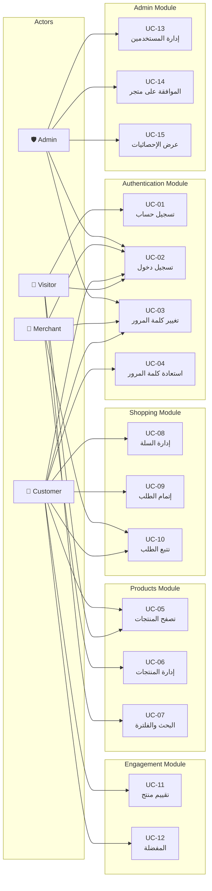

# الفصل الثاني: التحليل
## 2.8 حالات الاستخدام (Use Cases)

---

## 2.8.1 نظرة عامة

يصف هذا القسم التفاعلات الأساسية بين **المستخدمين (Actors)** و**النظام**، مُوثَّقة في شكل **حالات استخدام** (Use Cases) وفق منهجية UML. تُعتبر هذه الحالات المرجع الرئيسي لاختبار النظام والتحقق من اكتمال الوظائف.

---

## 2.8.2 مخطط حالات الاستخدام العام (Use Case Diagram)

---

## 2.8.3 جدول ملخص حالات الاستخدام

| ID | الحالة | Actor الرئيسي | Actors المشاركون | الأولوية | يرتبط بـ |
|----|--------|---------------|-------------------|----------|-----------|
| **UC-01** | تسجيل حساب | Visitor | — | عالية | FR-1.1 |
| **UC-02** | تسجيل الدخول | All | — | عالية | FR-1.2 |
| **UC-03** | تغيير كلمة المرور | All logged | — | عالية | FR-1.4 |
| **UC-04** | استعادة كلمة المرور | Customer/Merchant | — | متوسطة | FR-1.5 |
| **UC-05** | تصفح المنتجات | All | — | عالية | FR-4.4 |
| **UC-06** | إدارة المنتجات | Merchant | — | عالية | FR-4.1-4.3 |
| **UC-07** | البحث والفلترة | All | — | متوسطة | FR-4.5-4.6 |
| **UC-08** | إدارة السلة | Customer | — | عالية | FR-5.1-5.6 |
| **UC-09** | إتمام الطلب | Customer | — | عالية | FR-6.1-6.8 |
| **UC-10** | تتبع الطلب | Customer, Merchant | — | متوسطة | FR-6.5-6.6 |
| **UC-11** | تقييم منتج | Customer | — | متوسطة | FR-8.1-8.5 |
| **UC-12** | إدارة المفضلة | Customer | — | منخفضة | FR-9.1-9.3 |
| **UC-13** | إدارة المستخدمين | Admin | — | عالية | FR-2.1-2.5 |
| **UC-14** | الموافقة على متجر | Admin | — | عالية | FR-3.2 |
| **UC-15** | عرض الإحصائيات | Admin | — | متوسطة | FR-11.1-11.5 |

---

## 2.8.4 الوصف التفصيلي للحالات

### 🎯 UC-01: تسجيل حساب جديد

| الحقل | القيمة |
|-------|--------|
| **Actor الرئيسي** | Visitor |
| **الأولوية** | عالية |
| **يرتبط بـ** | FR-1.1 |
| **Preconditions** | لا يوجد |
| **Postconditions** | حساب جديد + جلسة مسجلة + بريد ترحيب |

#### السيناريو الرئيسي
1. الزائر يفتح صفحة **`/register`**.
2. يُدخل: الاسم الكامل، البريد الإلكتروني، كلمة المرور، تأكيد كلمة المرور.
3. يضغط زر **"إنشاء حساب"**.
4. النظام يتحقق من صحة البيانات (Format + Uniqueness).
5. النظام يتحقق من عدم تكرار البريد في قاعدة البيانات.
6. النظام يُشفّر كلمة المرور باستخدام **bcrypt**.
7. النظام يُنشئ الحساب بدور **Customer**.
8. النظام يرسل **بريد ترحيب** (Best-effort، لا يُعطّل التسجيل).
9. النظام ينشئ جلسة مسجلة.
10. النظام يُوجّه الزائر إلى **الصفحة الرئيسية**.

#### الاستثناءات
- **4a.** بيانات ناقصة → عرض رسالة "يرجى ملء جميع الحقول".
- **4b.** كلمة المرور < 8 أحرف → "8 أحرف على الأقل".
- **4c.** كلمتا المرور مختلفتان → "كلمتا المرور غير متطابقتين".
- **4d.** البريد غير صالح → "البريد الإلكتروني غير صحيح".
- **5a.** البريد مستخدم مسبقاً → "هذا البريد مسجل مسبقاً".
- **8a.** فشل إرسال البريد → Log فقط، التسجيل ينجح.

---

### 🎯 UC-02: تسجيل الدخول

| الحقل | القيمة |
|-------|--------|
| **Actor الرئيسي** | All (Admin/Merchant/Customer) |
| **الأولوية** | عالية |
| **يرتبط بـ** | FR-1.2 |
| **Preconditions** | حساب موجود + مؤكد |
| **Postconditions** | جلسة مسجلة + توجيه حسب الدور |

#### السيناريو الرئيسي
1. المستخدم يفتح **`/login`**.
2. يُدخل البريد وكلمة المرور.
3. (اختياري) يفعّل "تذكّرني".
4. يضغط **"دخول"**.
5. النظام يتحقق من صحة المدخلات.
6. النظام يبحث عن المستخدم بالبريد.
7. النظام يتحقق من كلمة المرور باستخدام **`Hash::check()`**.
8. النظام ينشئ جلسة (Session).
9. النظام يُوجّه حسب الدور:
   - **Admin** → `/admin/dashboard`
   - **Merchant** → `/merchant/dashboard`
   - **Customer** → `/`

#### الاستثناءات
- **5a.** مدخلات ناقصة → رسالة تحقق.
- **6a.** البريد غير موجود → "بيانات الدخول غير صحيحة" (رسالة عامة للأمان).
- **7a.** كلمة المرور خاطئة → "بيانات الدخول غير صحيحة".
- **7b.** تجاوز عدد المحاولات (>5/دقيقة) → "حاول لاحقاً".
- **8a.** البريد غير مؤكد → "يرجى تأكيد بريدك أولاً".

---

### 🎯 UC-03: تغيير كلمة المرور

| الحقل | القيمة |
|-------|--------|
| **Actor الرئيسي** | أي مستخدم مسجل |
| **الأولوية** | عالية |
| **يرتبط بـ** | FR-1.4 |
| **Preconditions** | مسجل دخول |
| **Postconditions** | كلمة المرور محدّثة + إشعار بريدي |

#### السيناريو الرئيسي
1. المستخدم يفتح **`/profile`**.
2. يذهب لقسم **"تغيير كلمة المرور"**.
3. يُدخل: كلمة المرور الحالية، الجديدة، تأكيد الجديدة.
4. يضغط **"تغيير كلمة المرور"**.
5. النظام يتحقق من صحة المدخلات.
6. النظام يتحقق من كلمة المرور الحالية.
7. النظام يُشفّر ويحفظ كلمة المرور الجديدة.
8. النظام يرسل **إشعاراً بريدياً** (sync + try/catch).
9. النظام يعرض رسالة "تم التغيير بنجاح".

#### الاستثناءات
- **6a.** كلمة المرور الحالية خاطئة → "كلمة المرور الحالية غير صحيحة".
- **5a.** كلمة المرور الجديدة ضعيفة → "8 أحرف على الأقل".
- **5b.** كلمتا المرور مختلفتان → "كلمتا المرور غير متطابقتين".
- **5c.** الجديدة = الحالية → "يجب أن تختلف عن الحالية".
- **8a.** فشل إرسال البريد → Log فقط، **التغيير ينجح** ✅

> 🔧 **ملاحظة تصميمية مهمة:** استُخدم الإرسال **المتزامن (sync)** بدل `ShouldQueue` لأن البيئة (Render Free) لا تدعم Queue Worker بشكل مستقر. هذا القرار جاء بعد مواجهة **خطأ 500** عند استخدام Queue، وتم حلّه عبر `try/catch` مع تسجيل الفشل في الـ Log.

---

### 🎯 UC-04: استعادة كلمة المرور

| الحقل | القيمة |
|-------|--------|
| **Actor الرئيسي** | Customer / Merchant / Admin |
| **الأولوية** | متوسطة |
| **يرتبط بـ** | FR-1.5 |
| **Preconditions** | حساب موجود + بريد مؤكد |
| **Postconditions** | كلمة مرور جديدة |

#### السيناريو الرئيسي
1. المستخدم يفتح **`/forgot-password`**.
2. يُدخل بريده الإلكتروني.
3. يضغط **"إرسال رابط الاستعادة"**.
4. النظام يبحث عن البريد في قاعدة البيانات.
5. النظام يُنشئ Token مؤقت (صالح 60 دقيقة).
6. النظام يرسل بريداً يحتوي على رابط الاستعادة.
7. المستخدم يفتح الرابط في البريد.
8. النظام يتحقق من صلاحية الـ Token.
9. المستخدم يُدخل كلمة المرور الجديدة مرتين.
10. النظام يُحدّث كلمة المرور.
11. النظام يُلغى الـ Token.
12. توجيه لصفحة الدخول.

#### الاستثناءات
- **4a.** البريد غير موجود → رسالة عامة "إن كان البريد مسجلاً، ستستلم رسالة".
- **8a.** Token منتهي → "الرابط منتهي، اطلب رابطاً جديداً".
- **8b.** Token مستخدم مسبقاً → "الرابط مستخدم".
- **9a.** كلمة المرور ضعيفة → "8 أحرف على الأقل".

---

### 🎯 UC-05: تصفح المنتجات

| الحقل | القيمة |
|-------|--------|
| **Actor الرئيسي** | أي زائر |
| **الأولوية** | عالية |
| **يرتبط بـ** | FR-4.4 |
| **Preconditions** | لا يوجد |
| **Postconditions** | عرض قائمة/تفاصيل منتجات |

#### السيناريو الرئيسي
1. المستخدم يفتح **`/`** (الصفحة الرئيسية).
2. النظام يعرض **شبكة منتجات** (12/صفحة) من المتاجر المعتمدة والنشطة.
3. المستخدم يستخدم **البحث** أو **الفلترة** (اختياري).
4. المستخدم يضغط منتجاً → **`/products/{id}`**.
5. النظام يعرض: صور، اسم، وصف، سعر، تقييمات، اسم المتجر.
6. المستخدم يضغط "أضف للسلة" (يتطلب تسجيل دخول).

#### الاستثناءات
- **2a.** لا توجد منتجات → "لا توجد منتجات حالياً".
- **3a.** لا نتائج بحث → "لا توجد نتائج مطابقة".
- **4a.** المنتج غير موجود/محذوف → 404.

---

### 🎯 UC-06: إدارة المنتجات (إضافة)

| الحقل | القيمة |
|-------|--------|
| **Actor الرئيسي** | Merchant |
| **الأولوية** | عالية |
| **يرتبط بـ** | FR-4.1-4.3 |
| **Preconditions** | تاجر مسجل + متجر معتمد |
| **Postconditions** | منتج جديد في قاعدة البيانات |

#### السيناريو الرئيسي
1. Merchant يفتح **`/merchant/products`**.
2. يضغط **"إضافة منتج"**.
3. يُدخل: الاسم، الوصف، السعر، المخزون، التصنيف.
4. يرفع صورة المنتج (≤ 2MB، jpg/png/webp).
5. يضغط **"حفظ"**.
6. النظام يتحقق من البيانات.
7. النظام يرفع الصورة إلى `storage/products/`.
8. النظام ينشئ سجل المنتج مرتبطاً بـ `store_id` الخاص بالتاجر.
9. رسالة نجاح + توجيه لقائمة المنتجات.

#### الاستثناءات
- **6a.** اسم فارغ → "الاسم مطلوب".
- **6b.** سعر ≤ 0 → "السعر يجب أن يكون أكبر من صفر".
- **6c.** مخزون سالب → "المخزون لا يمكن أن يكون سالباً".
- **7a.** صورة > 2MB → "حجم الصورة كبير جداً".
- **7b.** امتداد غير مسموح → "jpg, png, webp فقط".
- **8a.** التاجر يحاول إضافة منتج لمتجر آخر → 403 (Policy).

---

### 🎯 UC-07: البحث والفلترة

| الحقل | القيمة |
|-------|--------|
| **Actor الرئيسي** | All |
| **الأولوية** | متوسطة |
| **يرتبط بـ** | FR-4.5-4.6 |
| **Preconditions** | لا يوجد |
| **Postconditions** | نتائج مفلترة |

#### السيناريو الرئيسي
1. المستخدم في صفحة المنتجات.
2. يُدخل كلمة بحث أو يختار فلاتر:
   - **التصنيف** (قمصان، بناطيل...)
   - **نطاق السعر** (min-max)
   - **التقييم** (4+ نجوم)
   - **التاجر**
3. النظام يُنفّذ البحث بـ `LIKE` أو Eloquent.
4. النظام يعرض النتائج (12/صفحة).
5. يمكن **الترتيب** (الأحدث، السعر تصاعدي/تنازلي، التقييم).

#### الاستثناءات
- **2a.** فلاتر متناقضة (min > max) → "نطاق السعر غير صحيح".
- **4a.** صفر نتائج → "لا توجد منتجات مطابقة".

---

### 🎯 UC-08: إدارة السلة

| الحقل | القيمة |
|-------|--------|
| **Actor الرئيسي** | Customer |
| **الأولوية** | عالية |
| **يرتبط بـ** | FR-5.1-5.6 |
| **Preconditions** | مسجل دخول |
| **Postconditions** | السلة محدّثة |

#### السيناريو الرئيسي (إضافة منتج)
1. Customer في صفحة منتج.
2. يضغط **"أضف للسلة"**.
3. النظام يتحقق من **المخزون**.
4. إذا كان المنتج موجوداً → زيادة الكمية.
5. وإلا → إضافة عنصر جديد.
6. تحديث عدّاد السلة (Alpine.js بدون reload).

#### السيناريو الفرعي (تعديل الكمية)
1. Customer يفتح **`/cart`**.
2. يُعدّل كمية منتج (بالزيادة/النقصان).
3. النظام يتحقق من المخزون المتاح.
4. النظام يُحدّث الإجمالي.

#### الاستثناءات
- **3a.** المخزون = 0 → "المنتج غير متوفر".
- **3b.** الكمية المطلوبة > المخزون → "المتاح: X فقط".
- **2a.** كمية > 99 → "الحد الأقصى 99".

---

### 🎯 UC-09: إتمام الطلب (Checkout)

| الحقل | القيمة |
|-------|--------|
| **Actor الرئيسي** | Customer |
| **الأولوية** | عالية |
| **يرتبط بـ** | FR-6.1-6.8 |
| **Preconditions** | السلة غير فارغة + مسجل دخول |
| **Postconditions** | طلب جديد + خصم من المخزون + إشعارات |

#### السيناريو الرئيسي
1. Customer يفتح **`/cart`**.
2. يضغط **"إتمام الطلب"**.
3. يُدخل: عنوان الشحن + رقم الهاتف.
4. (اختياري) يُدخل كود خصم.
5. يختار طريقة الدفع (COD فقط حالياً).
6. يضغط **"تأكيد الطلب"**.
7. النظام يبدأ **Transaction** في قاعدة البيانات.
8. النظام يتحقق من المخزون (**SELECT FOR UPDATE**).
9. النظام ينشئ سجل الطلب (Order) برقم فريد.
10. النظام ينشئ OrderItems (مع snapshot لسعر الوحدة).
11. النظام يخصم الكميات من المخزون.
12. النظام يحذف عناصر السلة.
13. النظام ينشئ OrderStatusHistory (pending).
14. النظام يُنهي Transaction بنجاح.
15. النظام يرسل **إشعاراً للتاجر** (طلب جديد).
16. النظام يرسل **بريداً للزبون** (تأكيد).
17. توجيه لصفحة "شكراً" مع رقم الطلب.

#### الاستثناءات
- **3a.** عنوان فارغ → "العنوان مطلوب".
- **3b.** رقم هاتف غير صالح → "رقم الهاتف غير صحيح".
- **4a.** كوبون منتهي → "انتهت صلاحية الكوبون".
- **4b.** كوبون مستخدم → "استخدمت هذا الكوبون مسبقاً".
- **4c.** subtotal < min_order → "الحد الأدنى للطلب: X".
- **8a.** منتج نفد → Rollback + "المنتج X غير متوفر".
- **8b.** كمية غير كافية → "المتوفر: Y فقط".
- **15a.** فشل إرسال الإشعار → Log فقط، الطلب ينجح.
- **16a.** فشل إرسال البريد → Log فقط، الطلب ينجح.

---

### 🎯 UC-10: تتبع الطلب

| الحقل | القيمة |
|-------|--------|
| **Actor الرئيسي** | Customer, Merchant |
| **الأولوية** | متوسطة |
| **يرتبط بـ** | FR-6.5-6.6 |
| **Preconditions** | طلب موجود |
| **Postconditions** | عرض حالة الطلب |

#### السيناريو الرئيسي (Customer)
1. Customer يفتح **`/my-orders`**.
2. يرى قائمة طلباته مع الحالة.
3. يضغط طلباً → **`/orders/{id}`**.
4. يرى تفاصيل: المنتجات، العنوان، الحالة، التاريخ.
5. يرى **Timeline** للحالات (pending → confirmed → shipped → delivered).

#### السيناريو الفرعي (Merchant يحدّث الحالة)
1. Merchant يفتح **`/merchant/orders`**.
2. يرى طلبات منتجاته فقط.
3. يفتح طلباً → يضغط "تحديث الحالة".
4. يختار الحالة الجديدة (confirmed / shipped / delivered / cancelled).
5. يضيف ملاحظة (اختياري).
6. النظام يُحدّث الحالة ويُضيف سجلاً في History.
7. النظام يُرسل إشعاراً داخلياً للزبون.

#### الاستثناءات
- **4a.** التاجر يحاول تحديث طلب ليس لمنتجاته → 403.
- **4b.** انتقال حالة غير صالح (مثلاً delivered → pending) → رفض.

---

### 🎯 UC-11: تقييم منتج

| الحقل | القيمة |
|-------|--------|
| **Actor الرئيسي** | Customer |
| **الأولوية** | متوسطة |
| **يرتبط بـ** | FR-8.1-8.5 |
| **Preconditions** | Customer اشترى المنتج (order delivered) |
| **Postconditions** | تقييم جديد موثّق |

#### السيناريو الرئيسي
1. Customer يفتح صفحة منتج اشتراه.
2. يضغط **"أضف تقييماً"**.
3. يختار التقييم (1-5 نجوم).
4. يكتب تعليقاً (اختياري، حتى 500 حرف).
5. يضغط **"نشر"**.
6. النظام يتحقق من **الشراء الفعلي**.
7. النظام يتحقق من عدم وجود تقييم سابق.
8. النظام يحفظ التقييم مع `is_verified_purchase = true`.
9. النظام يُحدّث `avg_rating` للمنتج.
10. يظهر التقييم مع شارة "Verified Purchase".

#### الاستثناءات
- **6a.** لم يشترِ المنتج → "يمكن التقييم بعد الشراء فقط".
- **6b.** الطلب لم يُسلَّم بعد → "قيّم بعد استلام الطلب".
- **7a.** قيّم مسبقاً → "لا يمكن التقييم مرتين".
- **3a.** لم يختر نجوماً → "اختر التقييم أولاً".

---

### 🎯 UC-12: إدارة المفضلة

| الحقل | القيمة |
|-------|--------|
| **Actor الرئيسي** | Customer |
| **الأولوية** | منخفضة |
| **يرتبط بـ** | FR-9.1-9.3 |
| **Preconditions** | مسجل دخول |
| **Postconditions** | المفضلة محدّثة |

#### السيناريو الرئيسي
1. Customer في صفحة منتج.
2. يضغط **أيقونة القلب** ❤️.
3. النظام يضيف المنتج للمفضلة.
4. يظهر إشعار سريع "تمت الإضافة للمفضلة".
5. Customer يفتح **`/wishlist`** لرؤية كل المفضلة.

#### الاستثناءات
- **2a.** المنتج موجود مسبقاً → إزالة من المفضلة (Toggle).

---

### 🎯 UC-13: إدارة المستخدمين (Admin)

| الحقل | القيمة |
|-------|--------|
| **Actor الرئيسي** | Admin |
| **الأولوية** | عالية |
| **يرتبط بـ** | FR-2.1-2.5 |
| **Preconditions** | Admin مسجل دخول |
| **Postconditions** | بيانات المستخدمين محدّثة |

#### السيناريو الرئيسي
1. Admin يفتح **`/admin/users`**.
2. يرى جدول المستخدمين (مع Pagination + Search).
3. يمكنه:
   - **عرض** تفاصيل مستخدم
   - **تعديل** (اسم، بريد، دور)
   - **حذف** (Soft Delete)
   - **ترقية** زبون → تاجر
4. بعد كل عملية → رسالة نجاح.

#### الاستثناءات
- **3a.** Admin يحاول حذف نفسه → "لا يمكنك حذف حسابك".
- **3b.** حذف Admin آخر → "لا يمكن حذف حساب Admin آخر".

---

### 🎯 UC-14: الموافقة على متجر

| الحقل | القيمة |
|-------|--------|
| **Actor الرئيسي** | Admin |
| **الأولوية** | عالية |
| **يرتبط بـ** | FR-3.2 |
| **Preconditions** | طلب تاجر جديد قيد الانتظار (pending) |
| **Postconditions** | المتجر معتمد أو مرفوض |

#### السيناريو الرئيسي
1. Admin يفتح **`/admin/stores/pending`**.
2. يرى قائمة المتاجر المعلقة.
3. يضغط على متجر → يرى التفاصيل (اسم، وصف، شعار، بيانات التاجر).
4. يضغط **"موافقة"**.
5. النظام يُحدّث `status = 'active'` و`approved_at = now()`.
6. النظام يرسل **بريداً للتاجر** بالقبول.
7. المتجر يظهر في الصفحة الرئيسية.

#### الاستثناءات
- **4a.** Admin يرفض → إدخال سبب الرفض → `status = 'suspended'` + بريد للتاجر بسبب الرفض.

---

### 🎯 UC-15: عرض الإحصائيات (Admin)

| الحقل | القيمة |
|-------|--------|
| **Actor الرئيسي** | Admin |
| **الأولوية** | متوسطة |
| **يرتبط بـ** | FR-11.1-11.5 |
| **Preconditions** | Admin مسجل دخول |
| **Postconditions** | عرض إحصائيات |

#### السيناريو الرئيسي
1. Admin يفتح **`/admin/dashboard`**.
2. يرى:
   - عدد المستخدمين (الكلي + هذا الشهر)
   - عدد المتاجر (نشطة + معلقة)
   - إجمالي المبيعات
   - عدد الطلبات بحسب الحالة
   - أفضل 10 منتجات مبيعاً
   - آخر 10 طلبات

---

## 2.8.5 جدول العلاقات بين حالات الاستخدام

| UC | يرتبط بـ | يشمل (Include) | يمتد (Extend) |
|----|----------|-----------------|----------------|
| UC-03 | UC-02 | — | — |
| UC-08 | UC-02 | — | UC-09 |
| UC-09 | UC-08 | التحقق من الكوبون | — |
| UC-10 | UC-02 | — | — |
| UC-11 | UC-09 | — | — |
| UC-14 | UC-02 | UC-13 | — |

---

## 2.8.6 مصفوفة تتبع Use Cases → المتطلبات

| UC | FRs المرتبطة |
|----|---------------|
| UC-01 | FR-1.1 |
| UC-02 | FR-1.2, FR-1.7 |
| UC-03 | FR-1.4, FR-10.1 |
| UC-04 | FR-1.5, FR-1.6 |
| UC-05 | FR-4.4, FR-4.7 |
| UC-06 | FR-4.1, FR-4.2, FR-4.3 |
| UC-07 | FR-4.5, FR-4.6 |
| UC-08 | FR-5.1-5.6 |
| UC-09 | FR-6.1-6.8, FR-7.4-7.5, FR-10.2 |
| UC-10 | FR-6.5, FR-6.6, FR-10.3 |
| UC-11 | FR-8.1-8.5 |
| UC-12 | FR-9.1-9.3 |
| UC-13 | FR-2.1-2.5 |
| UC-14 | FR-3.2, FR-10.4 |
| UC-15 | FR-11.1-11.5 |

---

**نهاية قسم حالات الاستخدام**
