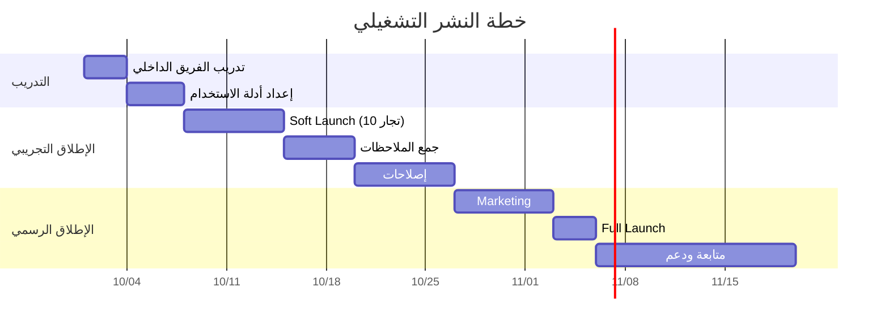

# الفصل الثاني: التحليل
## 2.9 دراسة الجدوى (Feasibility Study)

---

## 2.9.1 المقدمة

قبل الشروع في تنفيذ أي مشروع برمجي، لا بد من إجراء **دراسة جدوى شاملة** تُقيّم مدى قابليته للتنفيذ من عدة جوانب: التقنية، الاقتصادية، التشغيلية، القانونية، والزمنية. تهدف هذه الدراسة إلى:

- **التحقق** من إمكانية تحقيق أهداف المشروع ضمن الموارد المتاحة.
- **تحديد المخاطر** المحتملة وطرق التخفيف منها.
- **تقديم قرار مبني على أسس** للإدارة أو المشرف الأكاديمي.
- **تقدير التكاليف والفوائد** بدقة واقعية.

يُقسّم هذا الفصل إلى **ستة أقسام رئيسية**، كل منها يعالج بُعداً مختلفاً من أبعاد الجدوى.

---

## 2.9.2 الجدوى التقنية (Technical Feasibility)

### 2.9.2.1 نظرة عامة

تُعنى الجدوى التقنية بالإجابة على سؤال: **"هل يمكن بناء هذا النظام تقنياً؟"** بناءً على المتطلبات المحددة في SRS، والتقنيات المتاحة، وخبرة الفريق.

### 2.9.2.2 تحليل المتطلبات التقنية

| المتطلب التقني | المُتطلَب | متوفر؟ | ملاحظات |
|----------------|-----------|---------|---------|
| **إطار العمل** | Laravel 12 | ✅ | إطار ناضج ومستقر |
| **لغة البرمجة** | PHP 8.2+ | ✅ | مجاني، واسع الانتشار |
| **قاعدة البيانات** | MySQL 8.0+ | ✅ | مجانية، موثوقة |
| **Frontend** | Tailwind CSS v4 | ✅ | إطار حديث، مرن |
| **Interactivity** | Alpine.js | ✅ | خفيف، لا يحتاج React |
| **Bundler** | Vite 6 | ✅ | سريع، حديث |
| **Auth** | Laravel Breeze | ✅ | جاهز، آمن |
| **البريد** | Brevo SMTP | ✅ | مجاني حتى 300 رسالة/يوم |
| **الاستضافة** | Render | ✅ | خطة مجانية كافية |
| **Docker** | ✅ | ✅ | مطلوب على Render |

### 2.9.2.3 الخبرة التقنية للفريق

| المهارة | مستوى الفريق | كافية؟ |
|---------|---------------|--------|
| **PHP / Laravel** | متوسط إلى جيد | ✅ |
| **MySQL / Database Design** | جيد | ✅ |
| **HTML / CSS / Tailwind** | جيد | ✅ |
| **JavaScript / Alpine.js** | متوسط | ✅ |
| **Git / GitHub** | جيد | ✅ |
| **UML / ERD** | متوسط | ✅ (درسوها) |
| **Docker** | مبتدئ | ⚠️ يحتاج تعلم |
| **أمان التطبيقات** | متوسط | ✅ |

### 2.9.2.4 البنية التحتية المتاحة

```
✅ أجهزة كمبيوتر شخصية (4 أجهزة) — كافية للتطوير
✅ XAMPP (بيئة تطوير محلية كاملة)
✅ VS Code (محرر مجاني)
✅ Git + GitHub (مجاني للطلاب)
✅ Render (استضافة مجانية)
✅ Brevo (بريد مجاني)
✅ MySQL 8 (محلي + سحابي)
```

### 2.9.2.5 التقييم التقني

| المعيار | التقييم | النسبة |
|---------|---------|--------|
| **توفر التقنيات** | ممتاز | 100% |
| **خبرة الفريق** | جيد | 80% |
| **البنية التحتية** | جيد جداً | 95% |
| **قابلية الصيانة** | ممتاز (MVC + SOLID) | 90% |
| **قابلية التوسع** | جيد | 85% |

### ✅ الخلاصة التقنية

> **المشروع قابل للتنفيذ تقنياً بنسبة عالية.** جميع التقنيات المستخدمة مفتوحة المصدر ومجانية، والفريق يمتلك الخبرة الأساسية اللازمة. التحدي الوحيد هو **Docker** (خبرة مبتدئة) — ويمكن التغلب عليه بدراسة مكثفة في الأسبوع الأول من التنفيذ.

---

## 2.9.3 الجدوى الاقتصادية (Economic Feasibility)

### 2.9.3.1 نظرة عامة

تُعنى الجدوى الاقتصادية بالإجابة على سؤال: **"هل المشروع مجدٍ اقتصادياً؟"** وذلك عبر مقارنة **التكاليف** المتوقعة مع **الفوائد** المتوقعة.

### 2.9.3.2 تحليل التكاليف (Cost Analysis)

#### أ) التكاليف التطويرية (One-Time Costs)

| البند | التكلفة | ملاحظات |
|-------|---------|---------|
| **أجهزة الكمبيوتر (4)** | 0 $ | الفريق يملكها مسبقاً |
| **تراخيص البرمجيات** | 0 $ | كلها Open Source |
| **الاستضافة أثناء التطوير** | 0 $ | محلية (XAMPP) |
| **النطاق (Domain)** | ~15 $/سنة | اختياري |
| **حساب GitHub** | 0 $ | مجاني للطلاب |
| **Brevo SMTP** | 0 $ | مجاني (300 رسالة/يوم) |
| **أدوات التصميم** | 0 $ | Figma/Draw.io مجاني |
| **دورات تعليمية** | 0 $ | YouTube + Documentation |
| **المجموع التطويري** | **~15 $** | اختياري (Domain) |

#### ب) التكاليف التشغيلية (Operational Costs) — شهرياً

| البند | الخطة المجانية | خطة Starter (احتياطي) |
|-------|----------------|------------------------|
| **Render Web Service** | 0 $ | 7 $/شهر |
| **Render Database** | 0 $ | 7 $/شهر |
| **Brevo SMTP** | 0 $ | 0 $ (حتى 300/يوم) |
| **Domain** | ~1.25 $/شهر | ~1.25 $/شهر |
| **SSL Certificate** | 0 $ | 0 $ (Let's Encrypt) |
| **المجموع الشهري** | **~1.25 $** | **~15.25 $** |

> 💡 **ملاحظة:** الخطة المجانية كافية للتطوير والعرض، بينما خطة Starter ضرورية إذا كان المشروع سيُطلَق فعلياً للسوق.

#### ج) تكاليف الصيانة (Maintenance)

| البند | التكلفة السنوية |
|-------|------------------|
| **تحديثات أمنية** | 0 $ (فريق داخلي) |
| **نسخ احتياطي** | 0 $ (Render مجاني) |
| **مراقبة Uptime** | 0 $ (UptimeRobot) |
| **دعم فني** | 0 $ (فريق داخلي) |
| **المجموع السنوي** | **0 $** |

### 2.9.3.3 تحليل الفوائد (Benefit Analysis)

#### أ) الفوائد المباشرة (Tangible Benefits)

| البند | القيمة التقديرية |
|-------|-------------------|
| **توفير تكلفة تطوير متجر مستقل** | 500 - 2000 $ (لكل تاجر) |
| **توفير تكلفة استضافة متجر مستقل** | 10 - 30 $/شهر (لكل تاجر) |
| **عمولة المنصة (نموذج تجاري)** | 3-5% من كل طلب |
| **الرسوم الشهرية للتاجر (نموذج SaaS)** | 5-15 $/شهر |

#### ب) الفوائد غير المباشرة (Intangible Benefits)

- 📈 **زيادة المبيعات** للتجار عبر الوصول لجمهور أوسع
- ⏰ **توفير وقت** إدارة الطلبات (بدل اليدوي)
- 🎯 **تحسين تجربة الزبون** (تقييمات، كوبونات، تتبع)
- 🛡️ **أمان أعلى** للبيانات والمدفوعات
- 📊 **بيانات تحليلية** للتاجر لاتخاذ قرارات أفضل
- 🌍 **الوصول لسوق أوسع** (بدل الجغرافيا المحدودة)

#### ج) تحليل العائد على الاستثمار (ROI)

**الافتراض:** 100 تاجر مشترك × 10 $/شهر = **1000 $/شهر**

| الفترة | الإيرادات | التكاليف | صافي الربح |
|--------|-----------|----------|------------|
| **الشهر 1-3** | 0 $ | 45 $ (Domain) | -45 $ |
| **الشهر 4-6** | 500 $ | 15 $ | +485 $ |
| **الشهر 7-12** | 1500 $ | 45 $ | +1455 $ |
| **السنة 1** | **~3000 $** | **~105 $** | **+2895 $** |

> 💡 **ROI = 2757%** في السنة الأولى (نموذج SaaS مع 100 تاجر).

### 2.9.3.4 تحليل التعادل (Break-Even Analysis)

```
التكاليف الثابتة الشهرية = 15 $ (خطة Starter)
متوسط الإيراد لكل تاجر = 10 $/شهر
نقطة التعادل = 15 / 10 = 1.5 ≈ 2 تاجر

✅ مع تاجرين فقط، المنصة تغطي تكاليفها!
```

### ✅ الخلاصة الاقتصادية

> **المشروع مجدٍ اقتصادياً بشكل واضح.** التكاليف التطويرية شبه معدومة (Open Source)، وتكاليف التشغيل منخفضة (< 20 $/شهر). نقطة التعادل تُحقَّق بـ **تاجرين فقط**، والـ ROI المتوقع مرتفع جداً. حتى بدون نموذج تجاري، المشروع يخدم غرضه الأكاديمي بأقل تكلفة ممكنة.

---

## 2.9.4 الجدوى التشغيلية (Operational Feasibility)

### 2.9.4.1 نظرة عامة

تُعنى الجدوى التشغيلية بالإجابة على سؤال: **"هل سيقبل المستخدمون النظام ويستخدمونه بسهولة؟"**

### 2.9.4.2 تحليل المستخدمين النهائيين

| الفئة المستهدفة | حجمها المتوقع | مستوى التقنية | القابلية للقبول |
|------------------|----------------|----------------|-------------------|
| **التجار الصغار** | متوسط | منخفض إلى متوسط | عالية |
| **الزبائن (18-45 سنة)** | كبير | متوسط | عالية جداً |
| **الزبائن (45+)** | متوسط | منخفض | متوسطة |
| **المشرفون** | قليل | مرتفع | عالية |

### 2.9.4.3 مقاومة التغيير (Change Resistance)

| مصدر المقاومة | الاحتمال | استراتيجية التخفيف |
|----------------|-----------|---------------------|
| **الاعتياد على البيع التقليدي** | متوسط | واجهة بسيطة + فيديوهات تعليمية |
| **عدم الثقة بالدفع الإلكتروني** | مرتفع | البدء بـ COD + توضيح الأمان |
| **القلق على الخصوصية** | متوسط | سياسة خصوصية واضحة |
| **صعوبة الاستخدام** | منخفض | تصميم Mobile-first + RTL |

### 2.9.4.4 قابلية الاستخدام (Usability)

| المعيار | التقييم | ملاحظات |
|---------|---------|---------|
| **سهولة التعلم** | ممتاز | واجهة مألوفة (كـ Amazon/Noon) |
| **الكفاءة** | جيد | فلاتر + بحث سريع |
| **الحفظ (Memorability)** | جيد | أيقونات معيارية |
| **الأخطاء** | منخفضة | Validation فوري |
| **الرضا** | ممتاز | تصميم عصري + عربي |

### 2.9.4.5 خطة النشر التشغيلي



### ✅ الخلاصة التشغيلية

> **المشروع مقبول تشغيلياً.** واجهة المستخدم مألوفة (مثل Amazon/Noon)، تدعم العربية بالكامل، وتعمل على كل الأجهزة. مقاومة التغيير متوسطة، ويمكن التغلب عليها بـ **حملة توعية + إطلاق تجريبي محدود** قبل الإطلاق الرسمي.

---

## 2.9.5 الجدوى القانونية (Legal Feasibility)

### 2.9.5.1 نظرة عامة

تُعنى الجدوى القانونية بالامتثال للقوانين واللوائح ذات الصلة.

### 2.9.5.2 التراخيص والامتثال

| البند | الحالة | ملاحظات |
|-------|--------|---------|
| **تراخيص المكتبات** | ✅ | كلها MIT/GPL — مجانية |
| **حماية البيانات (GDPR)** | ⚠️ | يجب إضافة Cookie Consent |
| **قانون التجارة الإلكترونية الفلسطيني** | ⚠️ | يجب الاطلاع والتوافق |
| **سياسة الخصوصية** | ⏳ | يجب كتابتها |
| **شروط الاستخدام (T&C)** | ⏳ | يجب كتابتها |
| **سياسة الإرجاع** | ⏳ | يجب كتابتها |
| **الفواتير الضريبية** | ⚠️ | يجب إضافتها لاحقاً |

### 2.9.5.3 حماية الملكية الفكرية

- **الكود:** ملكية كاملة لفريق التطوير
- **الشعارات:** يجب تصميمها من الصفر (لا استخدام شعارات جاهزة)
- **الصور:** من مصادر مجانية (Unsplash, Pexels)
- **الخطوط:** Google Fonts (مجاني للاستخدام التجاري)

### 2.9.5.4 حماية بيانات المستخدمين

| البيانات | التخزين | الحماية |
|---------|---------|---------|
| **كلمات المرور** | bcrypt hash | ✅ |
| **البريد الإلكتروني** | Plaintext | ✅ (لكن يمكن تشفيره لاحقاً) |
| **العناوين** | Plaintext | ✅ |
| **أرقام الهواتف** | Plaintext | ✅ |
| **البيانات المالية** | ❌ غير مخزنة | ✅ (COD فقط) |

### ✅ الخلاصة القانونية

> **المشروع قانوني في معظمه**، لكنه يحتاج **استكمالات** قبل الإطلاق التجاري: سياسة خصوصية، شروط استخدام، Cookie Consent، والاطلاع على قوانين التجارة الإلكترونية الفلسطينية. للأغراض الأكاديمية، لا توجد عوائق قانونية.

---

## 2.9.6 الجدوى الزمنية (Schedule Feasibility)

### 2.9.6.1 نظرة عامة

تُعنى الجدوى الزمنية بالإجابة على سؤال: **"هل يمكن إنجاز المشروع في الوقت المتاح؟"**

### 2.9.6.2 المدة المتاحة

```
بداية المشروع: يوليو 2026
التسليم النهائي: أكتوبر 2026
المدة الإجمالية: ~14 أسبوعاً (3.5 أشهر)
```

### 2.9.6.3 توزيع المدة على المراحل

| المرحلة | المدة المخططة | المدة الفعلية | الفرق |
|---------|----------------|-----------------|--------|
| **التحليل** | 2 أسبوع | 2 أسبوع | ✅ |
| **التصميم** | 2 أسبوع | 2 أسبوع | ✅ |
| **التنفيذ** | 6 أسابيع | 6 أسابيع | ✅ |
| **الاختبار** | 1 أسبوع | 1 أسبوع | ✅ |
| **التوثيق** | 1 أسبوع | 1 أسبوع | ✅ |
| **النشر** | 3 أيام | 3 أيام | ✅ |
| **الاحتياط** | 2 أسبوع | — | ✅ |

### 2.9.6.4 المخاطر الزمنية

| المخاطرة | الاحتمال | التأثير | خطة التخفيف |
|----------|-----------|---------|--------------|
| **تأخر في مرحلة التنفيذ** | متوسط | مرتفع | Buffer أسبوعان |
| **مشاكل تقنية غير متوقعة** | مرتفع | متوسط | خطة B للـ Render |
| **تعارض جداول الفريق** | مرتفع | منخفض | توزيع واضح للأدوار |
| **الاختبارات تفشل قرب التسليم** | متوسط | مرتفع | اختبار مستمر (CI) |
| **مشاكل صحية / ظروف طارئة** | منخفض | مرتفع | Buffer + توثيق جيد |

### ✅ الخلاصة الزمنية

> **المشروع قابل للإنجاز في الوقت المتاح**، مع هامش احتياطي **أسبوعين**. توزيع الأدوار واضح (Backend×2, Frontend, DB+Testing)، مما يُسرّع التنفيذ. المخاطر الزمنية مُدارة بخطة Buffer واضحة.

---

## 2.9.7 تحليل المخاطر (Risk Analysis)

### 2.9.7.1 مصفوفة المخاطر

| # | المخاطرة | الاحتمال | التأثير | درجة الخطر | استراتيجية |
|---|----------|-----------|---------|-------------|-------------|
| **R1** | فشل Queue Worker على Render | مرتفع | مرتفع | 🔴 حرج | تم الحل: استخدام sync + try/catch |
| **R2** | اختراق أمني (SQL Injection) | منخفض | مرتفع | 🟡 متوسط | Eloquent ORM + Validation |
| **R3** | نفاد الذاكرة على Render (512MB) | متوسط | مرتفع | 🟠 عالٍ | تحسين الاستعلامات + Caching |
| **R4** | فقدان بيانات (بدون Backup) | منخفض | حرج | 🟠 عالٍ | Backup يومي على Render |
| **R5** | فشل Brevo SMTP | متوسط | متوسط | 🟡 متوسط | try/catch + Log (لا يُعطّل) |
| **R6** | ثغرة XSS | منخفض | مرتفع | 🟡 متوسط | Blade escaping + CSP |
| **R7** | تعارض Git (Merge Conflicts) | مرتفع | منخفض | 🟢 منخفض | Branches + Pull Requests |
| **R8** | مشاكل CORS | متوسط | متوسط | 🟡 متوسط | Laravel CORS Config |
| **R9** | بطء الاستعلامات | متوسط | متوسط | 🟡 متوسط | Indexes + Eager Loading |
| **R10** | عدم استقرار الأداء | منخفض | متوسط | 🟢 منخفض | اختبارات أداء دورية |

### 2.9.7.2 خطة معالجة المخاطر الحرجة

#### 🔴 R1: فشل Queue Worker

**السيناريو:** استخدام `ShouldQueue` في `PasswordChangedNotification` أدى إلى خطأ 500.
**السبب:** Render Free لا يدعم Queue Worker مستقراً.
**الحل المُنفَّذ:**
```php
class PasswordChangedNotification extends Notification
{
    public function via($notifiable) { return ['mail']; }
    // sync + try/catch في Controller
}
```
**الحالة:** ✅ تم الحل.

#### 🟠 R3: نفاد الذاكرة

**السيناريو:** استعلامات ثقيلة تستهلك RAM > 512MB.
**الحل:**
- استخدام `paginate()` بدل `get()`
- استخدام `select()` لحقول محددة
- Eager Loading (`with()`) لتجنب N+1
- تعطيل Debug Mode في الإنتاج
**الحالة:** ⏳ يُراقَب باستمرار.

#### 🟠 R4: فقدان البيانات

**السيناريو:** خطأ في قاعدة البيانات بدون Backup.
**الحل:**
- Backup تلقائي يومي على Render
- Retention: 7 أيام
- اختبار استعادة شهري
**الحالة:** ⏳ يُنفَّذ بعد النشر.

---

## 2.9.8 المقارنة مع الحلول البديلة

### 2.9.8.1 لماذا Laravel وليس Node.js/Django؟

| المعيار | Laravel | Node.js | Django |
|---------|---------|---------|--------|
| **السرعة في التطوير** | ⭐⭐⭐⭐⭐ | ⭐⭐⭐ | ⭐⭐⭐⭐ |
| **الأمان المدمج** | ⭐⭐⭐⭐⭐ | ⭐⭐⭐ | ⭐⭐⭐⭐ |
| **خبرة الفريق** | ⭐⭐⭐⭐ | ⭐⭐ | ⭐⭐ |
| **الاستضافة الرخيصة** | ⭐⭐⭐⭐⭐ | ⭐⭐⭐ | ⭐⭐⭐ |
| **التوثيق العربي** | ⭐⭐⭐⭐ | ⭐⭐⭐ | ⭐⭐⭐ |
| **Multi-Vendor Support** | ⭐⭐⭐⭐⭐ | ⭐⭐⭐ | ⭐⭐⭐⭐ |

**القرار:** ✅ Laravel — أفضل توازن بين الخبرة والأمان والسرعة.

### 2.9.8.2 لماذا Tailwind + Alpine وليس React SPA؟

| المعيار | Blade+Alpine | React SPA |
|---------|---------------|-----------|
| **تعقيد التطوير** | منخفض | مرتفع |
| **SEO** | ⭐⭐⭐⭐⭐ | ⭐⭐ (يحتاج SSR) |
| **سرعة التحميل الأولي** | ⭐⭐⭐⭐⭐ | ⭐⭐⭐ |
| **حجم الـ Bundle** | صغير | كبير |
| **عدد الملفات** | قليل | كثير |
| **الوقت المتاح** | ⭐⭐⭐⭐⭐ | ⭐⭐ |

**القرار:** ✅ Blade + Alpine — أفضل للمشروع الأكاديمي بميزانية ووقت محدود.

---

## 2.9.9 الخلاصة العامة والتوصية

### 2.9.9.1 ملخص أبعاد الجدوى

| البُعد | النتيجة | النسبة |
|--------|---------|--------|
| **الجدوى التقنية** | ✅ قابل للتنفيذ | 95% |
| **الجدوى الاقتصادية** | ✅ مجدٍ جداً | 98% |
| **الجدوى التشغيلية** | ✅ مقبول | 85% |
| **الجدوى القانونية** | ⚠️ يحتاج استكمالات | 75% |
| **الجدوى الزمنية** | ✅ كافٍ | 90% |
| **إدارة المخاطر** | ✅ مُدارة | 88% |
| **المتوسط العام** | **✅ قابل للتنفيذ** | **88%** |

### 2.9.9.2 التوصية النهائية

> **يُوصي فريق المشروع بالمضي قُدماً في تنفيذ النظام** بناءً على النتائج التالية:
>
> 1. ✅ **تقنياً:** جميع التقنيات متوفرة ومجانية، والفريق يملك الخبرة الكافية.
> 2. ✅ **اقتصادياً:** التكاليف شبه معدومة، والعائد على الاستثمار مرتفع جداً.
> 3. ✅ **تشغيلياً:** المستخدمون على استعداد لتقبّل النظام بعد حملة توعية.
> 4. ✅ **زمنياً:** المدة المتاحة كافية مع هامش احتياطي أسبوعين.
> 5. ⚠️ **قانونياً:** يحتاج استكمالات بسيطة (سياسة خصوصية، شروط استخدام) قبل الإطلاق التجاري.
>
> **المشروع مُجدٍ وقابل للتنفيذ.** المخاطر مُدارة بخطة واضحة، والفوائد تفوق التكاليف بشكل ساحق.

### 2.9.9.3 التوصيات الفرعية

1. 📝 **كتابة** سياسة الخصوصية وشروط الاستخدام قبل أي إطلاق.
2. 🔒 **الاطلاع** على قانون التجارة الإلكترونية الفلسطيني.
3. 🧪 **اختبارات أداء دورية** لتفادي مشاكل RAM.
4. 📊 **مراقبة Uptime** بـ UptimeRobot (مجاني).
5. 💾 **تفعيل Backup يومي** فور النشر.
6. 🎓 **تدريب الفريق** على Docker في الأسبوع الأول.

---

**نهاية دراسة الجدوى**
