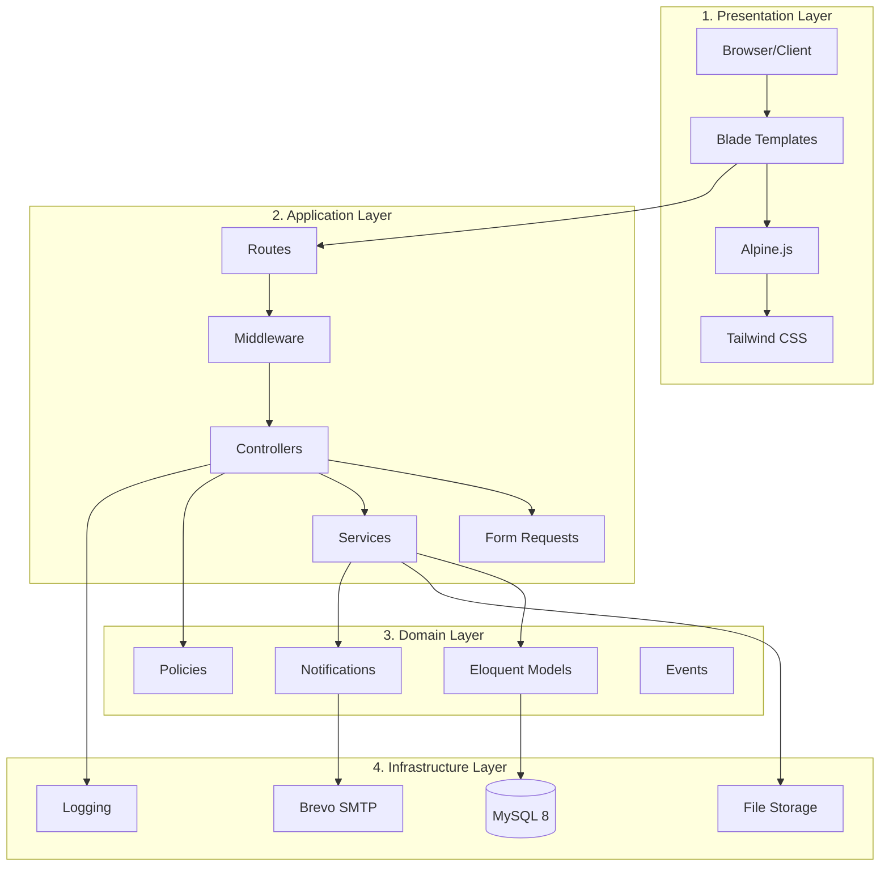
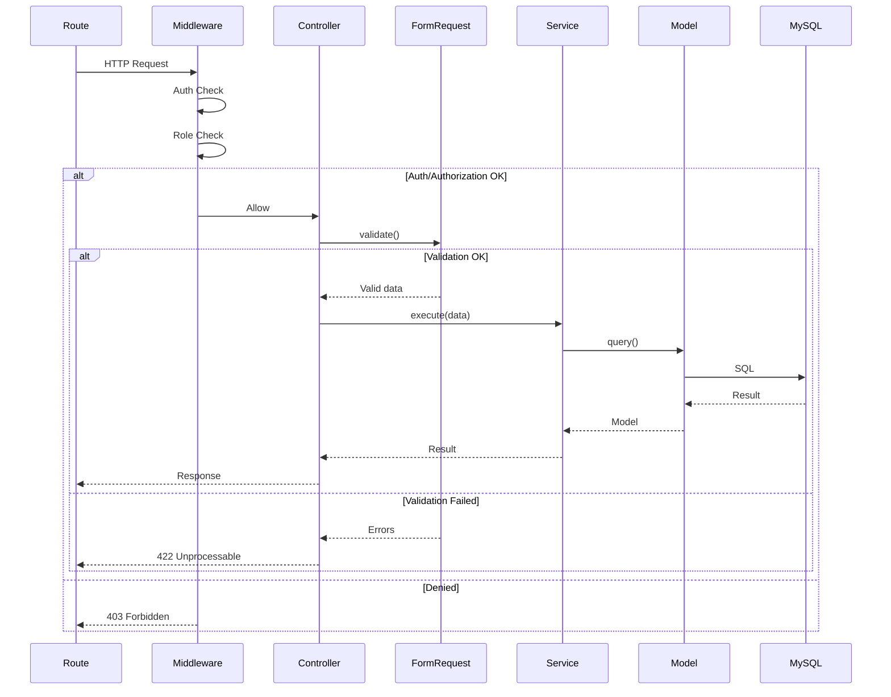
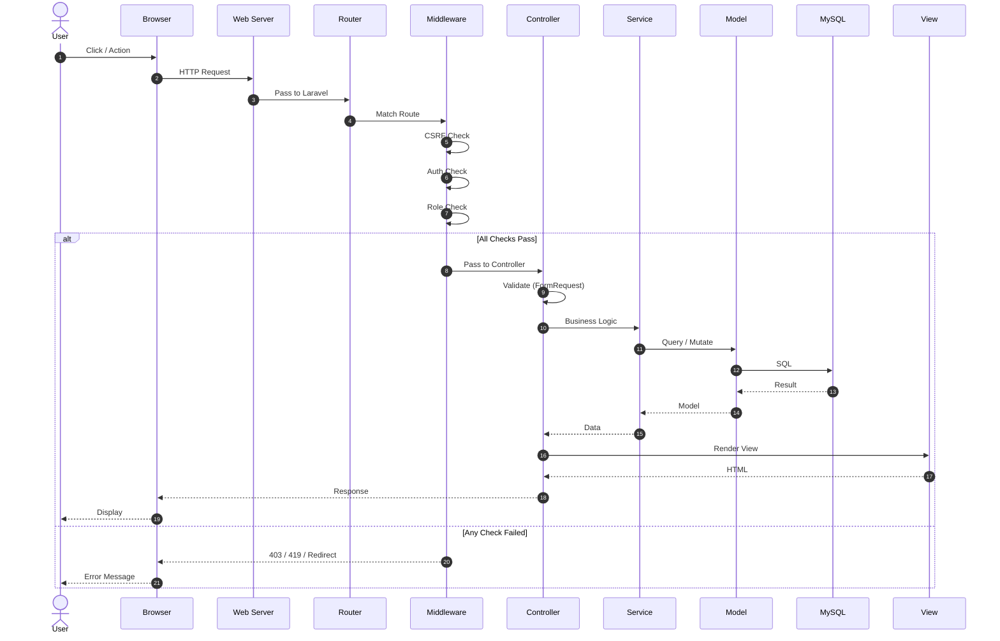
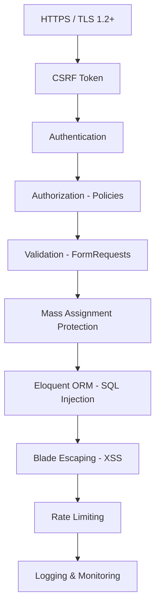
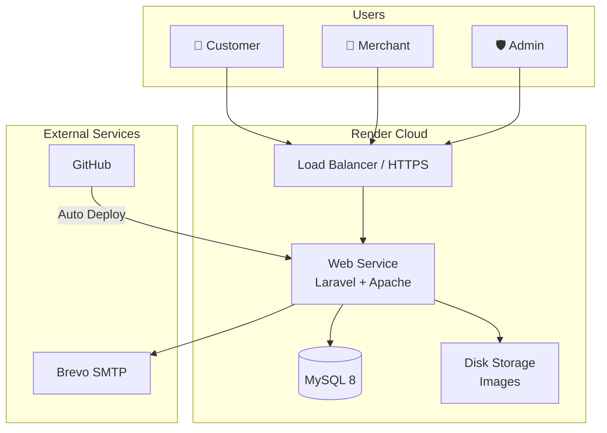

# الفصل الثالث: التصميم
## 3.1 معمارية النظام (System Architecture)

---

## 3.1.1 المقدمة

يمثّل هذا الفصل مرحلة **التصميم** (Design) — وهي المرحلة التي تُترجم فيها **المتطلبات** الموثقة في الفصل الثاني إلى **قرارات معمارية وتصميمية** قابلة للتنفيذ. يُعتبر هذا الفصل حلقة الوصل بين **التحليل** و**التنفيذ**.

يعتمد النظام على **نمط MVC الموسّع** (Model-View-Controller + Service Layer)، وهو نمط أثبت نجاحه في بناء تطبيقات الويب القابلة للصيانة والتوسع. يُوثّق هذا القسم:

- **النمط المعماري** العام ومبررات اختياره
- **الطبقات** ومكوّناتها
- **تدفق الطلب** (Request Lifecycle)
- **القرارات المعمارية** (ADRs)
- **هيكل المجلدات** في الكود

---

## 3.1.2 النمط المعماري العام

### 3.1.2.1 نظرة عامة

يتبع النظام نمط **Layered Architecture** (المعمارية الطبقية) بأربع طبقات رئيسية:



### 3.1.2.2 لماذا هذه المعمارية؟

| البديل | المزايا | العيوب | القرار |
|--------|---------|--------|--------|
| **Monolithic Flat** | بسيط | صعب الصيانة | ❌ مرفوض |
| **MVC تقليدي** | ناضج | Controllers منتفخة | ⚠️ جزئي |
| **MVC + Service** | منظم، قابل للاختبار | تعقيد بسيط | ✅ **مختار** |
| **Hexagonal** | مرن جداً | تعقيد مفرط | ❌ مرفوض |
| **Microservices** | قابل للتوسع | تعقيد هائل | ❌ مرفوض |

**المبرر:**
- المشروع متوسط الحجم (لا يحتاج Microservices)
- الفريق بحاجة لبنية **واضحة ومألوفة**
- Service Layer يمنع انتفاخ Controllers
- مناسب للاختبار المنفصل لكل طبقة

---

## 3.1.3 الطبقات بالتفصيل

### 3.1.3.1 طبقة العرض (Presentation Layer)

**المسؤولية:** عرض البيانات للمستخدم واستقبال مدخلاته.

#### المكوّنات

| المكوّن | المسؤولية | مثال |
|---------|-----------|-------|
| **Blade Templates** | توليد HTML من البيانات | `products/index.blade.php` |
| **Layouts** | قوالب مشتركة (Header, Footer) | `layouts/app.blade.php` |
| **Components** | مكونات قابلة لإعادة الاستخدام | `x-product-card` |
| **Alpine.js** | تفاعل ديناميكي (Cart, Filters) | `x-data="{ cart: [] }"` |
| **Tailwind CSS** | التنسيق | `class="bg-blue-500 rounded-lg"` |
| **Vite** | Bundling + HMR | `npm run dev` |

#### المبادئ المتبعة

- ✅ **Mobile-First:** تصميم يبدأ من الموبايل
- ✅ **RTL كامل:** دعم العربية من اليمين لليسار
- ✅ **Accessibility:** WCAG 2.1 AA
- ✅ **No Business Logic:** الصفحات لا تحتوي منطق أعمال

---

### 3.1.3.2 طبقة التطبيق (Application Layer)

**المسؤولية:** تنسيق الطلبات وتنفيذ منطق الأعمال.

#### المكوّنات

| المكوّن | المسؤولية | مثال |
|---------|-----------|-------|
| **Routes** | تعريف Endpoints | `Route::get('/products', ...)` |
| **Middleware** | تصفية الطلبات (Auth, Roles) | `middleware('role:merchant')` |
| **Controllers** | تنسيق الطلب والاستجابة | `ProductController@store` |
| **Form Requests** | التحقق من صحة البيانات | `StoreProductRequest` |
| **Services** | منطق الأعمال المعقد | `OrderService::createOrder()` |

#### تدفق داخل الطبقة



#### مثال: عملية إنشاء طلب

```php
// app/Http/Controllers/OrderController.php
public function store(StoreOrderRequest $request, OrderService $orderService)
{
    try {
        $order = $orderService->createOrder(
            user: $request->user(),
            data: $request->validated()
        );
        
        return redirect()->route('orders.show', $order)
            ->with('success', 'تم إنشاء طلبك بنجاح');
    } catch (InsufficientStockException $e) {
        return back()->withErrors(['stock' => $e->getMessage()]);
    }
}
```

---

### 3.1.3.3 طبقة النطاق (Domain Layer)

**المسؤولية:** تمثيل الكيانات التجارية وقواعد العمل الأساسية.

#### المكوّنات

| المكوّن | المسؤولية |
|---------|-----------|
| **Eloquent Models** | تمثيل الجداول والعلاقات |
| **Policies** | صلاحيات الوصول |
| **Notifications** | إشعارات بريدية/داخلية |
| **Events/Listeners** | أحداث النظام |

#### مثال: نموذج Product

```php
// app/Models/Product.php
class Product extends Model
{
    protected $fillable = [
        'store_id', 'category_id', 'name', 'description',
        'price', 'stock', 'image_path', 'is_active',
    ];
    
    protected $casts = [
        'price' => 'decimal:2',
        'is_active' => 'boolean',
    ];
    
    // Relations
    public function store() { return $this->belongsTo(Store::class); }
    public function category() { return $this->belongsTo(Category::class); }
    public function reviews() { return $this->hasMany(Review::class); }
    
    // Scopes
    public function scopeActive($query) { return $query->where('is_active', true); }
    public function scopeInStock($query) { return $query->where('stock', '>', 0); }
}
```

---

### 3.1.3.4 طبقة البنية التحتية (Infrastructure Layer)

**المسؤولية:** التعامل مع الأنظمة الخارجية.

#### المكوّنات

| المكوّن | التقنية | الغرض |
|---------|---------|-------|
| **Database** | MySQL 8 | تخزين البيانات |
| **File Storage** | Local Filesystem | الصور والشعارات |
| **Email** | Brevo SMTP | إشعارات بريدية |
| **Cache** | Database (مؤقتاً) | تحسين الأداء |
| **Session** | Database | جلسات المستخدمين |
| **Logging** | File Logs | تتبع الأخطاء |

---

## 3.1.4 تدفق الطلب (Request Lifecycle)

### 3.1.4.1 تسلسل كامل من النقر إلى الاستجابة



### 3.1.4.2 نقاط حرجة في التدفق

| النقطة | المسؤول | الأثر |
|--------|---------|-------|
| **CSRF Token** | Middleware | يمنع هجمات CSRF |
| **Authentication** | Middleware | يضمن وجود مستخدم |
| **Authorization** | Policy / Middleware | يمنع الوصول غير المصرح |
| **Validation** | FormRequest | يضمن صحة البيانات |
| **Business Logic** | Service | ضمان صحة العملية |
| **Transactions** | Service | ضمان الذرية (Atomicity) |
| **Logging** | Controller/Service | تتبع الأخطاء |

---

## 3.1.5 هيكل المجلدات

### 3.1.5.1 Backend Structure

```
clothing-store/
├── app/
│   ├── Http/
│   │   ├── Controllers/
│   │   │   ├── Admin/
│   │   │   │   ├── DashboardController.php
│   │   │   │   ├── UserController.php
│   │   │   │   ├── StoreController.php
│   │   │   │   └── CategoryController.php
│   │   │   ├── Merchant/
│   │   │   │   ├── DashboardController.php
│   │   │   │   ├── ProductController.php
│   │   │   │   ├── OrderController.php
│   │   │   │   └── CouponController.php
│   │   │   ├── Customer/
│   │   │   │   ├── CartController.php
│   │   │   │   ├── OrderController.php
│   │   │   │   ├── ReviewController.php
│   │   │   │   └── WishlistController.php
│   │   │   ├── Auth/
│   │   │   │   ├── LoginController.php
│   │   │   │   ├── RegisterController.php
│   │   │   │   └── PasswordController.php
│   │   │   ├── ProductController.php
│   │   │   └── ProfileController.php
│   │   ├── Middleware/
│   │   │   ├── RoleMiddleware.php
│   │   │   └── EnsureStoreActive.php
│   │   └── Requests/
│   │       ├── StoreProductRequest.php
│   │       ├── StoreOrderRequest.php
│   │       └── UpdatePasswordRequest.php
│   │
│   ├── Models/
│   │   ├── User.php
│   │   ├── Store.php
│   │   ├── Category.php
│   │   ├── Product.php
│   │   ├── Cart.php
│   │   ├── CartItem.php
│   │   ├── Order.php
│   │   ├── OrderItem.php
│   │   ├── Coupon.php
│   │   ├── Review.php
│   │   ├── Wishlist.php
│   │   └── Notification.php
│   │
│   ├── Services/
│   │   ├── OrderService.php
│   │   ├── CartService.php
│   │   └── CouponService.php
│   │
│   ├── Policies/
│   │   ├── ProductPolicy.php
│   │   ├── OrderPolicy.php
│   │   └── StorePolicy.php
│   │
│   ├── Notifications/
│   │   ├── PasswordChangedNotification.php
│   │   ├── OrderPlacedNotification.php
│   │   └── StoreApprovedNotification.php
│   │
│   ├── Exceptions/
│   │   ├── InsufficientStockException.php
│   │   └── InvalidCouponException.php
│   │
│   └── Providers/
│       └── AppServiceProvider.php
│
├── routes/
│   ├── web.php              (Customer + Visitor)
│   ├── admin.php            (Admin)
│   ├── merchant.php         (Merchant)
│   └── auth.php             (Authentication)
│
├── database/
│   ├── migrations/
│   ├── seeders/
│   └── factories/
│
├── resources/
│   ├── views/
│   │   ├── layouts/
│   │   │   ├── app.blade.php
│   │   │   ├── admin.blade.php
│   │   │   ├── merchant.blade.php
│   │   │   └── auth.blade.php
│   │   ├── components/
│   │   │   ├── product-card.blade.php
│   │   │   ├── cart-badge.blade.php
│   │   │   └── notification-icon.blade.php
│   │   ├── admin/
│   │   ├── merchant/
│   │   ├── customer/
│   │   ├── auth/
│   │   └── products/
│   │
│   ├── css/
│   │   └── app.css
│   └── js/
│       └── app.js
│
├── public/
│   ├── index.php
│   └── storage/ (symlink)
│
├── storage/
│   ├── app/
│   │   └── public/
│   │       ├── products/
│   │       ├── stores/
│   │       └── avatars/
│   └── logs/
│
├── tests/
│   ├── Unit/
│   ├── Feature/
│   └── Browser/
│
├── config/
├── docker/
└── docs/
```

### 3.1.5.2 مبررات الهيكل

| المبدأ | التطبيق |
|--------|---------|
| **فصل الأدوار** | Controllers في مجلدات منفصلة (Admin/Merchant/Customer) |
| **Service Layer** | منطق الأعمال في `Services/` |
| **Reusability** | مكونات Blade مشتركة في `components/` |
| **Testability** | كل طبقة قابلة للاختبار منفصلة |
| **PSR-4** | اتباع معايير Autoloading |

---

## 3.1.6 القرارات المعمارية (ADRs)

### ADR-001: استخدام Monolithic vs Microservices

| الحقل | القيمة |
|-------|--------|
| **القرار** | Monolithic (Laravel) |
| **التاريخ** | 2026-07-15 |
| **الحالة** | ✅ مُعتمد |

**السياق:** الفريق مكوّن من 4 طلاب، والمشروع متوسط الحجم، والوقت محدود.

**المبررات:**
- ✅ بساطة النشر (Dockerfile واحد)
- ✅ تحكم أفضل بالأداء (لا Network overhead)
- ✅ Transactions سهلة (Single Database)
- ✅ فريق مبتدئ لا يحتاج Microservices complexity

**البديل المرفوض:** Microservices — تعقيد هائل لا يتناسب مع حجم الفريق والمشروع.

---

### ADR-002: Blade + Alpine.js vs React SPA

| الحقل | القيمة |
|-------|--------|
| **القرار** | Blade Templates + Alpine.js |
| **التاريخ** | 2026-07-20 |
| **الحالة** | ✅ مُعتمد |

**السياق:** الحاجة لتطبيق تفاعلي مع SEO جيد ووقت تطوير محدود.

**المبررات:**
- ✅ **SEO ممتاز** (Server-side rendering مدمج)
- ✅ **وقت تطوير أقل** (لا حاجة لـ API منفصل)
- ✅ **Bundle أصغر** (Alpine.js خفيف جداً ~15KB)
- ✅ **بساطة النشر** (لا Node.js على السيرفر)
- ✅ **تعلم أسرع** (Blade مألوف)

**البديل المرفوض:** React SPA — يحتاج API منفصل + SSR Configuration + وقت أطول.

---

### ADR-003: Sync Notifications vs Queue

| الحقل | القيمة |
|-------|--------|
| **القرار** | Sync + try/catch |
| **التاريخ** | 2026-09-15 |
| **الحالة** | ✅ مُعتمد (مؤقتاً) |

**السياق:** محاولة أولى استخدمت `ShouldQueue` → خطأ 500 على Render Free.

**المبررات:**
- ✅ **Render Free** لا يدعم Queue Worker مستقراً
- ✅ **try/catch** يضمن عدم فشل العملية الأساسية
- ✅ **الخسارة الوحيدة:** بطء طفيف (~1-2 ثانية)
- ✅ **البديل المرفوض:** ShouldQueue → خطأ 500 مؤكد

**كود الحل:**
```php
// ❌ القديم (فشل)
class PasswordChangedNotification extends Notification implements ShouldQueue
{
    use Queueable;
}

// ✅ الجديد (يعمل)
class PasswordChangedNotification extends Notification
{
    public function via($notifiable) { return ['mail']; }
}

// في Controller
try {
    $user->notify(new PasswordChangedNotification(...));
} catch (\Exception $e) {
    \Log::error('Notification failed: ' . $e->getMessage());
}
```

**المستقبل:** عند الترقية لـ Render Starter، يُعاد تفعيل Queue.

---

### ADR-004: MySQL vs PostgreSQL

| الحقل | القيمة |
|-------|--------|
| **القرار** | MySQL 8 |
| **التاريخ** | 2026-07-10 |
| **الحالة** | ✅ مُعتمد |

**المبررات:**
- ✅ **دعم أوسع** على الاستضافات المجانية
- ✅ **خبرة أعلى** لدى الفريق
- ✅ **أداء ممتاز** لعمليات القراءة (المشروع read-heavy)
- ✅ **سهولة الاستخدام** مع XAMPP محلياً

**البديل المرفوض:** PostgreSQL — أفضل نظرياً لكن خبرة أقل ودعم أقل على Render Free.

---

### ADR-005: Single Database vs Multi-Tenant

| الحقل | القيمة |
|-------|--------|
| **القرار** | Single Database + `store_id` FK |
| **التاريخ** | 2026-07-15 |
| **الحالة** | ✅ مُعتمد |

**السياق:** النظام متعدد البائعين (Multi-Vendor) — كيف نعزل بيانات التجار؟

**المبررات:**
- ✅ **بساطة التنفيذ** (FK واحد)
- ✅ **أداء أفضل** (استعلامات بسيطة)
- ✅ **صيانة أسهل** (Migration واحدة)
- ✅ **عزل منطقي كافٍ** (Policies + `store_id` check)
- ✅ **قابل للتوسع** لآلاف المتاجر

**البديل المرفوض:** Multi-Tenant (كل تاجر DB منفصلة) — تعقيد هائل + تكلفة استضافة عالية.

---

### ADR-006: Docker vs Native Deployment

| الحقل | القيمة |
|-------|--------|
| **القرار** | Docker |
| **التاريخ** | 2026-09-01 |
| **الحالة** | ✅ مُعتمد |

**المبررات:**
- ✅ **Render يتطلب Docker** للنشر
- ✅ **بيئة موحّدة** (نفس البيئة محلياً وسحابياً)
- ✅ **سهولة الإعداد** (Dockerfile واحد)
- ✅ **قابلية التوسع** (Deploy نسخ متعددة)

---

## 3.1.7 الأنماط التصميمية المستخدمة

### 3.1.7.1 Design Patterns في المشروع

| النمط | التطبيق | الملف |
|-------|---------|-------|
| **MVC** | الفصل الأساسي | Controllers + Models + Views |
| **Repository** | (اختياري عبر Services) | OrderService |
| **Service Layer** | منطق الأعمال | Services/ |
| **Factory** | إنشاء الكائنات | Model Factories |
| **Strategy** | طرق الدفع (مستقبلاً) | PaymentInterface |
| **Observer** | Events + Listeners | OrderPlaced |
| **Policy** | الصلاحيات | Policies/ |
| **Middleware** | تصفية الطلبات | RoleMiddleware |

### 3.1.7.2 مثال: تطبيق Policy

```php
// app/Policies/ProductPolicy.php
class ProductPolicy
{
    public function update(User $user, Product $product): bool
    {
        return $user->role === 'merchant' 
            && $product->store_id === $user->store->id;
    }
}
```

```php
// في Controller
$this->authorize('update', $product); // throws 403 if not allowed
```

---

## 3.1.8 الأمان في المعمارية

### 3.1.8.1 طبقات الدفاع (Defense in Depth)



### 3.1.8.2 كل طبقة ومسؤوليتها

| الطبقة | الحماية من |
|--------|-----------|
| **HTTPS** | التنصت (Man-in-the-Middle) |
| **CSRF Token** | تزوير الطلبات |
| **Authentication** | الوصول غير المسجل |
| **Authorization** | الوصول غير المصرح |
| **Validation** | بيانات ضارة |
| **Mass Assignment** | تعديل حقول محمية |
| **Eloquent** | SQL Injection |
| **Blade Escaping** | XSS |
| **Rate Limiting** | Brute Force / DDoS |
| **Logging** | تتبع الحوادث |

---

## 3.1.9 الأداء والتحسين

### 3.1.9.1 استراتيجيات الأداء

| الاستراتيجية | التطبيق |
|--------------|---------|
| **Eager Loading** | `Product::with('store', 'reviews')->get()` |
| **Pagination** | `->paginate(12)` بدل `->get()` |
| **Select Specific Columns** | `->select('id', 'name', 'price')` |
| **Database Indexes** | على `email`, `store_id`, `status` |
| **Caching** | Session, Config caching |
| **Query Optimization** | تجنب N+1 queries |

### 3.1.9.2 مشكلة N+1 وحلها

```php
// ❌ سيئ: 1 + N استعلام
$products = Product::all();
foreach ($products as $p) {
    echo $p->store->name; // استعلام لكل منتج!
}

// ✅ جيد: 2 استعلام فقط
$products = Product::with('store')->get();
```

### 3.1.9.3 استهداف الأداء

| القياس | الهدف | كيف |
|--------|--------|-----|
| **Page Load** | < 2s | Caching + Eager Loading |
| **API Response** | < 500ms | Query optimization |
| **DB Query** | < 100ms | Indexes |
| **Concurrent Users** | ≥ 100 | Session optimization |

---

## 3.1.10 مخطط النشر (Deployment Architecture)

### 3.1.10.1 البنية السحابية



### 3.1.10.2 متطلبات النشر

| المكوّن | المواصفة |
|---------|-----------|
| **Web Service** | Docker container (PHP 8.2 + Apache) |
| **RAM** | 512MB (Free) / 2GB (Starter) |
| **Database** | MySQL 8 Managed |
| **Storage** | 1GB Persistent Disk (للصور) |
| **SSL** | تلقائي (Let's Encrypt) |
| **Region** | Frankfurt (أقرب للشرق الأوسط) |

### 3.1.10.3 متغيرات البيئة الحرجة

```env
APP_ENV=production
APP_DEBUG=false
APP_URL=https://clothing-store.onrender.com

DB_CONNECTION=mysql
# ... DB credentials

MAIL_MAILER=smtp
MAIL_HOST=smtp-relay.brevo.com
# ... SMTP credentials

QUEUE_CONNECTION=sync    # مهم!
SESSION_DRIVER=database
CACHE_STORE=database
```

---

## 3.1.11 القيود المعمارية

| القيد | الأثر | التخفيف |
|-------|-------|---------|
| **Render Free: 512MB RAM** | محدودية الاستعلامات | Eager Loading + Pagination |
| **لا Queue Workers** | إشعارات sync | try/catch + Log |
| **لا Redis** | Cache بسيط | Database cache |
| **Disk محدود** | تخزين صور محلي | ضغط الصور + CDN لاحقاً |
| **Single Region** | Latency لمناطق أخرى | اختيار Frankfurt |
| **لا Auto-scaling** | محدودية التوسع | Monitor + Upgrade لاحقاً |

---

## 3.1.12 الخلاصة

تتبع معمارية النظام نمط **MVC + Service Layer**، وهو نمط أثبت نجاحه في تطبيقات ويب متوسطة الحجم. تسمح هذه المعمارية بـ:

- ✅ **فصل واضح للاهتمامات** (Presentation / Application / Domain / Infrastructure)
- ✅ **قابلية عالية للاختبار** (كل طبقة تُختبر منفصلة)
- ✅ **سهولة الصيانة** (تعديل طبقة لا يؤثر على الأخرى)
- ✅ **قابلية التوسع** (إضافة وحدات جديدة بسهولة)

القرارات المعمارية (ADRs) موثقة بمبرراتها، وتشمل قرارات حساسة مثل **Sync Notifications** (بعد خطأ 500)، و**Blade + Alpine** بدل React SPA، و**Single Database** بدل Multi-Tenant.

النظام مُهيّأ للنشر على **Render** عبر **Docker**، مع مراعاة قيود البيئة المجانية (RAM, Queue, Cache).

---

**نهاية قسم معمارية النظام**