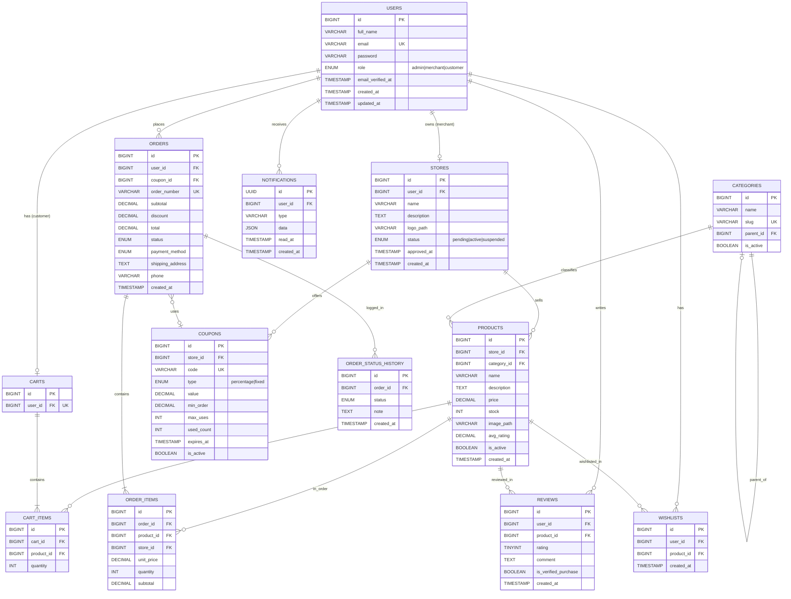

# الفصل الثالث: التصميم
## 3.2 تصميم قاعدة البيانات (Database Design & ERD)

---

## 3.2.1 المقدمة

تُعتبر قاعدة البيانات **العمود الفقري** لأي نظام معلوماتي. لذلك خُصص هذا القسم لتصميم قاعدة بيانات **متكاملة، مُطبَّعة، وآمنة** تلبي متطلبات النظام الموثقة في SRS.

يعتمد التصميم على:

- **نموذج البيانات العلائقي** (Relational Data Model)
- **قواعد التطبيع** (Normalization: 1NF, 2NF, 3NF)
- **الفهارس الاستراتيجية** (Strategic Indexes) للأداء
- **قيود السلامة** (Integrity Constraints) لضمان جودة البيانات

يوثّق هذا القسم:

1. **مخطط ERD** الكامل
2. **قاموس البيانات** لكل جدول
3. **العلاقات** بين الجداول
4. **الفهارس** الاستراتيجية
5. **تحليل التطبيع**
6. **قرارات Denormalization** المتعمدة

---

## 3.2.2 مخطط العلاقات الكامل (ERD)

### 3.2.2.1 المخطط الشامل



### 3.2.2.2 ملخص الجداول (13 جدولاً)

| # | الجدول | الدور | الحجم المتوقع |
|---|--------|-------|----------------|
| 1 | `users` | المستخدمون (3 أدوار) | كبير |
| 2 | `stores` | المتاجر | متوسط |
| 3 | `categories` | التصنيفات | صغير |
| 4 | `products` | المنتجات | كبير |
| 5 | `carts` | سلات التسوق | متوسط |
| 6 | `cart_items` | عناصر السلة | كبير |
| 7 | `orders` | الطلبات | كبير |
| 8 | `order_items` | عناصر الطلب | كبير |
| 9 | `coupons` | الكوبونات | صغير |
| 10 | `reviews` | التقييمات | كبير |
| 11 | `wishlists` | المفضلة | متوسط |
| 12 | `notifications` | الإشعارات | كبير |
| 13 | `order_status_history` | سجل حالات الطلب | كبير |

---

## 3.2.3 قاموس البيانات (Data Dictionary)

### 3.2.3.1 جدول `users`

**الوصف:** يحتوي على جميع مستخدمي النظام (Admin / Merchant / Customer).

| العمود | النوع | القيود | الافتراضي | الوصف |
|--------|------|--------|-----------|-------|
| `id` | BIGINT UNSIGNED | PK, AUTO_INCREMENT | — | المعرّف الفريد |
| `full_name` | VARCHAR(255) | NOT NULL | — | الاسم الكامل |
| `email` | VARCHAR(255) | UNIQUE, NOT NULL, INDEX | — | البريد الإلكتروني |
| `password` | VARCHAR(255) | NOT NULL | — | bcrypt hash |
| `role` | ENUM | NOT NULL, INDEX | 'customer' | admin/merchant/customer |
| `email_verified_at` | TIMESTAMP | NULL | NULL | تاريخ التحقق |
| `remember_token` | VARCHAR(100) | NULL | NULL | "تذكرني" |
| `created_at` | TIMESTAMP | NULL | — | — |
| `updated_at` | TIMESTAMP | NULL | — | — |

**الفهارس:**
- `PRIMARY KEY (id)`
- `UNIQUE INDEX (email)` — سرعة الدخول
- `INDEX (role)` — فلترة حسب الدور

**العلاقات:**
- `hasOne(Store)` — إذا كان merchant
- `hasOne(Cart)` — إذا كان customer
- `hasMany(Order)`
- `hasMany(Review)`
- `hasMany(Wishlist)`
- `hasMany(Notification)`

---

### 3.2.3.2 جدول `stores`

**الوصف:** يحتوي على متاجر التجار (كل تاجر له متجر واحد).

| العمود | النوع | القيود | الافتراضي | الوصف |
|--------|------|--------|-----------|-------|
| `id` | BIGINT UNSIGNED | PK | — | — |
| `user_id` | BIGINT UNSIGNED | FK → users.id, **UNIQUE** | — | التاجر المالك |
| `name` | VARCHAR(255) | NOT NULL | — | اسم المتجر |
| `description` | TEXT | NULL | — | الوصف |
| `logo_path` | VARCHAR(255) | NULL | — | مسار الشعار |
| `status` | ENUM | NOT NULL, INDEX | 'pending' | pending/active/suspended |
| `approved_at` | TIMESTAMP | NULL | NULL | تاريخ الموافقة |
| `created_at` | TIMESTAMP | NULL | — | — |
| `updated_at` | TIMESTAMP | NULL | — | — |

**الفهارس:**
- `PRIMARY KEY (id)`
- `UNIQUE INDEX (user_id)` — تاجر واحد = متجر واحد
- `INDEX (status)` — فلترة المتاجر النشطة/المعلقة

**العلاقات:**
- `belongsTo(User)` — التاجر
- `hasMany(Product)`
- `hasMany(Coupon)`

---

### 3.2.3.3 جدول `categories`

**الوصف:** تصنيفات المنتجات (تدعم التصنيفات المتداخلة).

| العمود | النوع | القيود | الافتراضي | الوصف |
|--------|------|--------|-----------|-------|
| `id` | BIGINT UNSIGNED | PK | — | — |
| `name` | VARCHAR(100) | NOT NULL | — | اسم التصنيف |
| `slug` | VARCHAR(120) | UNIQUE | — | للـ URLs |
| `parent_id` | BIGINT UNSIGNED | FK → categories.id, NULL | NULL | التصنيف الأب |
| `is_active` | BOOLEAN | NOT NULL | 1 | مفعّل |
| `created_at` | TIMESTAMP | NULL | — | — |
| `updated_at` | TIMESTAMP | NULL | — | — |

**الفهارس:**
- `PRIMARY KEY (id)`
- `UNIQUE INDEX (slug)`
- `INDEX (parent_id)` — التصنيفات الفرعية

**العلاقات:**
- `belongsTo(Category, 'parent_id')` — الأب
- `hasMany(Category, 'parent_id')` — الأبناء
- `hasMany(Product)`

---

### 3.2.3.4 جدول `products`

**الوصف:** منتجات الملابس (الجدول الأكثر استخداماً).

| العمود | النوع | القيود | الافتراضي | الوصف |
|--------|------|--------|-----------|-------|
| `id` | BIGINT UNSIGNED | PK | — | — |
| `store_id` | BIGINT UNSIGNED | FK → stores.id, INDEX | — | المتجر |
| `category_id` | BIGINT UNSIGNED | FK → categories.id, INDEX | — | التصنيف |
| `name` | VARCHAR(255) | NOT NULL, INDEX | — | اسم المنتج |
| `description` | TEXT | NULL | — | الوصف |
| `price` | DECIMAL(10,2) | NOT NULL, INDEX | — | السعر |
| `stock` | INT | NOT NULL | 0 | المخزون |
| `image_path` | VARCHAR(255) | NULL | — | الصورة الرئيسية |
| `avg_rating` | DECIMAL(3,2) | NOT NULL | 0.00 | متوسط التقييم (Denorm.) |
| `is_active` | BOOLEAN | NOT NULL, INDEX | 1 | معروض |
| `created_at` | TIMESTAMP | NULL | — | — |
| `updated_at` | TIMESTAMP | NULL | — | — |

**الفهارس (استراتيجية):**
- `PRIMARY KEY (id)`
- `INDEX (store_id)` — منتجات متجر معين
- `INDEX (category_id)` — فلترة بالتصنيف
- `INDEX (price)` — ترتيب بالسعر
- `INDEX (avg_rating)` — ترتيب بالتقييم
- `COMPOSITE INDEX (category_id, is_active)` — فلترة + عرض
- `INDEX (is_active)` — عرض المنتجات النشطة فقط

**العلاقات:**
- `belongsTo(Store)`
- `belongsTo(Category)`
- `hasMany(CartItem)`
- `hasMany(OrderItem)`
- `hasMany(Review)`
- `hasMany(Wishlist)`

**ملاحظة Denormalization:** `avg_rating` يُحدَّث تلقائياً عند إضافة/حذف تقييم (عبر Observer).

---

### 3.2.3.5 جدول `carts`

**الوصف:** سلة كل زبون (واحدة لكل زبون).

| العمود | النوع | القيود | الافتراضي | الوصف |
|--------|------|--------|-----------|-------|
| `id` | BIGINT UNSIGNED | PK | — | — |
| `user_id` | BIGINT UNSIGNED | FK → users.id, **UNIQUE** | — | الزبون |
| `created_at` | TIMESTAMP | NULL | — | — |
| `updated_at` | TIMESTAMP | NULL | — | — |

**الفهارس:**
- `PRIMARY KEY (id)`
- `UNIQUE INDEX (user_id)` — سلة واحدة لكل زبون

**العلاقات:**
- `belongsTo(User)`
- `hasMany(CartItem)`

---

### 3.2.3.6 جدول `cart_items`

**الوصف:** عناصر السلة (منتج + كمية).

| العمود | النوع | القيود | الافتراضي | الوصف |
|--------|------|--------|-----------|-------|
| `id` | BIGINT UNSIGNED | PK | — | — |
| `cart_id` | BIGINT UNSIGNED | FK → carts.id, INDEX | — | السلة |
| `product_id` | BIGINT UNSIGNED | FK → products.id, INDEX | — | المنتج |
| `quantity` | INT | NOT NULL, CHECK > 0 | 1 | الكمية |
| `created_at` | TIMESTAMP | NULL | — | — |
| `updated_at` | TIMESTAMP | NULL | — | — |

**الفهارس:**
- `PRIMARY KEY (id)`
- `UNIQUE INDEX (cart_id, product_id)` — منع التكرار
- `INDEX (cart_id)` — سرعة الاستعلام

**العلاقات:**
- `belongsTo(Cart)`
- `belongsTo(Product)`

---

### 3.2.3.7 جدول `orders`

**الوصف:** الطلبات (رأس الطلب).

| العمود | النوع | القيود | الافتراضي | الوصف |
|--------|------|--------|-----------|-------|
| `id` | BIGINT UNSIGNED | PK | — | — |
| `user_id` | BIGINT UNSIGNED | FK → users.id, INDEX | — | الزبون |
| `coupon_id` | BIGINT UNSIGNED | FK → coupons.id, NULL | NULL | الكوبون (اختياري) |
| `order_number` | VARCHAR(20) | UNIQUE | — | رقم الطلب |
| `subtotal` | DECIMAL(10,2) | NOT NULL | — | المجموع قبل الخصم |
| `discount` | DECIMAL(10,2) | NOT NULL | 0 | الخصم |
| `total` | DECIMAL(10,2) | NOT NULL | — | الإجمالي النهائي |
| `status` | ENUM | NOT NULL, INDEX | 'pending' | الحالة |
| `payment_method` | ENUM | NOT NULL | 'cod' | طريقة الدفع |
| `shipping_address` | TEXT | NOT NULL | — | عنوان الشحن |
| `phone` | VARCHAR(20) | NOT NULL | — | رقم الهاتف |
| `created_at` | TIMESTAMP | NOT NULL, INDEX | — | تاريخ الطلب |
| `updated_at` | TIMESTAMP | NULL | — | — |

**حالات الطلب (status):**
- `pending` — قيد الانتظار
- `confirmed` — مؤكد
- `shipped` — تم الشحن
- `delivered` — تم التسليم
- `cancelled` — ملغي

**الفهارس:**
- `PRIMARY KEY (id)`
- `UNIQUE INDEX (order_number)` — رقم فريد
- `INDEX (user_id)` — طلبات زبون
- `INDEX (status)` — فلترة بالحالة
- `COMPOSITE INDEX (user_id, status)` — طلبات زبون بحالة معينة
- `INDEX (created_at)` — ترتيب زمني

---

### 3.2.3.8 جدول `order_items`

**الوصف:** عناصر الطلب (Snapshot تاريخي).

| العمود | النوع | القيود | الافتراضي | الوصف |
|--------|------|--------|-----------|-------|
| `id` | BIGINT UNSIGNED | PK | — | — |
| `order_id` | BIGINT UNSIGNED | FK → orders.id, INDEX | — | الطلب |
| `product_id` | BIGINT UNSIGNED | FK → products.id | — | المنتج |
| `store_id` | BIGINT UNSIGNED | FK → stores.id, INDEX | — | المتجر (للتاجر) |
| `unit_price` | DECIMAL(10,2) | NOT NULL | — | سعر الوحدة (Snapshot) |
| `quantity` | INT | NOT NULL | — | الكمية |
| `subtotal` | DECIMAL(10,2) | NOT NULL | — | المجموع الفرعي |
| `created_at` | TIMESTAMP | NULL | — | — |

**الفهارس:**
- `PRIMARY KEY (id)`
- `INDEX (order_id)` — عناصر طلب
- `INDEX (store_id)` — طلبات تاجر معين (إحصائيات)
- `INDEX (product_id)` — مبيعات منتج

**ملاحظة Denormalization:** `unit_price` و `subtotal` يُخزَّنان كـ **Snapshot تاريخي** لأن:
- سعر المنتج قد يتغير لاحقاً
- بيانات الطلب يجب أن تبقى ثابتة للأبد
- التقارير المالية تحتاج سعر لحظة الشراء

---

### 3.2.3.9 جدول `coupons`

**الوصف:** كوبونات الخصم.

| العمود | النوع | القيود | الافتراضي | الوصف |
|--------|------|--------|-----------|-------|
| `id` | BIGINT UNSIGNED | PK | — | — |
| `store_id` | BIGINT UNSIGNED | FK → stores.id, INDEX | — | المتجر |
| `code` | VARCHAR(50) | UNIQUE | — | كود الكوبون |
| `type` | ENUM | NOT NULL | — | percentage/fixed |
| `value` | DECIMAL(10,2) | NOT NULL | — | القيمة |
| `min_order` | DECIMAL(10,2) | NOT NULL | 0 | الحد الأدنى |
| `max_uses` | INT | NULL | NULL | الحد الأقصى للاستخدام |
| `used_count` | INT | NOT NULL | 0 | عدد الاستخدامات |
| `expires_at` | TIMESTAMP | NULL | NULL | تاريخ الانتهاء |
| `is_active` | BOOLEAN | NOT NULL | 1 | مفعّل |
| `created_at` | TIMESTAMP | NULL | — | — |
| `updated_at` | TIMESTAMP | NULL | — | — |

**الفهارس:**
- `PRIMARY KEY (id)`
- `UNIQUE INDEX (code)` — كود فريد
- `INDEX (store_id)` — كوبونات تاجر
- `INDEX (is_active, expires_at)` — الكوبونات الصالحة

---

### 3.2.3.10 جدول `reviews`

**الوصف:** تقييمات المنتجات.

| العمود | النوع | القيود | الافتراضي | الوصف |
|--------|------|--------|-----------|-------|
| `id` | BIGINT UNSIGNED | PK | — | — |
| `user_id` | BIGINT UNSIGNED | FK → users.id, INDEX | — | الزبون |
| `product_id` | BIGINT UNSIGNED | FK → products.id, INDEX | — | المنتج |
| `rating` | TINYINT | NOT NULL, CHECK 1-5 | — | التقييم |
| `comment` | TEXT | NULL | — | التعليق |
| `is_verified_purchase` | BOOLEAN | NOT NULL | 0 | تحقق من الشراء |
| `created_at` | TIMESTAMP | NOT NULL | — | — |
| `updated_at` | TIMESTAMP | NULL | — | — |

**الفهارس:**
- `PRIMARY KEY (id)`
- `UNIQUE INDEX (user_id, product_id)` — تقييم واحد لكل مستخدم لكل منتج
- `INDEX (product_id)` — تقييمات منتج
- `INDEX (rating)` — ترتيب بالتقييم

---

### 3.2.3.11 جدول `wishlists`

**الوصف:** قائمة المفضلة.

| العمود | النوع | القيود | الافتراضي | الوصف |
|--------|------|--------|-----------|-------|
| `id` | BIGINT UNSIGNED | PK | — | — |
| `user_id` | BIGINT UNSIGNED | FK → users.id, INDEX | — | الزبون |
| `product_id` | BIGINT UNSIGNED | FK → products.id, INDEX | — | المنتج |
| `created_at` | TIMESTAMP | NULL | — | — |

**الفهارس:**
- `PRIMARY KEY (id)`
- `UNIQUE INDEX (user_id, product_id)` — منع التكرار

---

### 3.2.3.12 جدول `notifications`

**الوصف:** إشعارات المستخدمين (نظام Laravel).

| العمود | النوع | القيود | الافتراضي | الوصف |
|--------|------|--------|-----------|-------|
| `id` | CHAR(36) | PK (UUID) | — | معرّف UUID |
| `user_id` | BIGINT UNSIGNED | FK → users.id, INDEX | — | المستخدم |
| `type` | VARCHAR(255) | NOT NULL | — | نوع الإشعار |
| `data` | JSON | NOT NULL | — | بيانات الإشعار |
| `read_at` | TIMESTAMP | NULL | NULL | تاريخ القراءة |
| `created_at` | TIMESTAMP | NULL | — | — |

**الفهارس:**
- `PRIMARY KEY (id)`
- `INDEX (user_id)` — إشعارات مستخدم
- `COMPOSITE INDEX (user_id, read_at)` — غير المقروءة

---

### 3.2.3.13 جدول `order_status_history`

**الوصف:** سجل تغيرات حالة الطلب.

| العمود | النوع | القيود | الافتراضي | الوصف |
|--------|------|--------|-----------|-------|
| `id` | BIGINT UNSIGNED | PK | — | — |
| `order_id` | BIGINT UNSIGNED | FK → orders.id, INDEX | — | الطلب |
| `status` | ENUM | NOT NULL | — | الحالة الجديدة |
| `note` | TEXT | NULL | — | ملاحظة |
| `created_at` | TIMESTAMP | NOT NULL | — | وقت التغيير |

**الفهارس:**
- `PRIMARY KEY (id)`
- `INDEX (order_id)` — سجل طلب
- `INDEX (created_at)` — ترتيب زمني

---

## 3.2.4 العلاقات بين الجداول

### 3.2.4.1 ملخص العلاقات

| العلاقة | النوع | Cascade | ملاحظات |
|---------|-------|---------|---------|
| `users → stores` | One-to-One | CASCADE | تاجر واحد = متجر واحد |
| `users → carts` | One-to-One | CASCADE | زبون واحد = سلة واحدة |
| `users → orders` | One-to-Many | CASCADE | زبون → طلباته |
| `users → reviews` | One-to-Many | CASCADE | زبون → تقييماته |
| `users → wishlists` | One-to-Many | CASCADE | زبون → مفضلته |
| `stores → products` | One-to-Many | CASCADE | متجر → منتجاته |
| `stores → coupons` | One-to-Many | CASCADE | متجر → كوبوناته |
| `categories → products` | One-to-Many | RESTRICT | تصنيف → منتجاته |
| `categories → categories` | Self-referential | SET NULL | تصنيفات متداخلة |
| `products → cart_items` | One-to-Many | CASCADE | منتج → عناصر السلة |
| `products → order_items` | One-to-Many | RESTRICT | منتج → عناصر الطلب |
| `products → reviews` | One-to-Many | CASCADE | منتج → تقييماته |
| `carts → cart_items` | One-to-Many | CASCADE | سلة → عناصرها |
| `orders → order_items` | One-to-Many | CASCADE | طلب → عناصره |
| `orders → order_status_history` | One-to-Many | CASCADE | طلب → سجله |
| `orders → coupons` | Many-to-One | SET NULL | طلب → كوبونه |

### 3.2.4.2 استراتيجيات Cascade

| Cascade | متى نستخدمه |
|---------|-------------|
| **CASCADE** | حذف الأب يحذف الأبناء (سلة → عناصرها) |
| **RESTRICT** | منع حذف الأب إذا له أبناء (منتج في طلب) |
| **SET NULL** | تصفير FK عند حذف الأب (كوبون محذوف) |

**القرارات المهمة:**
- `products → order_items`: **RESTRICT** — لا يُحذف منتج له طلبات تاريخية
- `orders → coupons`: **SET NULL** — لو حُذف الكوبون، الطلب يبقى
- `categories → products`: **RESTRICT** — لا يُحذف تصنيف له منتجات

---

## 3.2.5 التطبيع (Normalization)

### 3.2.5.1 الشكل الأول (1NF — First Normal Form)

**القاعدة:** كل خلية تحتوي قيمة ذرية واحدة (No multi-valued attributes).

**التحقق:**
- ✅ كل عمود يحتوي قيمة واحدة
- ✅ لا arrays أو JSON في الأعمدة الحيوية
- ✅ كل صف فريد (له PK)

**مثال مرفوض:** حقل `phone_numbers = "0599..., 0566..."` — يجب فصلهم في جدول منفصل (لو احتجناه).

---

### 3.2.5.2 الشكل الثاني (2NF — Second Normal Form)

**القاعدة:** لا اعتماد جزئي على مفتاح مركب.

**التحقق:**
- ✅ كل الجداول لها PK عمود واحد (BIGINT AUTO_INCREMENT)
- ✅ لا توجد جداول بمفاتيح مركبة إلا `cart_items` و `wishlists` (UNIQUE constraint فقط)
- ✅ كل عمود يعتمد على PK الكامل

---

### 3.2.5.3 الشكل الثالث (3NF — Third Normal Form)

**القاعدة:** لا اعتماد متعدٍّ (Non-key attribute depends on another non-key attribute).

**التحقق:**

| الجدول | التحقق |
|--------|--------|
| `products` | ✅ `store_id` FK (لا اسم المتجر) |
| `orders` | ✅ `user_id` FK (لا اسم الزبون) |
| `order_items` | ⚠️ `store_id` موجود — **لكنه مبرر** (Denormalization متعمد) |
| `reviews` | ✅ كل شيء يعتمد على PK |

---

### 3.2.5.4 الخلاصة

| الشكل | الحالة | ملاحظات |
|-------|--------|---------|
| **1NF** | ✅ | كل الخلايا ذرية |
| **2NF** | ✅ | لا اعتماد جزئي |
| **3NF** | ✅ | لا اعتماد متعدٍّ |
| **BCNF** | ✅ | كل محدد مرشح |
| **Denormalization** | ⚠️ | متعمد (3 حالات) |

---

## 3.2.6 حالات Denormalization المتعمدة

### 3.2.6.1 لماذا Denormalization؟

رغم أن التطبيع الكامل (3NF) مثالي نظرياً، إلا أنه قد يؤدي إلى:

- **استعلامات معقدة** (الكثير من JOINs)
- **أداء ضعيف** (حسابات متكررة)
- **صعوبة في التقارير** (Aggregation على مدى طويل)

لذلك، قمنا بتطبيق **Denormalization متعمد ومحدود** في **3 حالات فقط**، بمبررات قوية:

---

### 3.2.6.2 الحالة 1: `products.avg_rating`

**الوصف:** تخزين متوسط التقييم بدل حسابه في كل استعلام.

**بدون Denormalization:**
```sql
-- كل عرض منتج يحتاج هذا الاستعلام
SELECT p.*, AVG(r.rating) as avg_rating
FROM products p
LEFT JOIN reviews r ON r.product_id = p.id
GROUP BY p.id;
-- بطيء مع 1000+ منتج
```

**مع Denormalization:**
```sql
SELECT * FROM products WHERE is_active = 1;
-- سريع جداً (عمود موجود)
```

**التكلفة:**
- تحديث `avg_rating` عند كل إضافة/حذف تقييم (عبر Observer)
- تحديث نادر جداً مقارنة بعدد القراءات

**المبرر:** نسبة القراءة/الكتابة = ~1000:1.

---

### 3.2.6.3 الحالة 2: `orders.total` و `subtotal`

**الوصف:** تخزين المجموع النهائي بدل حسابه من `order_items`.

**بدون Denormalization:**
```sql
SELECT o.*, SUM(oi.subtotal) as total
FROM orders o
JOIN order_items oi ON oi.order_id = o.id
GROUP BY o.id;
-- كل عرض طلب = JOIN + SUM
```

**مع Denormalization:**
```sql
SELECT * FROM orders WHERE user_id = 5;
-- سريع جداً
```

**المبرر:**
- التقارير المالية تحتاج الإجمالي كثيراً
- السعر لحظة الطلب قد يتغير لاحقاً (Snapshot ضروري)
- نسبة القراءة/الكتابة عالية

---

### 3.2.6.4 الحالة 3: `order_items.unit_price` و `subtotal`

**الوصف:** تخزين سعر الوحدة لحظة الشراء.

**المبرر (حرج!):**

> **الأسعار تتغير مع الزمن.** لو اعتمدنا على `products.price` عند عرض طلب قديم، سيدفع الزبون السعر الجديد بدل السعر الذي دفعه فعلاً!

**مثال:**
```
المنتج X كان سعره 100₪ يوم 2026-10-01
الزبون اشترى بـ 100₪ (order_items.unit_price = 100)
تغيّر السعر إلى 150₪ يوم 2026-10-15
عرض الطلب القديم يجب أن يظهر 100₪ (لا 150₪)
```

**هذا Denormalization ضروري** لأسباب قانونية ومحاسبية.

---

### 3.2.6.5 جدول Denormalization

| # | الجدول.العمود | السبب | التكلفة |
|---|----------------|--------|---------|
| 1 | `products.avg_rating` | سرعة عرض المنتجات | تحديث عند تقييم جديد |
| 2 | `orders.total` | تقارير مالية سريعة | تحديث عند إنشاء الطلب |
| 3 | `order_items.unit_price` | Snapshot تاريخي (قانوني) | لا تكلفة (يُكتب مرة واحدة) |

---

## 3.2.7 الفهارس الاستراتيجية (Indexes)

### 3.2.7.1 لماذا الفهارس؟

**بدون فهرس:**
```sql
SELECT * FROM products WHERE category_id = 5;
-- Full Table Scan: يمر على كل الصفوف
```

**مع فهرس:**
```sql
-- B-Tree Index: يصل مباشرة للصفوف المطلوبة
```

### 3.2.7.2 جدول الفهارس

| الجدول | الفهرس | النوع | السبب |
|--------|--------|------|-------|
| `users` | `email` | UNIQUE | تسجيل الدخول |
| `users` | `role` | INDEX | فلترة حسب الدور |
| `stores` | `user_id` | UNIQUE | تاجر واحد = متجر واحد |
| `stores` | `status` | INDEX | متاجر معلقة/نشطة |
| `categories` | `slug` | UNIQUE | URLs |
| `categories` | `parent_id` | INDEX | تصنيفات فرعية |
| `products` | `store_id` | INDEX | منتجات متجر |
| `products` | `category_id` | INDEX | فلترة |
| `products` | `price` | INDEX | ترتيب بالسعر |
| `products` | `avg_rating` | INDEX | ترتيب بالتقييم |
| `products` | `(category_id, is_active)` | COMPOSITE | فلترة + عرض |
| `cart_items` | `(cart_id, product_id)` | UNIQUE | منع التكرار |
| `orders` | `order_number` | UNIQUE | رقم فريد |
| `orders` | `(user_id, status)` | COMPOSITE | طلبات زبون بحالة |
| `orders` | `created_at` | INDEX | ترتيب زمني |
| `order_items` | `store_id` | INDEX | إحصائيات تاجر |
| `order_items` | `product_id` | INDEX | مبيعات منتج |
| `coupons` | `code` | UNIQUE | تطبيق كوبون |
| `coupons` | `(is_active, expires_at)` | COMPOSITE | كوبونات صالحة |
| `reviews` | `(user_id, product_id)` | UNIQUE | تقييم واحد |
| `reviews` | `product_id` | INDEX | تقييمات منتج |
| `notifications` | `(user_id, read_at)` | COMPOSITE | غير المقروءة |

### 3.2.7.3 Composite Indexes (فهارس مركبة)

**مثال:** `products (category_id, is_active)`

**الاستعلام المستهدف:**
```sql
SELECT * FROM products 
WHERE category_id = 5 AND is_active = 1;
```

**الفائدة:**
- ✅ الفهرس يخدم استعلامات `(category_id)` و `(category_id, is_active)`
- ❌ لا يخدم `(is_active)` فقط (ترتيب الأعمدة مهم!)

**قاعدة:** الأعمدة في الفهرس المركب مرتبة من **الأكثر انتقائية** إلى **الأقل**.

---

## 3.2.8 قيود السلامة (Integrity Constraints)

### 3.2.8.1 قيود المفاتيح

| النوع | التطبيق |
|-------|---------|
| **Primary Key** | كل جدول له `id` فريد |
| **Foreign Key** | كل FK يشير لـ PK موجود |
| **Unique** | `email`, `slug`, `code`, `order_number` |
| **Composite Unique** | `(cart_id, product_id)`, `(user_id, product_id)` |

### 3.2.8.2 قيود النطاق (CHECK)

| الجدول.العمود | القيد |
|----------------|-------|
| `products.price` | `>= 0` |
| `products.stock` | `>= 0` |
| `cart_items.quantity` | `> 0` |
| `reviews.rating` | `BETWEEN 1 AND 5` |
| `coupons.value` | `> 0` |
| `orders.total` | `>= 0` |

### 3.2.8.3 قيود NOT NULL

كل الأعمدة **الحيوية** لها `NOT NULL`:
- `users.email`, `users.password`
- `products.name`, `products.price`
- `orders.total`, `orders.status`, `orders.shipping_address`
- إلخ

---

## 3.2.9 النسخ الاحتياطي والاستعادة

### 3.2.9.1 استراتيجية Backup

| العنصر | القيمة |
|--------|--------|
| **التكرار** | يومي (تلقائي على Render) |
| **الاحتفاظ** | 7 أيام |
| **النوع** | Full Backup |
| **التخزين** | Render Managed Backups |

### 3.2.9.2 إجراءات الاستعادة

```bash
# 1. تحميل آخر Backup من Render
# 2. استعادة
mysql -u root -p clothing_store < backup.sql

# 3. التحقق
php artisan migrate:status
```

### 3.2.9.3 RTO / RPO

| المقياس | القيمة |
|---------|--------|
| **RTO** (Recovery Time Objective) | ≤ 4 ساعات |
| **RPO** (Recovery Point Objective) | ≤ 24 ساعة |

---

## 3.2.10 الأمان في قاعدة البيانات

### 3.2.10.1 الحماية من SQL Injection

**المبدأ:** استخدام **Prepared Statements** (Eloquent ORM تلقائياً).

```php
// ✅ آمن: Eloquent
Product::where('name', $userInput)->get();
// SQL: SELECT * FROM products WHERE name = ?

// ❌ غير آمن: Raw SQL (لا نستخدمه)
DB::select("SELECT * FROM products WHERE name = '$userInput'");
```

### 3.2.10.2 تشفير كلمات المرور

- **الخوارزمية:** bcrypt
- **Cost:** 12 (تلقائي في Laravel)
- **Salt:** تلقائي لكل كلمة مرور

```php
// عند التسجيل
Hash::make($password); // $2y$12$...

// عند التحقق
Hash::check($plain, $hash); // true/false
```

### 3.2.10.3 صلاحيات المستخدم

| المستخدم | الصلاحيات |
|----------|-----------|
| **DB User (App)** | SELECT, INSERT, UPDATE, DELETE |
| **DB Admin** | ALL PRIVILEGES |

> 🛡️ **قاعدة:** التطبيق لا يستخدم DB Admin credentials أبداً — فقط User محدود الصلاحيات.

---

## 3.2.11 حجم البيانات المتوقع

### 3.2.11.1 التقديرات (السنة الأولى)

| الجدول | عدد الصفوف | الحجم التقريبي |
|--------|------------|------------------|
| `users` | 1,000 | 500 KB |
| `stores` | 100 | 100 KB |
| `products` | 5,000 | 2 MB |
| `carts` | 500 | 50 KB |
| `cart_items` | 3,000 | 300 KB |
| `orders` | 2,000 | 1 MB |
| `order_items` | 10,000 | 1.5 MB |
| `reviews` | 3,000 | 500 KB |
| `coupons` | 200 | 50 KB |
| `wishlists` | 5,000 | 300 KB |
| `notifications` | 20,000 | 5 MB |
| `order_status_history` | 8,000 | 800 KB |
| **المجموع** | **~56,800** | **~12 MB** |

> 💡 **Render Free** يدعم حتى **256 MB** من MySQL — كافٍ جداً للسنة الأولى.

---

## 3.2.12 الخلاصة

تصميم قاعدة البيانات يلبي جميع متطلبات النظام مع مراعاة:

- ✅ **التطبيع الكامل** (1NF, 2NF, 3NF)
- ✅ **Denormalization متعمد** في 3 حالات فقط بمبررات واضحة
- ✅ **22 فهرس استراتيجي** (منها 5 composite)
- ✅ **قيود سلامة شاملة** (PK, FK, UNIQUE, CHECK)
- ✅ **حماية أمنية** (Prepared Statements, bcrypt)
- ✅ **قابلية التوسع** (يدعم آلاف المستخدمين والمنتجات)
- ✅ **نسخ احتياطي** يومي مع RTO ≤ 4h

**التصميم جاهز للتنفيذ** عبر Laravel Migrations، مع كل القيود والعلاقات الضرورية.

---

**نهاية قسم تصميم قاعدة البيانات**