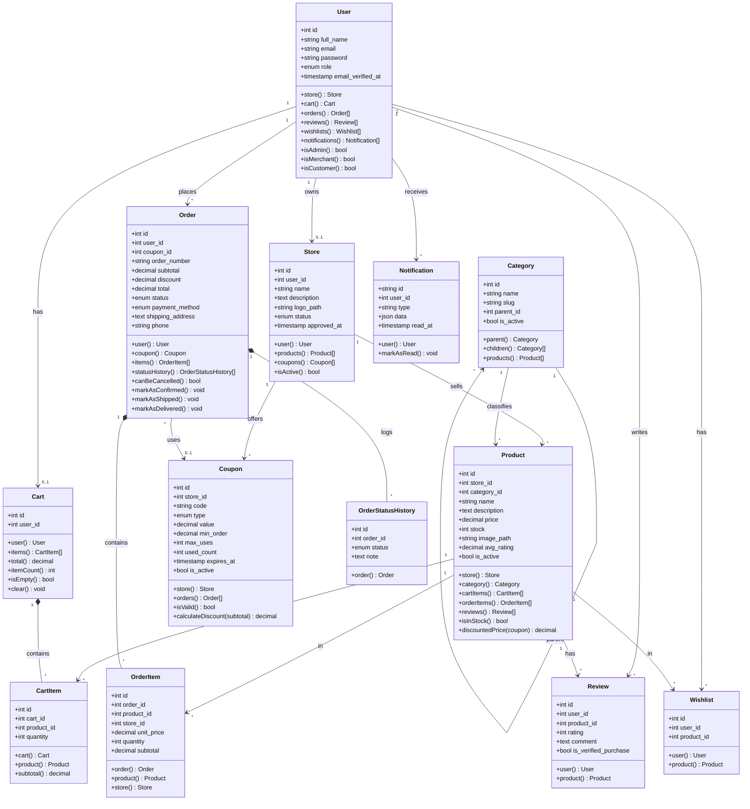
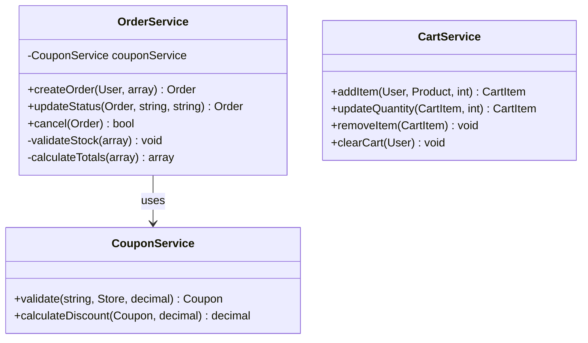
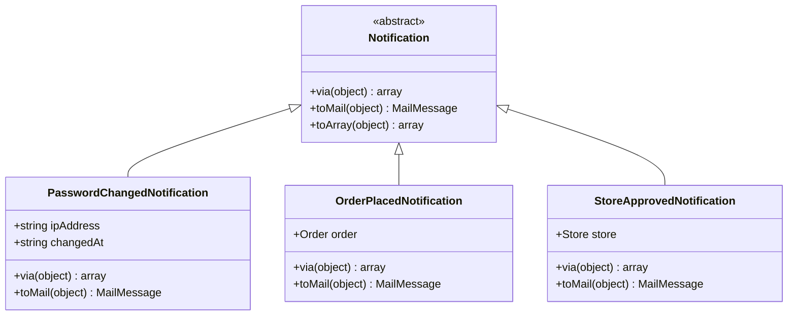

# الفصل الثالث: التصميم
## 3.3 مخطط الفئات (Class Diagram)

---

## 3.3.1 المقدمة

يوثّق هذا القسم **مخطط الفئات** (Class Diagram) الذي يمثّل البنية الكائنية للنظام، ويصف:

- **الفئات الرئيسية** (Classes) وخصائصها وعملياتها
- **العلاقات** بين الفئات (Associations, Inheritance, Composition)
- **التعددية** (Multiplicity)

يعتمد التصميم على مبادئ **البرمجة الكائنية** (OOP) ومبادئ **SOLID** لضمان القابلية للصيانة والتوسع والاختبار.

---

## 3.3.2 مخطط الفئات العام

---

## 3.3.3 الفئات بالتفصيل

### 3.3.3.1 Class: `User`

**الوصف:** يمثّل مستخدم النظام (Admin / Merchant / Customer).

| المكوّن | النوع | الوصف |
|---------|------|-------|
| `id` | int | معرّف فريد |
| `full_name` | string | الاسم الكامل |
| `email` | string | البريد (فريد) |
| `password` | string | bcrypt hash |
| `role` | enum | admin/merchant/customer |
| `email_verified_at` | timestamp | تاريخ التحقق |

**العمليات:**
| العملية | الإرجاع |
|---------|---------|
| `store()` | Store (لو merchant) |
| `cart()` | Cart (لو customer) |
| `orders()` | Order[] |
| `isAdmin()` | bool |
| `isMerchant()` | bool |
| `isCustomer()` | bool |

---

### 3.3.3.2 Class: `Store`

**الوصف:** يمثّل متجر تاجر.

| المكوّن | النوع |
|---------|------|
| `user_id` | int (FK, UNIQUE) |
| `name` | string |
| `status` | enum (pending/active/suspended) |
| `approved_at` | timestamp |

**العمليات:** `products()`, `coupons()`, `isActive()`

---

### 3.3.3.3 Class: `Product`

**الوصف:** يمثّل منتج ملابس.

| المكوّن | النوع | الوصف |
|---------|------|-------|
| `price` | decimal | السعر |
| `stock` | int | المخزون |
| `avg_rating` | decimal | متوسط التقييم (Denorm.) |
| `is_active` | bool | معروض |

**العمليات:** `store()`, `category()`, `reviews()`, `isInStock()`, `discountedPrice(Coupon)`

---

### 3.3.3.4 Class: `Cart` + `CartItem`

**Cart:** سلة الزبون (واحدة فقط).
- `items()`, `total()`, `itemCount()`, `isEmpty()`, `clear()`

**CartItem:** عنصر في السلة.
- `subtotal()` = `quantity * product.price`

**العلاقة:** `Cart *-- CartItem` (**Composition**)

---

### 3.3.3.5 Class: `Order` + `OrderItem`

**Order:** رأس الطلب.
- `canBeCancelled()`, `markAsConfirmed()`, `markAsShipped()`, `markAsDelivered()`

**OrderItem:** عنصر في الطلب (Snapshot تاريخي).

**العلاقة:** `Order *-- OrderItem` (**Composition**)

---

### 3.3.3.6 Class: `Coupon`

**الوصف:** كوبون خصم.

**العمليات:**
- `isValid()` → bool
- `calculateDiscount(subtotal)` → decimal

---

### 3.3.3.7 فئات مساعدة

| Class | الوصف |
|-------|-------|
| `Review` | تقييم منتج (1-5 نجوم) |
| `Wishlist` | منتج في المفضلة |
| `Notification` | إشعار داخلي (UUID) |
| `OrderStatusHistory` | سجل تغيرات حالة الطلب |

---

## 3.3.4 العلاقات بين الفئات

| العلاقة | النوع | Multiplicity | Cascade |
|---------|-------|---------------|---------|
| `User → Store` | Association | 1 : 0..1 | CASCADE |
| `User → Cart` | Association | 1 : 0..1 | CASCADE |
| `User → Order` | Association | 1 : * | CASCADE |
| `Store → Product` | Aggregation | 1 : * | CASCADE |
| `Category → Product` | Association | 1 : * | RESTRICT |
| `Cart → CartItem` | **Composition** | 1 : * | CASCADE |
| `Order → OrderItem` | **Composition** | 1 : * | CASCADE |
| `Order → Coupon` | Association | * : 0..1 | SET NULL |

### الفرق بين الأنواع

| النوع | المعنى | مثال |
|-------|--------|------|
| **Association** | علاقة عامة | User ↔ Order |
| **Aggregation** (◇) | "has-a" ضعيف | Store ◇ Product |
| **Composition** (◆) | "has-a" قوي | Order ◆ OrderItem |

---

## 3.3.5 تطبيق مبادئ SOLID

### Single Responsibility
- `User` → بيانات المستخدم
- `Order` → إدارة الطلب
- `OrderService` → منطق إنشاء الطلبات

### Open/Closed
- إضافة طرق دفع جديدة دون تعديل `Order`

### Liskov Substitution
- `Admin`, `Merchant`, `Customer` جميعهم `User`

### Interface Segregation
- `ProductPolicy`, `OrderPolicy`, `StorePolicy` — كل policy لفئة واحدة

### Dependency Inversion
- Controllers تعتمد على **Services**، لا Models مباشرة

---

## 3.3.6 Class Diagram للـ Services

---

## 3.3.7 Class Diagram للـ Notifications

---

## 3.3.8 الخلاصة

مخطط الفئات يعكس:

- ✅ **13 فئة رئيسية** (11 Model + 2 Helper)
- ✅ **3 خدمات** بفصل واضح للمسؤوليات
- ✅ **3 إشعارات** بنمط Inheritance
- ✅ **علاقات متنوعة** (Association, Aggregation, Composition)
- ✅ **تطبيق مبادئ SOLID** كاملة

**التصميم قابل للتنفيذ مباشرة** عبر Laravel Eloquent Models + Service Layer.

---

**نهاية مخطط الفئات**