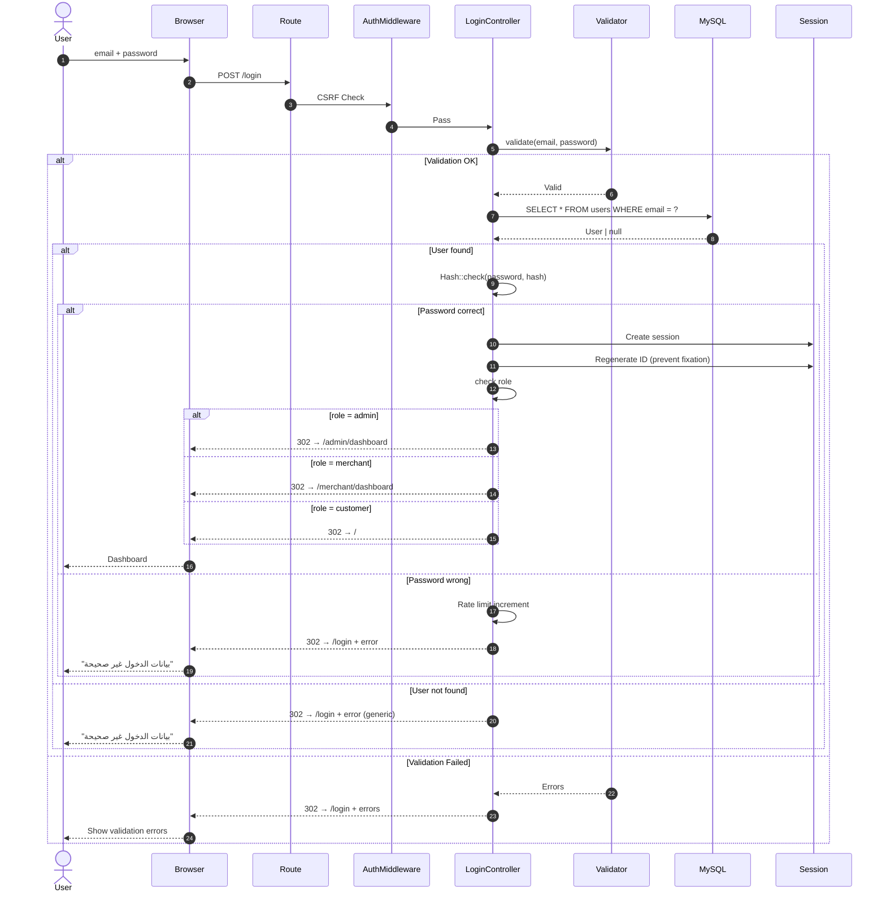
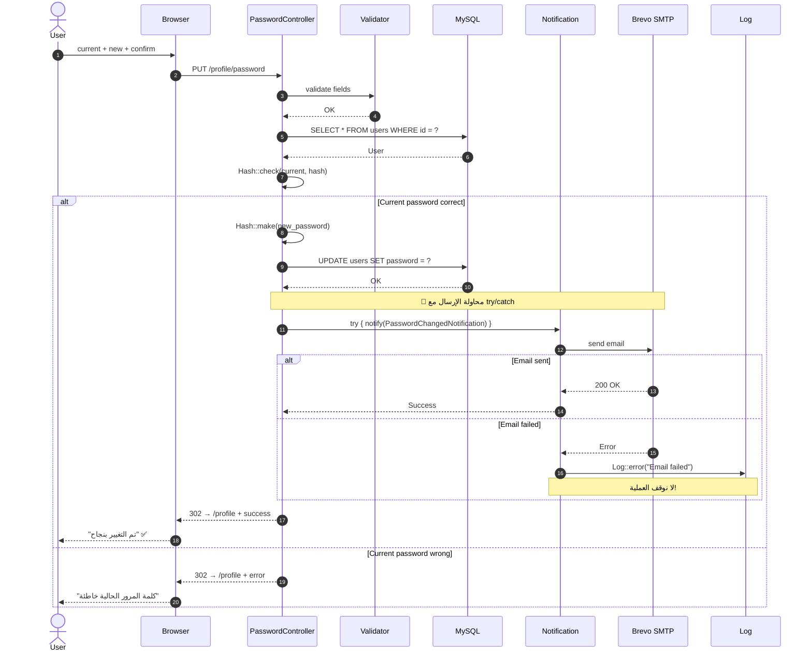
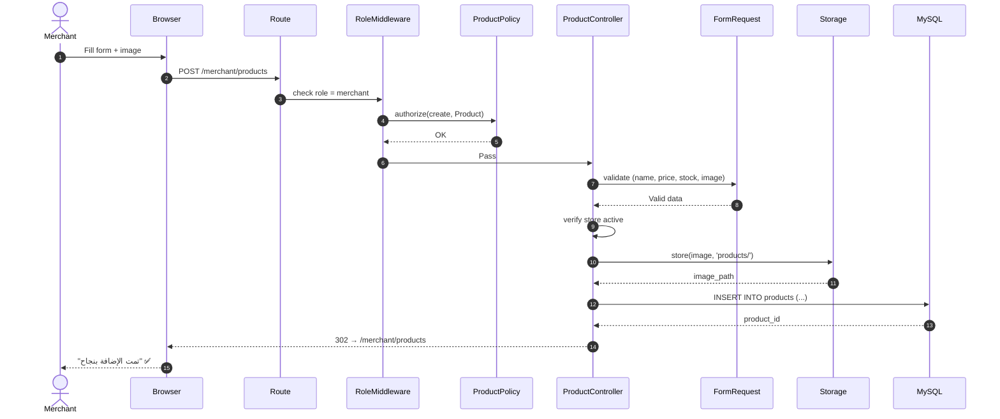
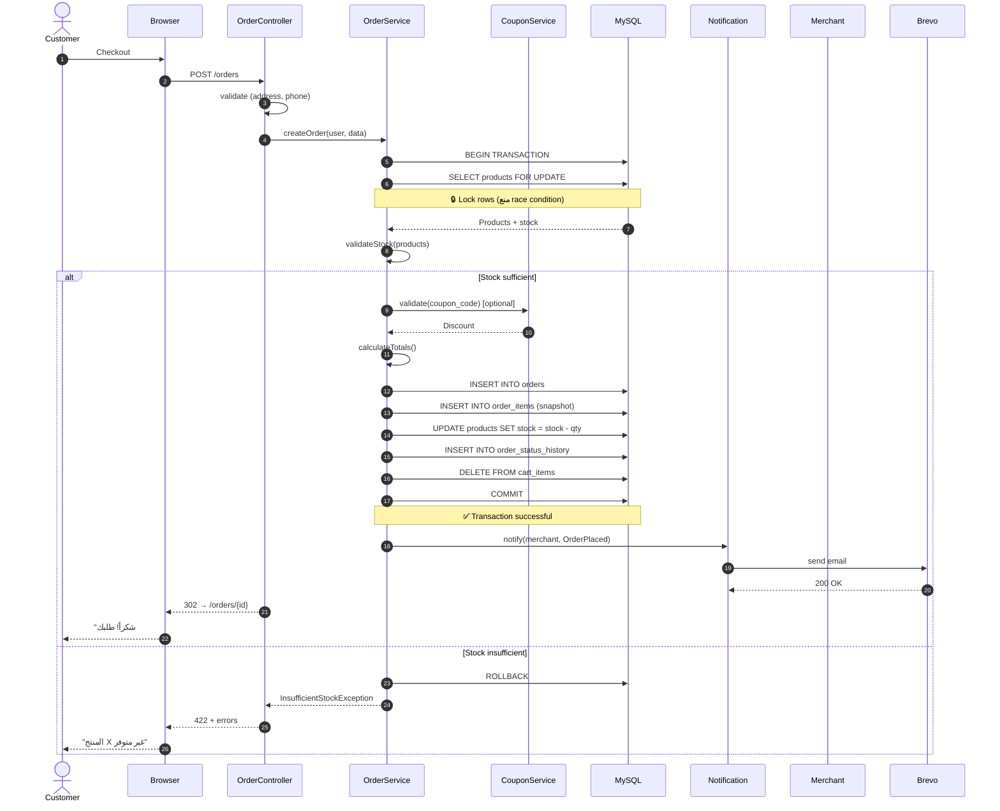
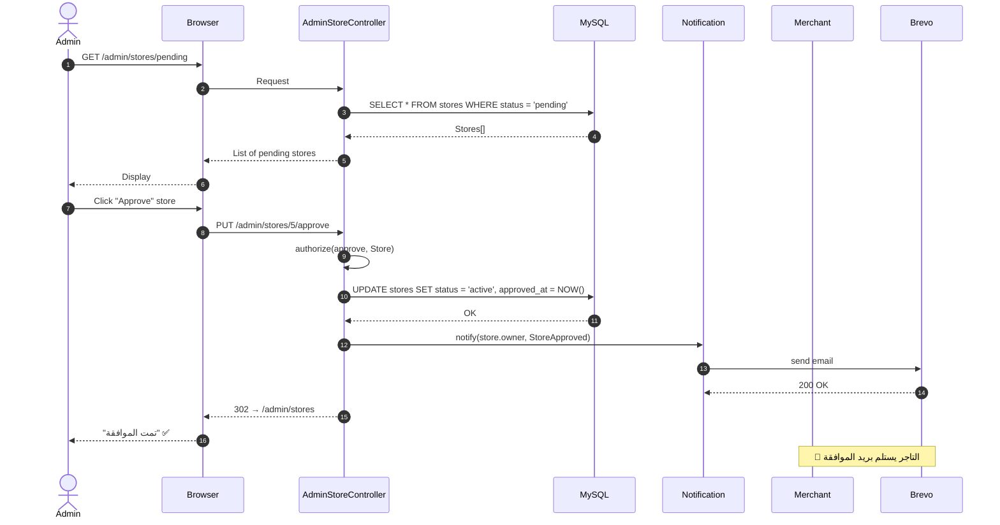
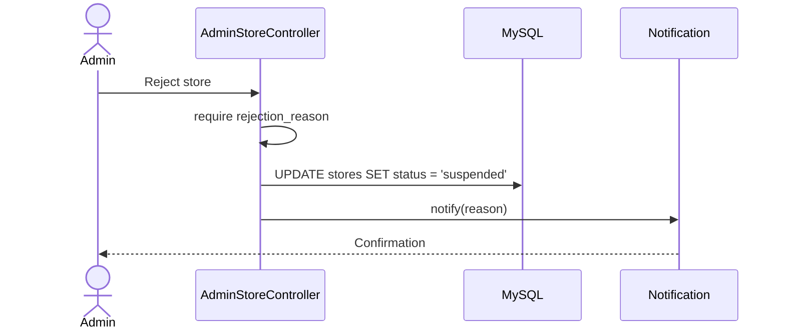
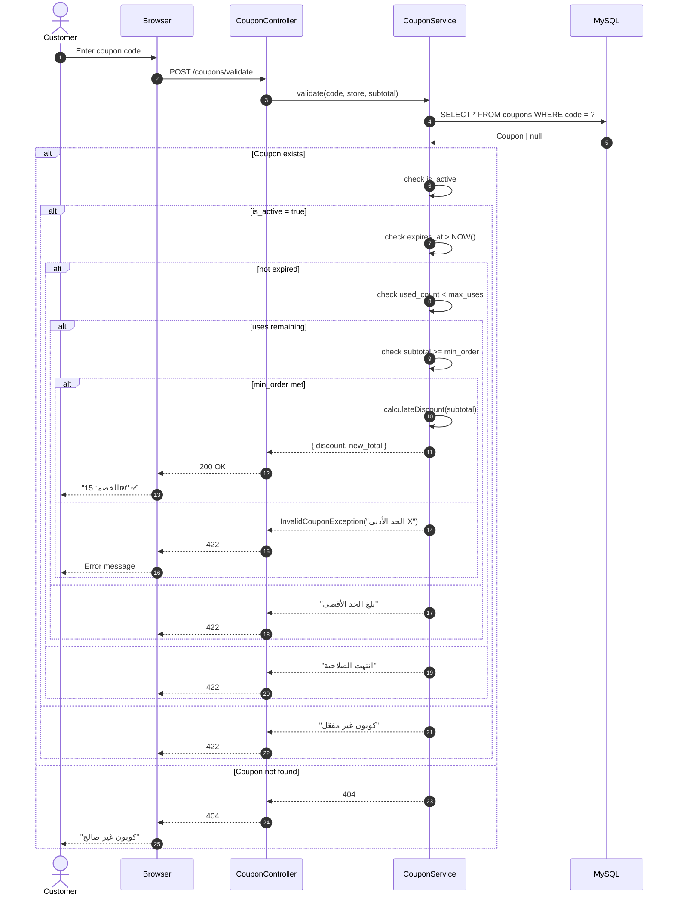
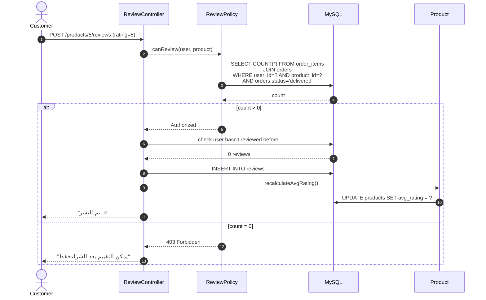

# الفصل الثالث: التصميم
## 3.4 مخططات التتابع (Sequence Diagrams)

---

## 3.4.1 المقدمة

توثّق **مخططات التتابع** (Sequence Diagrams) تسلسل الرسائل بين الكائنات/المكونات عبر الزمن، لكل عملية مهمة في النظام. تُعتبر أداة أساسية لفهم:

- **تدفق التنفيذ** (Execution Flow)
- **التفاعل** بين الطبقات (Controller → Service → Model → DB)
- **معالجة الاستثناءات** (Error Handling)
- **النقاط الحرجة** في الأداء

يغطي هذا القسم **6 عمليات رئيسية** تمثل المسارات الأكثر استخداماً في النظام.

---

## 3.4.2 SEQ-01: تسجيل الدخول

**يرتبط بـ:** FR-1.2، UC-02
**Actors:** Admin / Merchant / Customer
**الأولوية:** عالية

**نقاط حرجة:**
- 🔐 **Session Regeneration** بعد الدخول (منع Session Fixation)
- 🛡️ **رسالة خطأ عامة** (لا نكشف إن البريد موجود أم لا)
- ⏱️ **Rate Limiting**: 5 محاولات/دقيقة

---

## 3.4.3 SEQ-02: تغيير كلمة المرور (خطأ 500 السابق)

**يرتبط بـ:** FR-1.4، UC-03
**Actors:** أي مستخدم مسجل
**الأولوية:** عالية
**ملاحظة:** هذا هو السيناريو الذي واجه فيه الفريق **خطأ 500** وتم حله.

### 3.4.3.1 تحليل المشكلة والحل

| المرحلة | الوضع |
|---------|-------|
| **قبل الحل** | `PasswordChangedNotification implements ShouldQueue` → timeout → **500** |
| **السبب** | Render Free لا يدعم Queue Worker مستقر |
| **الحل** | إزالة `ShouldQueue` + `try/catch` + Log |
| **النتيجة** | ✅ لا خطأ 500، ✅ إيميل يصل، ✅ عملية التغيير تنجح دائماً |

---

## 3.4.4 SEQ-03: إضافة منتج

**يرتبط بـ:** FR-4.1، UC-06
**Actors:** Merchant
**الأولوية:** عالية

**نقاط حرجة:**
- 🔐 **Policy check**: التاجر لا يمكنه إضافة منتج لمتجر آخر
- 📁 **Image Storage**: `storage/app/public/products/`
- ✅ **Validation**: name + price > 0 + stock >= 0 + image ≤ 2MB

---

## 3.4.5 SEQ-04: إتمام الطلب (Checkout)

**يرتبط بـ:** FR-6.1، UC-09
**Actors:** Customer
**الأولوية:** **حرجة (Critical)**

**نقاط حرجة:**

| النقطة | الأهمية |
|--------|---------|
| `BEGIN TRANSACTION` | ضمان الذرية (Atomicity) |
| `SELECT FOR UPDATE` | منع Race Condition (منتج واحد لزبونين) |
| `INSERT order_items` | Snapshot لسعر الوحدة |
| `DELETE cart_items` | تفريغ السلة بعد النجاح |
| `COMMIT` | تثبيت كل التغييرات دفعة واحدة |
| `try/catch` للإيميل | لا نوقف الطلب لو البريد فشل |

---

## 3.4.6 SEQ-05: الموافقة على متجر

**يرتبط بـ:** FR-3.2، UC-14
**Actors:** Admin
**الأولوية:** عالية

**الاستثناءات:**

---

## 3.4.7 SEQ-06: تطبيق كوبون الخصم

**يرتبط بـ:** FR-7.4-7.5
**Actors:** Customer
**الأولوية:** متوسطة

**نقاط حرجة:**

| القيد | السبب |
|-------|-------|
| `is_active` | يمكن للتاجر تعطيل الكوبون |
| `expires_at > NOW()` | منع الاستخدام بعد الانتهاء |
| `used_count < max_uses` | حد الاستخدامات |
| `subtotal >= min_order` | حد أدنى للطلب |

---

## 3.4.8 SEQ-07: تقييم منتج (Bonus)

**يرتبط بـ:** FR-8.1-8.5، UC-11
**Actors:** Customer

---

## 3.4.9 ملخص المخططات

| # | Sequence Diagram | Actor | المرحلة | الأولوية |
|---|------------------|-------|---------|----------|
| **SEQ-01** | تسجيل الدخول | All | Auth | عالية |
| **SEQ-02** | تغيير كلمة المرور | User | Auth | عالية |
| **SEQ-03** | إضافة منتج | Merchant | CRUD | عالية |
| **SEQ-04** | Checkout | Customer | Transaction | **حرجة** |
| **SEQ-05** | الموافقة على متجر | Admin | Admin | عالية |
| **SEQ-06** | تطبيق كوبون | Customer | Discount | متوسطة |
| **SEQ-07** | تقييم منتج | Customer | Review | متوسطة |

---

## 3.4.10 الدروس المستفادة

### 3.4.10.1 نقاط التصميم الحرجة

| النقطة | الدرس |
|--------|-------|
| **Transactions** | Checkout يجب أن يكون `transactional` |
| **Row Locking** | `SELECT FOR UPDATE` يمنع Race Condition |
| **Snapshots** | `order_items.unit_price` ضروري للتاريخ |
| **try/catch للإشعارات** | الإشعار لا يجب أن يُعطّل العملية |
| **Policy + Middleware** | التحقق من الصلاحيات على مستويين |
| **Session Regeneration** | منع Session Fixation بعد الدخول |

### 3.4.10.2 مشكلة خطأ 500 — قصة نجاح

> **القصة الكاملة:** عند اختبار تغيير كلمة المرور، استخدم الفريق `PasswordChangedNotification implements ShouldQueue`. على Render Free، الـ Queue Worker غير مستقر، مما أدى إلى **timeout** ثم **خطأ 500**.
>
> **التشخيص:**
> 1. فحص Logs → ظهور `PasswordChangedNotification` error
> 2. اكتشاف `QUEUE_CONNECTION=database` مع عدم وجود Worker
>
> **الحل:**
> 1. إزالة `implements ShouldQueue` + `Queueable`
> 2. الإرسال **متزامن (sync)** داخل `try/catch`
> 3. تسجيل الفشل في `Log` (لا يُعطّل العملية)
>
> **النتيجة:** ✅ 200 OK، ✅ إيميل يصل، ✅ لا timeout

---

## 3.4.11 الخلاصة

مخططات التتابع السبعة توثّق **المسارات الحرجة** في النظام، مع التركيز على:

- ✅ **Transactions** في العمليات الحساسة (Checkout)
- ✅ **Error Handling** (try/catch + Log)
- ✅ **Security** (Policy + Middleware + Session)
- ✅ **Data Integrity** (Snapshots, Row Locking)

هذه المخططات **مرجع مباشر للتنفيذ** والتوثيق الأكاديمي.

---

**نهاية مخططات التتابع**