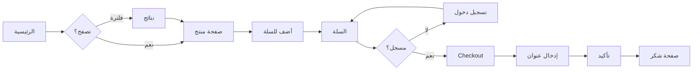
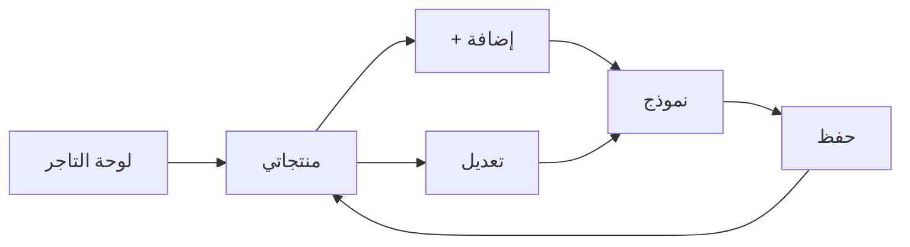
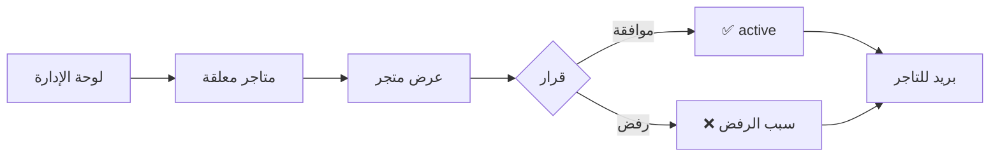

# الفصل الثالث: التصميم
## 3.5 تصميم واجهات المستخدم (UI/UX Design)

---

## 3.5.1 المقدمة

تُعتبر **واجهة المستخدم** (User Interface) و**تجربة المستخدم** (User Experience) من أهم عوامل نجاح أي تطبيق ويب. يوثّق هذا القسم:

- **نظام التصميم** (Design System): الألوان، الخطوط، المكونات
- **مخططات الواجهات** (Wireframes) لكل صفحة رئيسية
- **مسارات المستخدم** (User Flows)
- **التصميم المتجاوب** (Responsive Design)
- **إمكانية الوصول** (Accessibility)

يعتمد التصميم على:

- **Mobile-First Approach:** يبدأ من الموبايل ثم يتوسع
- **RTL كامل:** دعم اللغة العربية من اليمين لليسار
- **Tailwind CSS v4:** إطار تنسيق حديث
- **Alpine.js:** تفاعل خفيف بدون إعادة تحميل
- **WCAG 2.1 AA:** معايير إمكانية الوصول

---

## 3.5.2 نظام التصميم (Design System)

### 3.5.2.1 لوحة الألوان (Color Palette)

#### الألوان الأساسية

| اللون | HEX | RGB | الاستخدام |
|-------|-----|-----|-----------|
| **Primary** | `#1E40AF` | rgb(30, 64, 175) | الأزرار الرئيسية، الروابط |
| **Primary Hover** | `#1E3A8A` | rgb(30, 58, 138) | حالة Hover |
| **Primary Light** | `#DBEAFE` | rgb(219, 234, 254) | خلفيات ناعمة |

#### الألوان الدلالية (Semantic Colors)

| اللون | HEX | الاستخدام |
|-------|-----|-----------|
| **Success** | `#16A34A` | نجاح العمليات، تأكيد |
| **Warning** | `#F59E0B` | تحذيرات |
| **Danger** | `#DC2626` | أخطاء، حذف |
| **Info** | `#3B82F6` | معلومات |

#### ألوان محايدة

| اللون | HEX | الاستخدام |
|-------|-----|-----------|
| **Gray-50** | `#F9FAFB` | خلفية الصفحة |
| **Gray-100** | `#F3F4F6` | خلفيات ثانوية |
| **Gray-300** | `#D1D5DB` | حدود |
| **Gray-600** | `#4B5563` | نص ثانوي |
| **Gray-900** | `#111827` | نص أساسي |
| **White** | `#FFFFFF` | خلفيات البطاقات |

#### مبرر الاختيار

- **الأزرق (Primary):** يعطي إحساساً بالثقة والأمان (مناسب للتجارة)
- **الأخضر (Success):** معياري للنجاح
- **الأحمر (Danger):** معياري للأخطاء
- **الرمادي:** محايد ويسمح للألوان الأخرى بالبروز

---

### 3.5.2.2 الخطوط (Typography)

#### الخطوط المستخدمة

| اللغة | الخط | الوزن | الاستخدام |
|-------|------|-------|-----------|
| **العربية** | Cairo | 400, 500, 600, 700 | كل النصوص |
| **الإنجليزية** | Inter | 400, 500, 600, 700 | الأرقام والأسماء الإنجليزية |

#### مقاسات الخطوط

| العنصر | الحجم | Line Height |
|--------|-------|-------------|
| **H1** | 32px (text-3xl) | 1.2 |
| **H2** | 24px (text-2xl) | 1.3 |
| **H3** | 20px (text-xl) | 1.4 |
| **Body** | 16px (text-base) | 1.5 |
| **Small** | 14px (text-sm) | 1.5 |
| **Caption** | 12px (text-xs) | 1.5 |

#### مثال Tailwind

```html
<h1 class="text-3xl font-bold text-gray-900">عنوان رئيسي</h1>
<p class="text-base text-gray-600 leading-relaxed">نص عادي</p>
<small class="text-sm text-gray-500">نص صغير</small>
```

---

### 3.5.2.3 المسافات (Spacing)

يتبع النظام مقياس **4px** (مضاعفات):

| الرمز | القيمة | Tailwind |
|-------|--------|----------|
| XS | 4px | `p-1` |
| S | 8px | `p-2` |
| M | 16px | `p-4` |
| L | 24px | `p-6` |
| XL | 32px | `p-8` |
| 2XL | 48px | `p-12` |

---

### 3.5.2.4 المكونات (Components)

#### الأزرار (Buttons)

| النوع | الاستخدام | مثال Tailwind |
|-------|-----------|---------------|
| **Primary** | إجراءات رئيسية | `bg-blue-600 text-white px-4 py-2 rounded-lg` |
| **Secondary** | إجراءات ثانوية | `bg-gray-200 text-gray-900 px-4 py-2 rounded-lg` |
| **Danger** | حذف/إلغاء | `bg-red-600 text-white px-4 py-2 rounded-lg` |
| **Ghost** | إجراءات خفيفة | `text-blue-600 hover:bg-blue-50 px-4 py-2 rounded-lg` |

**أحجام الأزرار:**
- **Small:** `px-3 py-1.5 text-sm`
- **Medium (Default):** `px-4 py-2 text-base`
- **Large:** `px-6 py-3 text-lg`

#### الحقول (Inputs)

```html
<!-- Text Input -->
<input type="text" 
       class="w-full px-3 py-2 border border-gray-300 rounded-lg 
              focus:ring-2 focus:ring-blue-500 focus:border-blue-500">

<!-- Select -->
<select class="w-full px-3 py-2 border border-gray-300 rounded-lg">
    <option>اختر...</option>
</select>

<!-- Textarea -->
<textarea rows="4" 
          class="w-full px-3 py-2 border border-gray-300 rounded-lg">
</textarea>
```

#### البطاقات (Cards)

```html
<div class="bg-white rounded-xl shadow-md p-4 hover:shadow-lg transition">
    <!-- محتوى البطاقة -->
</div>
```

#### الشارات (Badges)

| اللون | الاستخدام | مثال |
|-------|-----------|-------|
| **Green** | مكتمل | `bg-green-100 text-green-800` |
| **Yellow** | معلق | `bg-yellow-100 text-yellow-800` |
| **Red** | ملغي | `bg-red-100 text-red-800` |
| **Blue** | جديد | `bg-blue-100 text-blue-800` |

---

## 3.5.3 مخططات الواجهات (Wireframes)

> 💡 **ملاحظة:** Wireframes نصية (ASCII Art) لسهولة القراءة في Markdown. للتطبيق الفعلي، تُترجم إلى HTML/Tailwind.

### 3.5.3.1 الصفحة الرئيسية (Home)

```
┌─────────────────────────────────────────────────────────┐
│ [Logo]  الرئيسية  المنتجات  المتاجر  [🛒 3]  [👤 أحمد] │
├─────────────────────────────────────────────────────────┤
│                                                          │
│  ┌──────────────────────────────────────────────────┐  │
│  │  🔍 ابحث عن منتج...        [التصنيف ▾]  [ترتيب ▾]│  │
│  └──────────────────────────────────────────────────┘  │
│                                                          │
│  الفلاتر:                                                │
│  [الكل] [قمصان] [بناطيل] [أحذية] [جاكيتات]              │
│                                                          │
│  ┌──────┐  ┌──────┐  ┌──────┐  ┌──────┐                │
│  │ IMG  │  │ IMG  │  │ IMG  │  │ IMG  │                │
│  │      │  │      │  │      │  │      │                │
│  │      │  │      │  │      │  │      │                │
│  └──────┘  └──────┘  └──────┘  └──────┘                │
│  قميص قطن  بنطال     حذاء      جاكيت                    │
│  ⭐⭐⭐⭐    ⭐⭐⭐⭐    ⭐⭐⭐⭐⭐   ⭐⭐⭐                  │
│  50 ₪      80 ₪      120 ₪     200 ₪                    │
│  [أضف]     [أضف]     [أضف]     [أضف]                    │
│                                                          │
│  ┌──────┐  ┌──────┐  ┌──────┐  ┌──────┐                │
│  │ IMG  │  │ IMG  │  │ IMG  │  │ IMG  │                │
│  └──────┘  └──────┘  └──────┘  └──────┘                │
│                                                          │
│              [< السابق]  [1] [2] [3]  [التالي >]        │
│                                                          │
├─────────────────────────────────────────────────────────┤
│  Footer: من نحن | اتصل بنا | سياسة الخصوصية              │
└─────────────────────────────────────────────────────────┘
```

**المكونات:**
- **Header:** شعار + روابط + سلة + حساب
- **Search Bar:** بحث + فلتر + ترتيب
- **Categories Tabs:** تصنيفات سريعة
- **Product Grid:** 4 أعمدة (Desktop) / 2 (Tablet) / 1 (Mobile)
- **Pagination:** 12 منتج/صفحة
- **Footer:** روابط مهمة

---

### 3.5.3.2 صفحة المنتج (Product Detail)

```
┌─────────────────────────────────────────────────────────┐
│ [Logo]  الرئيسية  المنتجات  [🛒 3]  [👤 أحمد]          │
├─────────────────────────────────────────────────────────┤
│                                                          │
│  ┌──────────────┐  ┌────────────────────────────────┐  │
│  │              │  │  قميص قطن أبيض                 │  │
│  │              │  │  ⭐⭐⭐⭐ (24 تقييم)             │  │
│  │    IMG       │  │  ─────────────────────          │  │
│  │   (كبيرة)    │  │  السعر: 50 ₪                    │  │
│  │              │  │  ─────────────────────          │  │
│  │              │  │  الوصف:                         │  │
│  │              │  │  قميص قطن 100%، مريح، متوفر     │  │
│  │              │  │  في عدة مقاسات...               │  │
│  │              │  │  ─────────────────────          │  │
│  └──────────────┘  │  المتجر: أزياء العصر            │  │
│                    │  ─────────────────────          │  │
│  [IMG] [IMG] [IMG] │  المخزون: 15 قطعة ✅            │  │
│  (مصغرات)          │  ─────────────────────          │  │
│                    │  الكمية: [-] [2] [+]            │  │
│                    │  ─────────────────────          │  │
│                    │  [🛒 أضف للسلة]  [❤️]           │  │
│                    └────────────────────────────────┘  │
│                                                          │
│  ─────────── التقييمات (24) ───────────                 │
│                                                          │
│  👤 أحمد محمد    ⭐⭐⭐⭐⭐   "منتج ممتاز"  ✅ شراء موثق  │
│  ─────────────────────────────────────────              │
│  👤 سارة علي     ⭐⭐⭐⭐     "جودة عالية"                │
│  ─────────────────────────────────────────              │
│                                                          │
│  ─────────── منتجات مشابهة ───────────                  │
│  [IMG] [IMG] [IMG] [IMG]                                │
│                                                          │
└─────────────────────────────────────────────────────────┘
```

**المكونات:**
- **صورة كبيرة + مصغرات**
- **المعلومات:** اسم، تقييم، سعر، وصف، متجر، مخزون
- **الكمية:** +/- قبل الإضافة
- **أزرار:** أضف للسلة + مفضلة
- **قسم التقييمات** مع شارة "Verified"
- **منتجات مشابهة**

---

### 3.5.3.3 صفحة السلة (Cart)

```
┌─────────────────────────────────────────────────────────┐
│ [Logo]  الرئيسية  [🛒 3]  [👤 أحمد]                    │
├─────────────────────────────────────────────────────────┤
│                                                          │
│  🛒 سلة التسوق (3 منتجات)                                │
│                                                          │
│  ┌────────────────────────────────────────────────┐    │
│  │ [IMG] قميص قطن أبيض                     [🗑]  │    │
│  │       50 ₪ × [-] [2] [+]  =  100 ₪             │    │
│  ├────────────────────────────────────────────────┤    │
│  │ [IMG] بنطال جينز                        [🗑]  │    │
│  │       80 ₪ × [-] [1] [+]  =  80 ₪              │    │
│  ├────────────────────────────────────────────────┤    │
│  │ [IMG] حذاء رياضي                        [🗑]  │    │
│  │       120 ₪ × [-] [1] [+]  =  120 ₪            │    │
│  └────────────────────────────────────────────────┘    │
│                                                          │
│  ┌────────────────────────┐  ┌──────────────────┐      │
│  │ كود الخصم:             │  │  الملخص          │      │
│  │ [WELCOME10]  [تطبيق]   │  │  ─────────────   │      │
│  │                        │  │  المجموع:  300 ₪ │      │
│  │                        │  │  الخصم:   -30 ₪  │      │
│  │                        │  │  ─────────────   │      │
│  │                        │  │  الإجمالي: 270 ₪ │      │
│  │                        │  │                  │      │
│  │                        │  │  [إتمام الطلب]   │      │
│  └────────────────────────┘  └──────────────────┘      │
│                                                          │
└─────────────────────────────────────────────────────────┘
```

**المكونات:**
- **قائمة المنتجات:** صورة، اسم، سعر، كمية، حذف
- **كود خصم:** حقل + زر تطبيق
- **ملخص الطلب:** المجموع، الخصم، الإجمالي
- **زر إتمام الطلب** (Primary CTA)

---

### 3.5.3.4 صفحة Checkout

```
┌─────────────────────────────────────────────────────────┐
│  [Logo]  إتمام الطلب                          [👤]      │
├─────────────────────────────────────────────────────────┤
│                                                          │
│  ┌────────────────────────────┐  ┌────────────────┐     │
│  │ 1. عنوان الشحن             │  │ ملخص الطلب    │     │
│  │ ─────────────────────────  │  │ ─────────────  │     │
│  │ المدينة: [غزة        ]     │  │ قميص ×2  100 ₪│     │
│  │ الشارع: [الرشيد    ]       │  │ بنطال ×1  80 ₪│     │
│  │ رقم المبنى: [12     ]      │  │ ─────────────  │     │
│  │ رقم الهاتف: [0599123456]   │  │ المجموع: 180₪ │     │
│  │                            │  │ الخصم:  -10₪ │     │
│  │ ─────────────────────────  │  │ الإجمالي:170₪ │     │
│  │ 2. طريقة الدفع             │  │                │     │
│  │ ◉ الدفع عند الاستلام (COD) │  │ [تأكيد الطلب]│     │
│  │ ○ دفع إلكتروني (قريباً)    │  │                │     │
│  │                            │  │                │     │
│  └────────────────────────────┘  └────────────────┘     │
│                                                          │
└─────────────────────────────────────────────────────────┘
```

**المكونات:**
- **نموذج العنوان:** مدينة، شارع، مبنى، هاتف
- **طريقة الدفع:** COD (متاح)، إلكتروني (قريباً)
- **ملخص الطلب:** ثابت جانبي
- **زر التأكيد**

---

### 3.5.3.5 صفحة الملف الشخصي

```
┌─────────────────────────────────────────────────────────┐
│ [Logo]  [🛒 3]  [👤 أحمد]                              │
├─────────────────────────────────────────────────────────┤
│                                                          │
│  ┌────────────────────────────────────────────────┐    │
│  │  👤 الملف الشخصي                                │    │
│  │  ─────────────────────────────────────────────  │    │
│  │  الاسم: [أحمد ماهر             ]               │    │
│  │  البريد: [ahmad@example.com    ]               │    │
│  │  الهاتف: [0599123456           ]               │    │
│  │                                                 │    │
│  │  [💾 حفظ التغييرات]                            │    │
│  └────────────────────────────────────────────────┘    │
│                                                          │
│  ┌────────────────────────────────────────────────┐    │
│  │  🔐 تغيير كلمة المرور                          │    │
│  │  ─────────────────────────────────────────────  │    │
│  │  كلمة المرور الحالية:  [••••••••]              │    │
│  │  كلمة المرور الجديدة:  [••••••••]              │    │
│  │  تأكيد كلمة المرور:    [••••••••]              │    │
│  │                                                 │    │
│  │  [🔐 تغيير كلمة المرور]                        │    │
│  └────────────────────────────────────────────────┘    │
│                                                          │
│  ┌────────────────────────────────────────────────┐    │
│  │  📦 طلباتي  (5)                                 │    │
│  │  ─────────────────────────────────────────────  │    │
│  │  #123  4 منتجات  180 ₪  [مكتمل]  [عرض]         │    │
│  │  #122  2 منتجات  120 ₪  [مشحون]  [عرض]         │    │
│  └────────────────────────────────────────────────┘    │
│                                                          │
└─────────────────────────────────────────────────────────┘
```

**المكونات:**
- **قسم البيانات:** تعديل الملف
- **قسم كلمة المرور:** تغيير آمن (مع try/catch في الخلف)
- **قسم الطلبات:** قائمة تاريخية + حالة
- **أزرار الحفظ**

---

### 3.5.3.6 لوحة تحكم التاجر (Merchant Dashboard)

```
┌─────────────────────────────────────────────────────────┐
│ [Logo]  لوحة التاجر  [📦 منتجات] [🛒 طلبات] [👤]       │
├─────────────────────────────────────────────────────────┤
│                                                          │
│  📊 إحصائيات سريعة                                       │
│                                                          │
│  ┌──────────┐  ┌──────────┐  ┌──────────┐  ┌────────┐  │
│  │ 📦 45    │  │ 🛒 120   │  │ 💰 8500₪ │  │ ⭐ 4.5 │  │
│  │ منتج     │  │ طلب      │  │ مبيعات   │  │ تقييم │  │
│  └──────────┘  └──────────┘  └──────────┘  └────────┘  │
│                                                          │
│  ─────────── الطلبات الأخيرة ───────────                │
│                                                          │
│  ┌────────────────────────────────────────────────┐    │
│  │ #123  أحمد محمد  180₪  [جديد]      [عرض]      │    │
│  │ #122  سارة علي   120₪  [مؤكد]      [عرض]      │    │
│  │ #121  خالد سمير  250₪  [مشحون]     [عرض]      │    │
│  └────────────────────────────────────────────────┘    │
│                                                          │
│  ─────────── إدارة المنتجات ───────────                 │
│                                                          │
│  [+ إضافة منتج جديد]                                    │
│                                                          │
│  ┌────────────────────────────────────────────────┐    │
│  │ [IMG] قميص  │ 50₪  │ 15 قطعة │  ⭐4.5  │ [✏] [🗑]│    │
│  │ [IMG] بنطال │ 80₪  │ 8 قطع   │  ⭐4.2  │ [✏] [🗑]│    │
│  └────────────────────────────────────────────────┘    │
│                                                          │
└─────────────────────────────────────────────────────────┘
```

**المكونات:**
- **إحصائيات:** منتجات، طلبات، مبيعات، تقييم
- **الطلبات الأخيرة:** قائمة + حالة + عرض
- **إدارة المنتجات:** جدول + إجراءات (تعديل/حذف)

---

### 3.5.3.7 لوحة الإدارة (Admin Dashboard)

```
┌─────────────────────────────────────────────────────────┐
│ [Logo]  لوحة الإدارة  [👥] [🏪] [📊] [⚙]  [🛡️ خالد]   │
├─────────────────────────────────────────────────────────┤
│                                                          │
│  📊 إحصائيات المنصة                                      │
│                                                          │
│  ┌──────────┐  ┌──────────┐  ┌──────────┐  ┌────────┐  │
│  │ 👥 1200  │  │ 🏪 85    │  │ 🛒 350   │  │ 💰 25K│  │
│  │ مستخدم   │  │ متجر     │  │ طلب      │  │ مبيعات │  │
│  └──────────┘  └──────────┘  └──────────┘  └────────┘  │
│                                                          │
│  ─────────── متاجر في انتظار الموافقة (3) ───────────   │
│                                                          │
│  ┌────────────────────────────────────────────────┐    │
│  │ 🏪 أزياء العصر    [👀 عرض]  [✅ موافقة] [❌]  │    │
│  │ 🏪 ملابس المستقبل [👀 عرض]  [✅ موافقة] [❌]  │    │
│  │ 🏪 ستايل       [👀 عرض]  [✅ موافقة] [❌]  │    │
│  └────────────────────────────────────────────────┘    │
│                                                          │
│  ─────────── آخر المستخدمين ───────────                 │
│                                                          │
│  ┌────────────────────────────────────────────────┐    │
│  │ 👤 أحمد محمد   customer  [عرض] [حذف]           │    │
│  │ 👤 سارة علي    merchant  [عرض] [حذف]           │    │
│  └────────────────────────────────────────────────┘    │
│                                                          │
└─────────────────────────────────────────────────────────┘
```

**المكونات:**
- **إحصائيات عامة:** مستخدمين، متاجر، طلبات، مبيعات
- **متاجر معلقة:** Quick Approve/Reject
- **إدارة المستخدمين:** قائمة + إجراءات

---

## 3.5.4 مسارات المستخدم (User Flows)

### 3.5.4.1 Flow: التسوق والشراء



### 3.5.4.2 Flow: إدارة منتج (Merchant)



### 3.5.4.3 Flow: الموافقة على متجر (Admin)



---

## 3.5.5 التصميم المتجاوب (Responsive Design)

### 3.5.5.1 نقاط الانكسار (Breakpoints)

| الجهاز | العرض | Tailwind |
|--------|-------|----------|
| **Mobile** | < 640px | (default) |
| **Tablet** | 640-1024px | `md:` |
| **Desktop** | 1024-1280px | `lg:` |
| **Large** | > 1280px | `xl:` |

### 3.5.5.2 Grid المتجاوب

```html
<!-- 1 عمود موبايل، 2 تابلت، 4 ديسكتوب -->
<div class="grid grid-cols-1 md:grid-cols-2 lg:grid-cols-4 gap-4">
    <div class="card">منتج 1</div>
    <div class="card">منتج 2</div>
    <div class="card">منتج 3</div>
    <div class="card">منتج 4</div>
</div>
```

### 3.5.5.3 سلوك الـ Header

| الجهاز | العرض |
|--------|-------|
| **Mobile** | Hamburger menu 🍔 |
| **Tablet** | روابط مختصرة |
| **Desktop** | كل الروابط + سلة + ملف |

---

## 3.5.6 دعم RTL (Right-to-Left)

### 3.5.6.1 التطبيق

```html
<html lang="ar" dir="rtl">
```

### 3.5.6.2 Tailwind RTL

Tailwind v4 يدعم RTL تلقائياً عبر `dir="rtl"`:
- `ml-2` → margin-left (يبقى يسار)
- `ms-2` → margin-inline-start (يتبع RTL)
- `pe-4` → padding-inline-end (يتبع RTL)

**القاعدة:** استخدم `ms-*` / `me-*` / `ps-*` / `pe-*` بدل `ml-*` / `mr-*` / `pl-*` / `pr-*`.

### 3.5.6.3 تنسيق النصوص

- **الأرقام:** تظهر LTR حتى داخل النص العربي (`50 ₪` وليس `₪ 50`)
- **الأيقونات:** تنعكس حسب الحاجة (سهم اليمين ← يصبح ←)
- **النماذج:** تبدأ من اليمين

---

## 3.5.7 إمكانية الوصول (Accessibility)

### 3.5.7.1 معايير WCAG 2.1 AA

| المعيار | التطبيق |
|---------|---------|
| **تباين الألوان** | ≥ 4.5:1 للنص العادي |
| **حجم الخط** | ≥ 16px للـ body |
| **ARIA Labels** | على كل زر أيقونة |
| **Keyboard Navigation** | كل شيء يعمل بـ Tab |
| **Focus Indicators** | واضحة على العناصر |
| **Alt Text** | على كل صورة |
| **Form Labels** | كل input له label |

### 3.5.7.2 أمثلة

```html
<!-- زر أيقونة -->
<button aria-label="أضف للسلة" class="...">
    <svg>🛒</svg>
</button>

<!-- Input accessible -->
<label for="email">البريد الإلكتروني</label>
<input id="email" type="email" aria-required="true">

<!-- Image alt -->

```

---

## 3.5.8 المكونات المشتركة (Shared Components)

### 3.5.8.1 Header

| العنصر | الوصف |
|--------|-------|
| **Logo** | قابل للنقر → الرئيسية |
| **Navigation** | روابط رئيسية |
| **Search** | (اختياري في Header) |
| **Cart Badge** | عدد المنتجات |
| **User Menu** | Dropdown (بروفايل، طلبات، خروج) |

### 3.5.8.2 Footer

| العنصر | الوصف |
|--------|-------|
| **Links** | من نحن، اتصل، سياسة |
| **Social** | روابط تواصل اجتماعي |
| **Copyright** | © 2026 |

### 3.5.8.3 Notifications

| النوع | الأسلوب |
|-------|---------|
| **Success** | أخضر + ✅ |
| **Error** | أحمر + ❌ |
| **Warning** | أصفر + ⚠️ |
| **Info** | أزرق + ℹ️ |

تظهر **أعلى الصفحة**، تختفي تلقائياً بعد 4 ثواني.

---

## 3.5.9 الأداء والتحسين

### 3.5.9.1 تحسينات الصور

| التقنية | التطبيق |
|---------|---------|
| **Lazy Loading** | `loading="lazy"` |
| **WebP** | تحويل تلقائي |
| **Responsive Images** | `srcset` |
| **Compression** | ≤ 200KB/صورة |

### 3.5.9.2 تحسينات CSS/JS

- **Tailwind Purge:** حذف الـ classes غير المستخدمة
- **Vite Bundling:** ضغط + minify
- **Code Splitting:** Alpine.js خفيف (~15KB)
- **Lazy Load:** تحميل Alpine عند الحاجة فقط

### 3.5.9.3 أهداف الأداء

| المقياس | الهدف |
|---------|-------|
| **LCP** (Largest Contentful Paint) | < 2.5s |
| **FID** (First Input Delay) | < 100ms |
| **CLS** (Cumulative Layout Shift) | < 0.1 |
| **Page Size** | < 1MB |
| **Time to Interactive** | < 3s |

---

## 3.5.10 اختبار قابلية الاستخدام

### 3.5.10.1 معايير الاختبار

| المعيار | الهدف |
|---------|-------|
| **وقت تعلم المهمة** | < 2 دقيقة |
| **معدل إكمال المهمة** | > 90% |
| **عدد النقرات للشراء** | ≤ 5 |
| **رضا المستخدم** | > 4/5 |

### 3.5.10.2 المشاكل الشائعة المتوقعة

| المشكلة | الحل |
|---------|------|
| صعوبة العثور على المنتجات | فلاتر + بحث واضح |
| عدم فهم حالة الطلب | Timeline ملون |
| الخوف من الدفع | عرض "COD فقط" بوضوح |
| قلة الثقة | شارات Verified + تقييمات |

---

## 3.5.11 الخلاصة

يتبع التصميم مبادئ حديثة تركز على المستخدم:

- ✅ **Design System موحد** (ألوان، خطوط، مكونات)
- ✅ **Wireframes لكل الصفحات** الرئيسية
- ✅ **Mobile-First** + Responsive
- ✅ **RTL كامل** للعربية
- ✅ **WCAG 2.1 AA** لإمكانية الوصول
- ✅ **أداء عالٍ** (LCP < 2.5s)

**الترجمة إلى HTML/Tailwind** مباشرة من الـ Wireframes، مع Alpine.js للتفاعل.

---

**نهاية تصميم واجهات المستخدم**