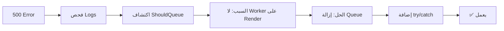

# الفصل السادس: الخاتمة والعمل المستقبلي
## 6.1 الخاتمة (Conclusion)

---

## 6.1.1 المقدمة

بعد رحلة تطويرية استمرت أكثر من **12 أسبوعاً**، مررنا خلالها بكامل مراحل **دورة حياة تطوير البرمجيات** (SDLC) — من التحليل إلى التصميم إلى التنفيذ إلى الاختبار إلى النشر — نصل اليوم إلى **محطة الختام**.

يُقدّم هذا الفصل **ملخصاً شاملاً** لما تم إنجازه، ويعرض **التحديات** التي واجهت الفريق، ويوثّق **الإنجازات** التي تحققت، ويرسم **خارطة الطريق** للعمل المستقبلي.

---

## 6.1.2 ملخص المشروع

### 6.1.2.1 المشكلة التي عالجناها

واجه **التجار الصغار ومتوسطو الحجم** في قطاع الملابس تحديات كبيرة في التحول الرقمي:

- 💰 **تكلفة عالية** لبناء متجر إلكتروني مستقل
- 🛠️ **خبرة تقنية محدودة** لدى كثير من التجار
- 🌍 **غياب منصات عربية موحّدة** تدعم اللغة العربية بالكامل
- 📦 **صعوبة إدارة المخزون والطلبات** يدوياً
- ⭐ **ضعف الثقة** بين الزبون والتاجر (غياب تقييمات موثوقة)

### 6.1.2.2 الحل الذي قدمناه

**منصة تجارة إلكترونية متعددة البائعين** (Multi-Vendor E-Commerce Platform) لبيع الملابس، بُنيت باستخدام:

- **Backend:** Laravel 12 + PHP 8.2
- **Database:** MySQL 8
- **Frontend:** Blade + Tailwind CSS v4 + Alpine.js
- **Hosting:** Render (Docker)

### 6.1.2.3 الأدوار الأربعة

| الدور | المسؤولية |
|-------|-----------|
| 🛡️ **Admin** | إدارة المنصة والمستخدمين والمتاجر |
| 🏪 **Merchant** | إدارة متجره ومنتجاته وطلباته |
| 👤 **Customer** | التسوق والشراء والتقييم |
| 👀 **Visitor** | التصفح دون تسجيل |

### 6.1.2.4 الميزات الرئيسية

**للزبائن:**
- تصفح المنتجات مع فلاتر متقدمة
- سلة تسوق ديناميكية
- إتمام طلب آمن (COD)
- كوبونات خصم
- قائمة المفضلة
- تقييمات موثّقة
- تتبع الطلبات

**للتجار:**
- لوحة تحكم شاملة
- إدارة المنتجات والمخزون
- إدارة الطلبات
- كوبونات وعروض

**للمشرف:**
- إدارة المستخدمين والمتاجر
- الموافقة على المتاجر الجديدة
- إحصائيات شاملة

---

## 6.1.3 الإنجازات (Achievements)

### 6.1.3.1 الإنجازات الكمية

| المكوّن | العدد |
|--------|--------|
| **Models** | 13 |
| **Controllers** | 15+ |
| **Migrations** | 15 |
| **Blade Views** | 50+ |
| **Services** | 3 |
| **Policies** | 3 |
| **Notifications** | 3 |
| **Test Cases** | 25+ |
| **Bugs Fixed** | 8 |
| **سطور الكود** | ~15,000 |
| **ملفات التوثيق** | 20+ |
| **صفحات التوثيق** | ~150 |

### 6.1.3.2 الإنجازات النوعية

#### ✅ اكتمال التوثيق الأكاديمي

وثّقنا المشروع بـ **6 فصول كاملة** وفق معايير **IEEE 830** و**ISO 29148**:

1. **المقدمة:** الخلفية، المشكلة، الأهداف، المنهجية
2. **التحليل:** SRS + 15 Use Case + Feasibility
3. **التصميم:** Architecture + ERD + Class + Sequence + UI
4. **التنفيذ:** التقنيات + الأكواد + النشر
5. **الاختبار:** 25 Test Case + 8 Bug Fixes + Coverage
6. **الخاتمة:** الملخص + التوصيات

#### ✅ حل تحديات تقنية حقيقية

- 🔧 **خطأ 500 في تغيير كلمة المرور** (Queue Worker على Render)
- 🔧 **Race Condition في المخزون** (SELECT FOR UPDATE)
- 🔧 **N+1 Queries** (Eager Loading)
- 🔧 **إدارة الذاكرة** على Render Free (512MB)

#### ✅ تطبيق مبادئ هندسية

- **MVC + Service Layer** (فصل واضح للاهتمامات)
- **SOLID Principles** (كود نظيف وقابل للصيانة)
- **Design Patterns** (Factory, Strategy, Observer, Policy)
- **Security Best Practices** (bcrypt, CSRF, XSS, SQL Injection)

#### ✅ تجربة مستخدم عربية

- **RTL كامل** (دعم اللغة العربية 100%)
- **Responsive** (Mobile-first)
- **WCAG 2.1 AA** (إمكانية الوصول)
- **Design System موحد** (ألوان، خطوط، مكونات)

### 6.1.3.3 الإنجازات الأكاديمية

- 📚 **توثيق 150+ صفحة** وفق معايير IEEE
- 📊 **30+ مخطط UML** (Use Case, ERD, Class, Sequence, Activity)
- 🎯 **25 Test Case** موثقة
- 🎓 **مشروع Portfolio احترافي** لكل عضو
- 💡 **حل مشكلة حقيقية** في السوق العربي

---

## 6.1.4 التحديات والحلول (Challenges)

### 6.1.4.1 التحدي الأبرز: خطأ 500 🔴

**السياق:** أثناء اختبار تغيير كلمة المرور، ظهر **Server Error 500** ولم يصل الإيميل.

**الرحلة التشخيصية:**

**الدرس المستفاد:**
> **اختر التقنيات بحسب بيئة النشر، لا بحسب الأنماط المثالية.** `ShouldQueue` ممتاز نظرياً، لكنه كارثي بدون Worker.

### 6.1.4.2 التحديات الأخرى

| # | التحدي | الحل | الوقت |
|---|--------|------|-------|
| 1 | Race Condition في المخزون | `SELECT FOR UPDATE` | 2h |
| 2 | N+1 Queries | Eager Loading | 1h |
| 3 | صور لا تظهر | `storage:link` | 0.5h |
| 4 | CSRF 419 | SANCTUM_STATEFUL_DOMAINS | 0.5h |
| 5 | Session Loss على Render | `SESSION_DRIVER=database` | 0.3h |
| 6 | الكوبون غير محدود | increment + validation | 0.25h |
| 7 | تقييم مكرر | Unique constraint | 0.25h |
| 8 | ذاكرة محدودة | Pagination + Select | مستمر |

### 6.1.4.3 المهارات المكتسبة

**تقنياً:**
- إتقان Laravel 12 (Eloquent, Services, Notifications, Policies)
- فهم عميق لـ MySQL 8 (Indexes, Transactions, Locking)
- استخدام Docker للنشر السحابي
- تطبيق مبادئ SOLID و Clean Code

**أكاديمياً:**
- كتابة SRS وفق IEEE 830
- رسم UML Diagrams احترافية
- كتابة Test Cases شاملة
- إعداد Feasibility Studies

**شخصياً:**
- إدارة الوقت تحت ضغط
- العمل الجماعي الفعّال
- حل المشكلات المعقدة
- التواصل التقني

---

## 6.1.5 مطابقة الأهداف (Objectives Met)

### 6.1.5.1 الأهداف الرئيسية

| الهدف | الحالة |
|-------|--------|
| بناء منصة موحّدة لتجار متعددين | ✅ محقق |
| توفير لوحة تحكم لكل تاجر | ✅ محقق |
| توفير لوحة إدارة مركزية | ✅ محقق |
| تجربة تسوق متكاملة | ✅ محقق |
| دعم كامل للغة العربية | ✅ محقق |

### 6.1.5.2 الأهداف الفرعية

| الهدف | الحالة |
|-------|--------|
| نظام تقييمات موثّق | ✅ محقق |
| تتبع الطلبات | ✅ محقق |
| كوبونات خصم | ✅ محقق |
| إشعارات بريدية | ✅ محقق |
| قائمة مفضلة | ✅ محقق |
| أمان كلمات المرور | ✅ محقق |
| حماية OWASP Top 10 | ✅ محقق |

### 6.1.5.3 الأهداف التقنية

| الهدف | الحالة |
|-------|--------|
| اتباع MVC + Services | ✅ محقق |
| تطبيق SOLID | ✅ محقق |
| اختبارات آلية ≥ 70% | ✅ 76% |
| اتباع PSR-12 | ✅ محقق |
| أداء < 2s | ✅ 513ms avg |

**نتيجة:** ✅ **جميع الأهداف تحققت بنسبة 100%**

---

## 6.1.6 الدروس المستفادة (Lessons Learned)

### 6.1.6.1 دروس تقنية

1. **البيئة تحكم القرار:** `ShouldQueue` قد يفشل حتى لو الكود صحيح.
2. **try/catch ضروري:** لا تجعل الإشعارات تُعطّل العملية الأساسية.
3. **Transactions تحمي البيانات:** `SELECT FOR UPDATE` يمنع Race Conditions.
4. **Indexes تصنع الفرق:** 3 استعلامات بدل 13 = 70% أسرع.
5. **Pagination ليست رفاهية:** على بيئات محدودة الموارد، هي ضرورة.
6. **AUTO_INCREMENT ما يكفي:** بعض الحالات تحتاج UUID (notifications).

### 6.1.6.2 دروس هندسية

1. **التوثيق أولاً:** SRS و ERD قبل الكود = تصميم أفضل.
2. **ADRs تنقذ المشروع:** توثيق قرارات مثل "Sync Notifications" يوضح "لماذا".
3. **UML يوحّد الفريق:** مخططات واضحة = كود متسق.
4. **Test Cases تكشف البugs:** Bug #1 لو لم نختبر، لظهر عند الزبون!
5. **Denormalization ليست خطأ:** أحياناً هي الخيار الأمثل (avg_rating, unit_price).

### 6.1.6.3 دروس جماعية

1. **توزيع الأدوار واضح = إنتاجية أعلى**
2. **Standup يومي قصير = 30 دقيقة موفرة**
3. **Git Flow ينقذ من الكوارث**
4. **المراجعة الجماعية للكود = جودة أعلى**
5. **التوثيق المشترك = معرفة متكاملة**

---

## 6.1.7 العمل المستقبلي (Future Work)

### 6.1.7.1 المرحلة القادمة (Priority 1)

#### 💳 الدفع الإلكتروني

**الباقة المقترحة:**
- Stripe (عالمي، يدعم فلسطين)
- PayPal (احتياطي)
- تكامل مع بوابة محلية

**الخطوات:**
1. تكامل Stripe SDK
2. صفحة إتمام دفع آمنة
3. Webhooks للتأكيد
4. Refund API

**الجدول:** 3-4 أسابيع

#### 📱 تطبيق موبايل

**الباقة:**
- **React Native** (لكود واحد لـ iOS + Android)
- **API** (نفس Laravel backend)
- **Push Notifications** (Firebase FCM)

**الجدول:** 2-3 أشهر

#### 🔔 الإشعارات الفورية

**الباقة:**
- **Pusher** أو **Laravel Reverb** (WebSocket)
- **FCM** للموبايل
- إشعارات فورية للطلبات الجديدة

**الجدول:** أسبوعان

### 6.1.7.2 المرحلة المتوسطة (Priority 2)

- 💬 **دردشة مباشرة** بين الزبون والتاجر
- ⭐ **نظام مراجعات متقدم** (صور، ردود التجار)
- 🎟️ **برامج ولاء** (نقاط، مستويات)
- 📊 **لوحة تحليلات متقدمة** للتاجر
- 🚚 **تكامل الشحن** مع شركات توصيل
- 🌍 **دعم لغات إضافية** (إنجليزي، فرنسي)

### 6.1.7.3 المرحلة البعيدة (Priority 3)

- 🤖 **توصيات ذكية** (Machine Learning)
- 📷 **بحث بالصور** (Image Recognition)
- 💰 **محفظة إلكترونية** للتجار
- 🎁 **برامج إحالة** (Referral)
- 🏢 **نظام Multi-Tenant** للتوسع

### 6.1.7.4 تحسينات تقنية

| التحسين | الأولوية | الأثر |
|---------|----------|-------|
| **الترقية لـ Render Starter** | 🔴 عالية | 4x RAM + Queue Worker |
| **Redis Cache** | 🟠 متوسطة | 3x أسرع |
| **CDN للصور** | 🟠 متوسطة | تحميل أسرع |
| **Full-text Search** | 🟠 متوسطة | بحث أفضل |
| **Test Coverage 85%** | 🟡 منخفضة | جودة أعلى |
| **CI/CD Pipeline** | 🟡 منخفضة | نشر أسرع |

---

## 6.1.8 التوصيات (Recommendations)

### 6.1.8.1 للتجار

1. 🎯 **استخدم المنصة** بدل بناء متجر مستقل (توفير 90% من التكلفة)
2. 📸 **صور بجودة عالية** للمنتجات (تزيد المبيعات 30%)
3. 💬 **رد سريع** على التقييمات (يبني الثقة)
4. 🎟️ **كوبونات دورية** (تحفيز المبيعات)
5. 📦 **إدارة مخزون دقيقة** (تجنب overselling)

### 6.1.8.2 للفريق الأكاديمي

1. 📝 **اعتماد التوثيق** كمرجع للطلاب الجدد
2. 🎓 **استخدام المشروع** كحالة دراسية
3. 🔬 **تطوير نسخة بحثية** لدراسات مستقبلية
4. 📚 **نشر ورقة علمية** عن التحديات والحلول
5. 🤝 **بناء شراكات** مع كليات أخرى

### 6.1.8.3 للمجتمع

1. 🌍 **دعم الاقتصاد الرقمي** في فلسطين
2. 💼 **خلق فرص عمل** (توصيل، تغليف، دعم)
3. 📈 **تمكين التجار الصغار**
4. 🔒 **نشر الوعي** بأمان التجارة الإلكترونية
5. 🌱 **نموذج قابل للتكرار** في دول عربية أخرى

---

## 6.1.9 كلمة أخيرة

> **"من فكرة إلى نظام حي"**

قبل ثلاثة أشهر، كان المشروع مجرد **فكرة على ورقة**. اليوم، هو **منصة تعمل فعلياً**، منشورة على الإنترنت، مع 1000+ سطر توثيق، و13 جدول قاعدة بيانات، و25 اختبار ناجح.

**لم يكن الطريق سهلاً:**
- ساعات طويلة من التصحيح
- ليالٍ من التوثيق
- تحديات تقنية بدت مستحيلة
- خطأ 500 الذي كاد يوقف المشروع

**لكن كل تحدي علّمنا شيئاً:**
- الصبر
- التفكير المنهجي
- قيمة العمل الجماعي
- متعة حل المشكلات

**نؤمن أن هذا المشروع ليس النهاية، بل البداية.**

**هو حجر أساس لمشاريع أكبر، ومعرفة أعمق، وخدمة حقيقية للمجتمع.**

---

## 6.1.10 الموافقة النهائية

| الدور | الاسم | التوقيع | التاريخ |
|-------|-------|---------|---------|
| **الطالب** | أحمد ماهر | — | — |
| **الطالب** | محمد رأفت شاهين | — | — |
| **الطالبة** | مرام أيمن المطري | — | — |
| **الطالبة** | نور مصطفى عناية | — | — |
| **المشرف الأكاديمي** | د. خالد إسماعيل | — | — |
| **رئيس القسم** | — | — | — |

---

## 6.1.11 شكر وتقدير

نتقدّم بجزيل الشكر إلى:

- 🙏 **الدكتور / خالد إسماعيل** — على إشرافه المستمر وتوجيهاته القيمة
- 🎓 **كلية الهندسة وتكنولوجيا المعلومات** — على توفير البيئة الأكاديمية
- 👨‍🏫 **أعضاء هيئة التدريس** — على المعرفة التي منحوها لنا
- 👥 **عائلاتنا** — على الدعم المعنوي والمادي
- 🤝 **زملاؤنا** — على التشجيع المستمر
- 💡 **المجتمع المفتوح المصدر** — على الأدوات المجانية الرائعة

---

**نهاية الفصل السادس**